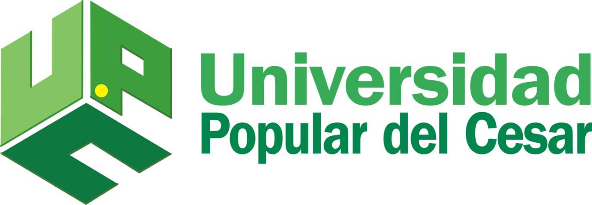
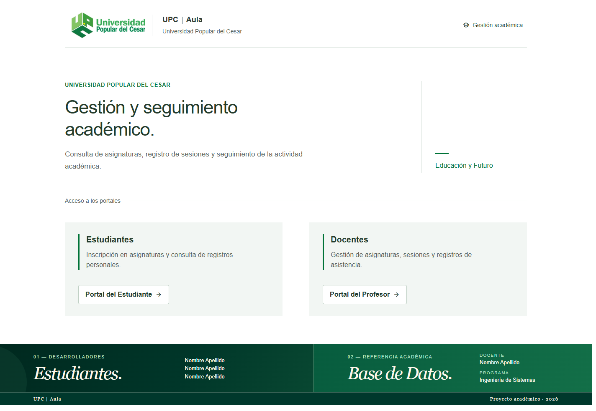

<p align="center">
  
</p>

<h1 align="center">UPC | Aula</h1>

<p align="center">
  <strong>Gestión y seguimiento académico</strong><br>
  Universidad Popular del Cesar<br>
  <em>Educación y Futuro</em>
</p>

Proyecto académico para organizar asignaturas y grupos, registrar sesiones de clase y consultar
la participación estudiantil. Reúne los portales docente, estudiantil y administrativo, con
información académica en Oracle y trazabilidad de las operaciones mediante SQL y PL/SQL.

[Instalación](docs/INSTALACION.md) · [Documentación](docs/README.md) · [Roadmap](docs/ROADMAP.md) · [Registro de cambios](docs/CAMBIOS.md)

## La plataforma



*Captura de la portada de la aplicación en el entorno local, sin una sesión iniciada.*

La actividad se organiza por **asignatura, grupo y sesión académica**. El docente prepara y
revisa los registros de cada clase; el estudiante consulta sus materias y su historial; la
administración gestiona cuentas y consulta la auditoría.

## Roles y acceso

| Rol | Acceso actual | Funciones |
| --- | --- | --- |
| Docente | Usuario y contraseña; alta mediante autorización privada | Gestión de materias, inscripción de estudiantes, sesiones de clase, toma y revisión de asistencia e historial. |
| Estudiante | Reconocimiento facial o excepción previamente autorizada con documento y contraseña | Inscripción por código o enlace, consulta de materias y registros, perfil académico y calendario de asistencia. |
| Administración | Cuenta administrativa habilitada | Consulta y exportación de auditoría, edición de cuentas y materias, autorización y revocación de excepciones biométricas. |

La autenticación y las sesiones se validan en el servidor. Hay una sesión vigente por cuenta,
caducidad por tiempo y revocación; Inicio y el logotipo conservan la identidad autenticada.
La recuperación de contraseña docente está disponible desde su formulario de acceso.

## Funciones implementadas

- **Gestión académica:** asignaturas, grupos, matrículas, retiros y archivo de cuentas o materias,
  conservando el historial correspondiente.
- **Sesiones de clase:** borradores, revisión de resultados y confirmación de registros, con
  control de duplicados por estudiante y clase.
- **Asistencia asistida por biometría:** análisis facial y de voz, separación entre presencia,
  ausencia, falta de muestra y análisis fallido, con revisión manual del docente.
- **Perfil estudiantil:** porcentaje general acumulado, materias matriculadas, asistencias y
  ausencias, detalle por asignatura y calendario mensual.
- **Excepciones de identidad:** acceso alternativo con documento y contraseña, aprobación
  administrativa, vigencia y estado diferenciado de verificación.
- **Auditoría y recuperación:** historial de cambios, consultas y exportaciones administrativas,
  copias cifradas y restauración verificada.
- **Acceso web local:** HTTPS de desarrollo y enlaces/QR de inscripción configurables.

El acceso biométrico estudiantil actual comprueba **un factor facial**. La voz se utiliza en
asistencia y su inscripción es opcional. El acceso por excepción exige autorización vigente;
introducir un documento por sí solo no autentica ni registra asistencia.

## Tecnología

| Área | Herramientas |
| --- | --- |
| Aplicación | Python 3.11, Streamlit, HTML, CSS y JavaScript |
| Datos | Oracle Database, python-oracledb en modo thin, SQL y PL/SQL |
| Reconocimiento facial | dlib, scikit-learn y NumPy |
| Procesamiento de voz | Resemblyzer, PyTorch, librosa, SoundFile y WebRTC VAD |
| Credenciales y protección de datos | bcrypt, zxcvbn y cryptography |
| Recursos gráficos y QR | Pillow y Segno |

Las dependencias directas están en [requirements.txt](requirements.txt). El archivo
[requirements-lock-windows-py311.txt](requirements-lock-windows-py311.txt) registra el entorno
Windows auditado; la compatibilidad con otras plataformas forma parte del trabajo pendiente.

## Puesta en marcha

### Requisitos

- Windows de 64 bits y Python **3.11 de 64 bits**, entorno actualmente verificado.
- Git y conexión para instalar las dependencias.
- Oracle disponible; el entorno local de trabajo utiliza **Oracle XE 18c / XEPDB1**.
- SQL*Plus en `PATH` para preparar, actualizar y verificar el esquema.
- Cámara, micrófono y permisos del navegador para los recorridos biométricos.

### Instalación nueva en Windows

Desde PowerShell:

```powershell
git clone https://github.com/rcamilorodriguez1/ControlAsistenciaUPC.git
cd ControlAsistenciaUPC
.\preparar_entorno.cmd
```

Para una base Oracle local nueva, con acceso SYSDBA, el siguiente comando crea el usuario y
ejecuta la instalación del esquema. Después se preparan las claves y autorizaciones locales:

```powershell
.\.venv\Scripts\python.exe scripts\preparar_oracle.py --os-auth --pdb XEPDB1
.\.venv\Scripts\python.exe scripts\preparar_identidad.py
.\.venv\Scripts\python.exe scripts\preparar_alta_docente.py
.\.venv\Scripts\python.exe scripts\preparar_administracion.py
```

Las credenciales se generan y guardan en archivos privados del equipo. Para una base ya
preparada o una conexión remota, seguir la [guía de instalación](docs/INSTALACION.md).
Una instalación existente se actualiza mediante `scripts/oracle.py migrar`, que realiza
un respaldo privado previo; la aplicación requiere las versiones **001–008**.

Arrancar la aplicación:

```powershell
.\iniciar.cmd
```

Dirección local: **https://localhost:8501**. La confianza del certificado se configura con la
CA generada en ese equipo; después de importarla, cerrar y volver a abrir el navegador.
El acceso desde un teléfono requiere una dirección LAN y la configuración descrita en la
[guía de HTTPS y QR](docs/INSTALACION.md#4-qr-desde-un-teléfono-u-otro-pc-de-la-red).

### Configuración privada

[.streamlit/secrets.toml.example](.streamlit/secrets.toml.example) muestra la estructura de
configuración. Los valores reales se proporcionan en `.streamlit/secrets.toml` o mediante
variables de entorno; las variables del proceso tienen prioridad.

Los entornos virtuales, credenciales, claves, certificados, plantillas biométricas privadas,
exportaciones y respaldos permanecen fuera de Git. Al restaurar una base, también debe
recuperarse por un canal privado su clave original de identidad. Los procedimientos están en
[recuperación](docs/RECUPERACION.md) y [excepciones biométricas](docs/EXCEPCIONES_BIOMETRICAS.md).

## Oracle y PL/SQL

El esquema evoluciona mediante scripts de instalación y migraciones versionadas:

| Versión | Alcance |
| --- | --- |
| 001 | Estructura inicial del proyecto |
| 002 | Disparadores, contexto de auditoría e historial |
| 003 | Sesiones de clase y revisión de asistencia |
| 004 | Estados de detección y tratamiento de resultados desconocidos |
| 005 | Gestión de cuentas, matrículas y archivo |
| 006 | Administración institucional y edición auditable |
| 007 | Sesiones únicas, revocación y caducidad en servidor |
| 008 | Autorizaciones excepcionales y estado de verificación de identidad |

El punto de entrada SQL es [oracle_scripts.sql](oracle_scripts.sql); las migraciones están
en [sql/migraciones](sql/migraciones). La operación actual utiliza SQL*Plus. La conexión,
el modelo visual y la presentación final con SQL Developer se detallan en la
[guía de base de datos](docs/SQLPLUS_Y_SQLDEVELOPER.md) y en el roadmap.

## Estructura del repositorio

```text
ControlAsistenciaUPC/
├── principal.py                 # Entrada de la aplicación
├── iniciar.cmd                  # Arranque local con HTTPS
├── preparar_entorno.cmd         # Preparación del entorno Python
├── requirements.txt             # Dependencias directas
├── src/
│   ├── base_datos/              # Conexiones, repositorios y recuperación
│   ├── canalizaciones/          # Análisis facial y de voz
│   ├── componentes/             # Elementos compartidos de interfaz
│   ├── interfaz/                # Diseño, navegación y créditos académicos
│   ├── pantallas/               # Portales y perfil del estudiante
│   ├── servicios/               # Reglas de aplicación, acceso y verificación
│   └── utilidades/              # Sesiones, fechas y tratamiento de muestras
├── sql/                         # Instalación, migraciones, paquetes y verificaciones
├── scripts/                     # Preparación, diagnóstico y operación
├── tests/                       # Pruebas automatizadas y vistas aisladas
├── static/                      # Estilos, recursos institucionales e imágenes
├── Proyecto_recursos/           # Material gráfico y manual de identidad UPC
└── docs/                        # Guías, justificaciones, cambios y roadmap
```

## Verificación

```powershell
.\.venv\Scripts\python.exe scripts\diagnostico.py
.\.venv\Scripts\python.exe scripts\oracle.py verificar
```

Para ejecutar las pruebas con una base de trabajo preparada, incluida la integración Oracle:

```powershell
$env:UPC_TEST_ORACLE = "1"
.\.venv\Scripts\python.exe -B -m unittest discover -s tests
```

La última publicación completa se verificó con **217 pruebas aprobadas** sobre una copia de
los archivos publicables, con Oracle habilitado. También se registraron revisiones de escritorio
y móvil y un ensayo de restauración en esquemas temporales. Las guías de cada entrega describen
sus resultados, evidencias y límites.

## Estado y documentación

La revisión funcional y visual continúa. Quedan pendientes el login institucional general del
estudiante, los perfiles de los otros roles y Configuración, el ensayo con personas y dispositivos
reales, la validación en otro PC y la presentación final con SQL Developer. El roadmap mantiene
el detalle y distingue implementación, prueba automática y aceptación del usuario.

- [Índice de documentación](docs/README.md)
- [Registro de cambios](docs/CAMBIOS.md)
- [Roadmap y pendientes](docs/ROADMAP.md)
- [Navegación y sesiones](docs/PORTAL_Y_SESIONES.md)
- [Administración](docs/ADMINISTRACION.md)
- [Mi perfil del estudiante](docs/PERFIL_ESTUDIANTE.md)
- [Excepciones biométricas](docs/EXCEPCIONES_BIOMETRICAS.md)
- [Justificación de disparadores y PL/SQL](docs/DISPARADORES_Y_PLSQL.md)

## Recursos institucionales

El logotipo utilizado corresponde a la Universidad Popular del Cesar y se conserva con sus
proporciones y colores originales. Su procedencia y criterios de integración están documentados
en [recursos UPC](static/img/upc/README.md), con referencia al
[manual de identidad visual](<Proyecto_recursos/MANUAL DE IDENTIDAD VISUAL-UPC-2010.pdf>).
La imagen de presentación corresponde a la interfaz de UPC | Aula.
