<h1 align="center">
IntelliPresenceSync
</h1>

<p align="center">

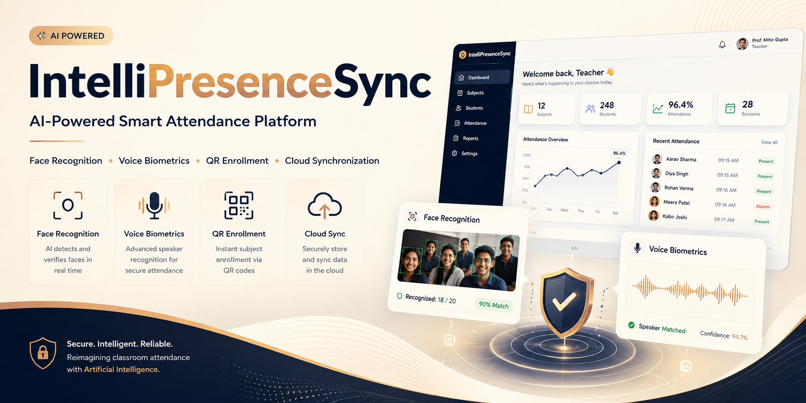

</p>

<h3 align="center">
AI-Powered Smart Attendance Platform for Modern Classrooms
</h3>

<p align="center">
Face Recognition • Voice Biometrics • QR Enrollment • Cloud Synchronization
</p>

<p align="center">

<a href="https://intelli-presence-sync-landing-dashb.vercel.app/">

</a>

<a href="https://intellipresencesync-mihirlegacy.streamlit.app/">

</a>

<a href="https://github.com/mihirgupta665/IntelliPresenceSync">

</a>

<a href="https://github.com/mihirgupta665/IntelliPresenceSync_LandingDashboard">

</a>

<a href="static/IntelliPresenceSyncVideo.mp4">

</a>

</p>

<p align="center">


</p>

---

<p align="center">

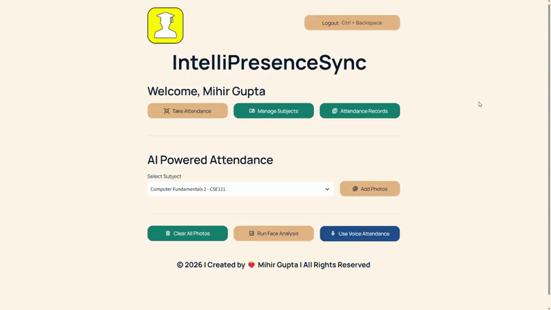

</p>

---

## 📑 Table of Contents

* [Overview](#-overview)
* [Why IntelliPresenceSync?](#-why-intellipresencesync)
* [Project Ecosystem](#-project-ecosystem)
* [Project Highlights](#-project-highlights)
* [Core Features](#-core-features)
* [Live Demonstration](#-live-demonstration)
* [Project Walkthrough](#-project-walkthrough)
* [Screenshot Gallery](#-screenshot-gallery)
* [System Architecture](#-system-architecture)
* [AI Workflow](#-ai-attendance-workflow)
* [Technology Stack](#-technology-stack)
* [AI Pipeline](#-artificial-intelligence-pipeline)
* [Repository Structure](#-repository-structure)
* [Getting Started](#-getting-started)
* [Deployment](#-deployment)
* [Roadmap](#-roadmap)
* [Key Learnings](#-key-learnings)
* [Acknowledgements](#-acknowledgements)
* [Author](#-author)

---

# 📖 Overview

**IntelliPresenceSync** is an end-to-end AI-powered attendance management ecosystem designed to modernize classroom attendance through intelligent biometric verification.

Instead of relying on traditional roll calls, the platform combines **Computer Vision**, **Voice Biometrics**, **QR-Based Enrollment**, and **Cloud Synchronization** to create a streamlined attendance workflow for students and educators.

The ecosystem consists of two integrated applications:

### 🌐 Landing Dashboard

A professional **Flask-based product website** that introduces IntelliPresenceSync, presents its features and technology, explains the user journey, and provides direct navigation to the AI attendance platform.

### 🤖 AI Attendance System

A **Streamlit-based AI application** where students register and enroll in subjects while teachers can manage classrooms, conduct attendance using facial or voice verification, and review attendance records.

Both applications work together with **Supabase PostgreSQL** as the centralized cloud database.

---

# ❓ Why IntelliPresenceSync?

Traditional classroom attendance can introduce several practical challenges.

| Traditional Approach          | IntelliPresenceSync         |
| ----------------------------- | --------------------------- |
| Manual roll calls             | AI-assisted attendance      |
| Proxy attendance concerns     | Biometric verification      |
| Time-consuming verification   | Automated recognition       |
| Manual record management      | Centralized cloud storage   |
| Repeated enrollment processes | QR-based subject enrollment |
| Limited accessibility         | Web-based experience        |

Students complete a one-time registration process using their **facial and voice information**.

Teachers can subsequently verify attendance through:

* 📸 Classroom photographs
* 🎙️ Sequential voice recordings

Verified attendance records are then synchronized with **Supabase PostgreSQL** for centralized management and retrieval.

---

# 🚀 Project Ecosystem

```text
                         IntelliPresenceSync
                                │
                 ┌──────────────┴──────────────┐
                 │                             │
                 ▼                             ▼
       Landing Dashboard             AI Attendance System
             Flask                        Streamlit
                 │                             │
                 │                     ┌───────┴───────┐
                 │                     │               │
                 │                     ▼               ▼
                 │              Face Recognition   Voice Biometrics
                 │                     │               │
                 │                     └───────┬───────┘
                 │                             │
                 └──────────────┬──────────────┘
                                ▼
                       Supabase PostgreSQL
                                │
                                ▼
                  Attendance Records & Management
```

---

# ✨ Project Highlights

* Dual-biometric attendance verification
* Face recognition for classroom photographs
* Deep-learning speaker identification
* Dynamic QR-based subject enrollment
* Student and teacher dashboards
* Attendance history and record management
* Supabase cloud database integration
* Responsive custom interface
* Dedicated product landing dashboard
* Modular AI pipeline architecture
* Separate production deployments for both applications

---

# ⭐ Core Features

| Feature                      | Description                                                                                                                   |
| ---------------------------- | ----------------------------------------------------------------------------------------------------------------------------- |
| 📸 **Face Recognition**      | Recognizes multiple enrolled students from classroom photographs using facial embeddings and machine learning classification. |
| 🎙️ **Voice Biometrics**     | Identifies registered speakers using deep-learning voice embeddings and similarity matching.                                  |
| 📲 **QR Enrollment**         | Allows students to enroll into subjects through dynamically generated QR codes or invitation links.                           |
| 👨‍🏫 **Teacher Dashboard**  | Provides subject management, attendance processing, and attendance record access.                                             |
| 👨‍🎓 **Student Dashboard**  | Provides student registration, subject enrollment, and profile-related functionality.                                         |
| ☁️ **Cloud Synchronization** | Stores student information, biometric embeddings, subjects, and attendance records through Supabase PostgreSQL.               |
| 📱 **Responsive Interface**  | Designed to provide a consistent experience across different screen sizes.                                                    |
| 🔐 **Authentication**        | Uses password hashing with `bcrypt` for credential protection.                                                                |

---

# 🎥 Live Demonstration

| Resource                        | Link                                                                                            |
| ------------------------------- | ----------------------------------------------------------------------------------------------- |
| 🌐 Landing Dashboard            | [Open Live Dashboard](https://intelli-presence-sync-landing-dashb.vercel.app/)                  |
| 🤖 AI Attendance Platform       | [Launch AI Application](https://intellipresencesync-mihirlegacy.streamlit.app/)                 |
| 🎥 Full Project Demo            | [View Demo Video](static/IntelliPresenceSyncVideo.mp4)                                          |
| 🤖 AI Application Repository    | [View GitHub Repository](https://github.com/mihirgupta665/IntelliPresenceSync)                  |
| 🌐 Landing Dashboard Repository | [View GitHub Repository](https://github.com/mihirgupta665/IntelliPresenceSync_LandingDashboard) |

---

# 🎬 Project Walkthrough

The complete demonstration follows the IntelliPresenceSync workflow from platform introduction and student enrollment to AI-powered attendance verification and attendance record management.

### Demonstration Flow

**Landing Dashboard → Student Registration → Subject Enrollment → Teacher Dashboard → Face Attendance / Voice Attendance → Attendance Records**

The project demonstration video is available here:

<p align="center">

<a href="static/IntelliPresenceSyncVideo.mp4">

</a>

</p>

---

# 📸 Screenshot Gallery

The following gallery presents the complete user journey through IntelliPresenceSync.

Each section contains a single full-width screenshot to preserve visual clarity and storytelling.

---

# 🌐 Landing Dashboard

The Landing Dashboard acts as the public-facing product experience.

It introduces IntelliPresenceSync, explains the problem being addressed, presents the major features, walks through the user journey, and showcases the technology behind the system.

## 🏠 Home

<p align="center">

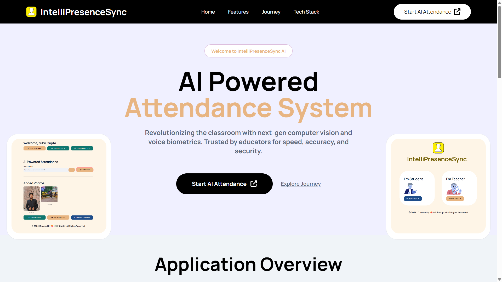

</p>

---

## 📖 Application Overview

<p align="center">

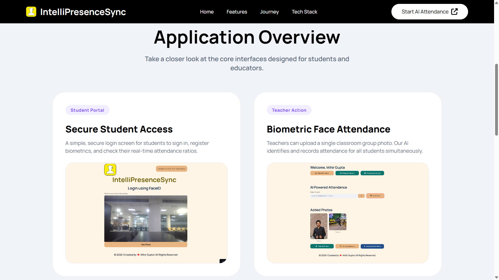

</p>

---

## ✨ Innovative Features

<p align="center">

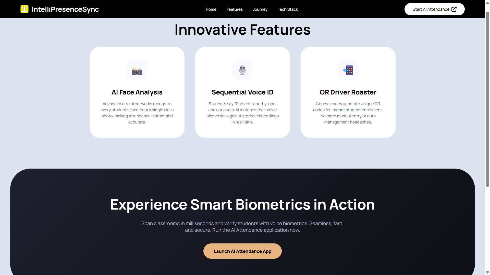

</p>

---

## 🚀 User Journey

<p align="center">

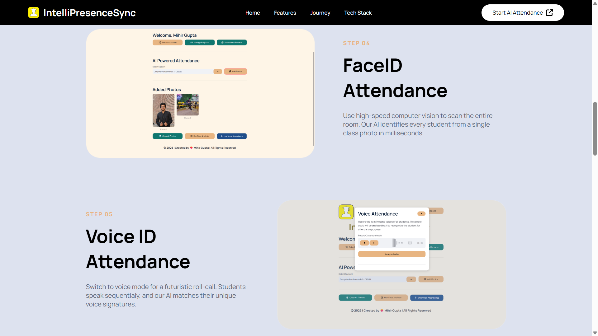

</p>

---

## 🛠 Technology Stack

<p align="center">

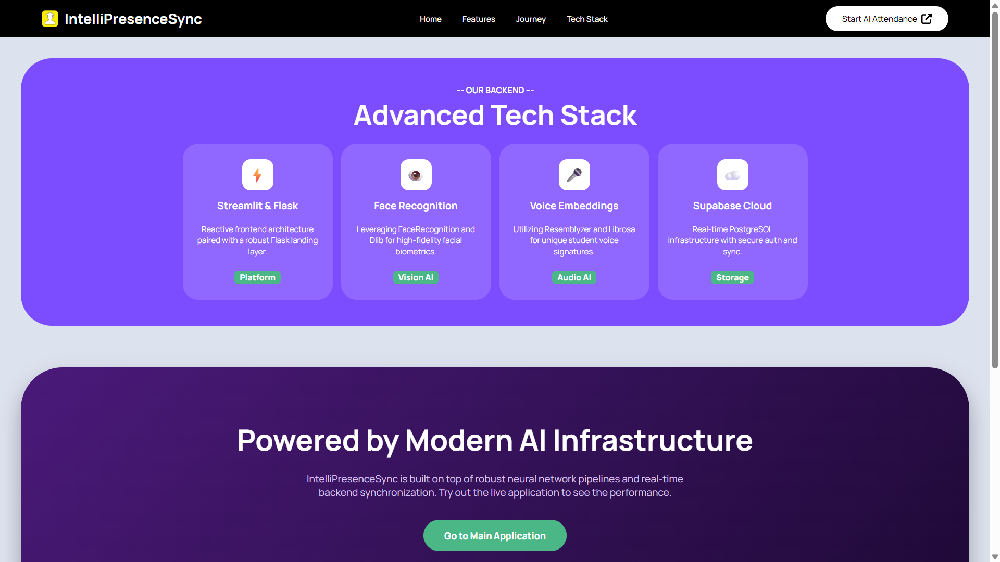

</p>

---

# 👨‍🎓 Student Workflow

The student workflow focuses on one-time registration and subject enrollment.

Students can create their profile, enroll into available subjects, and provide the biometric information required for future attendance verification.

## Step 1 — Student Login

<p align="center">

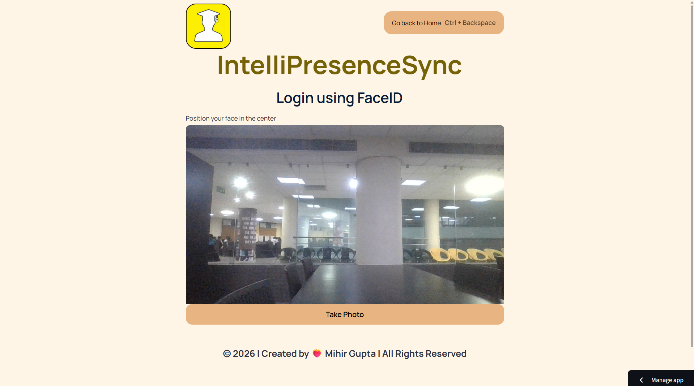

</p>

---

## Step 2 — Subject Enrollment

<p align="center">

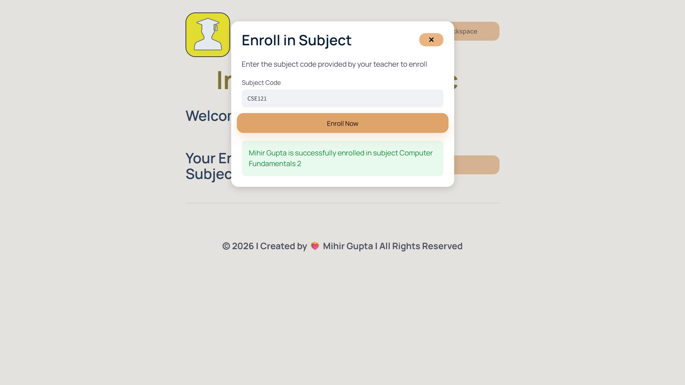

</p>

---

## Step 3 — Student Dashboard

<p align="center">

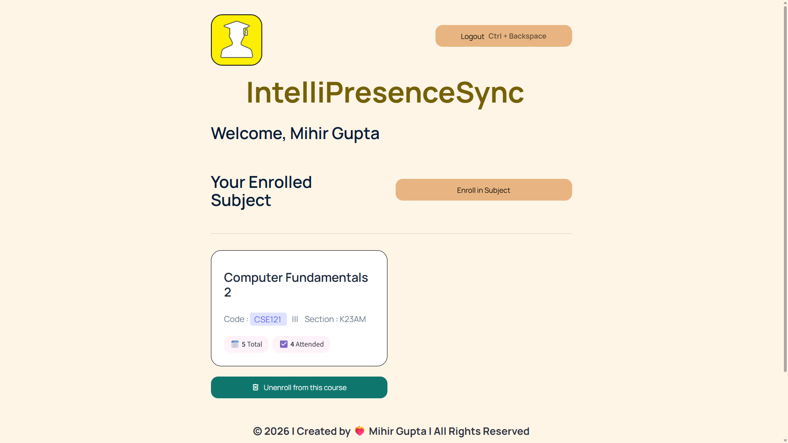

</p>

---

# 👩‍🏫 Teacher Workflow

The teacher workflow provides the tools required to create and manage subjects, enroll students, conduct AI-powered attendance, and review stored attendance records.

## Step 1 — Teacher Login

<p align="center">

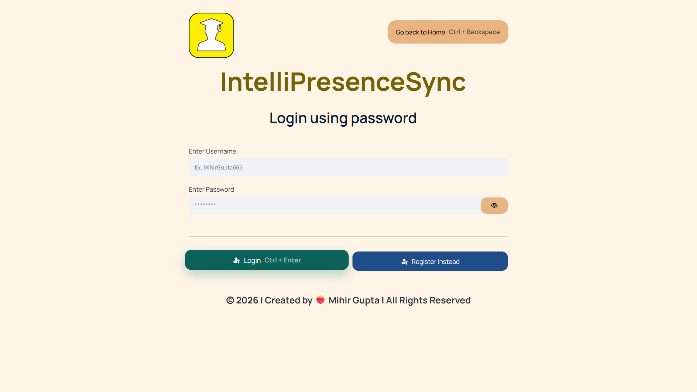

</p>

---

## Step 2 — Teacher Dashboard

<p align="center">

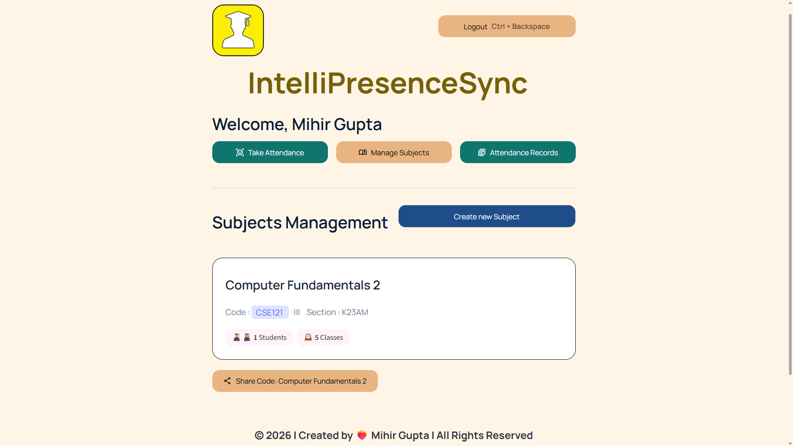

</p>

---

## Step 3 — Create Subject

<p align="center">

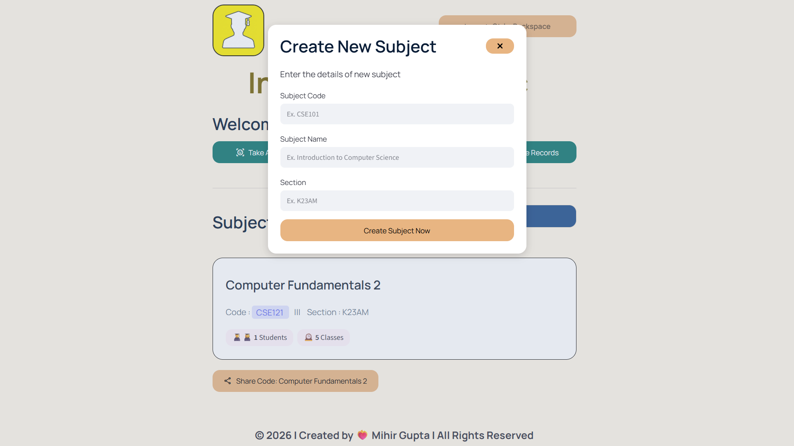

</p>

---

## Step 4 — Share QR Code / Invite Link

<p align="center">

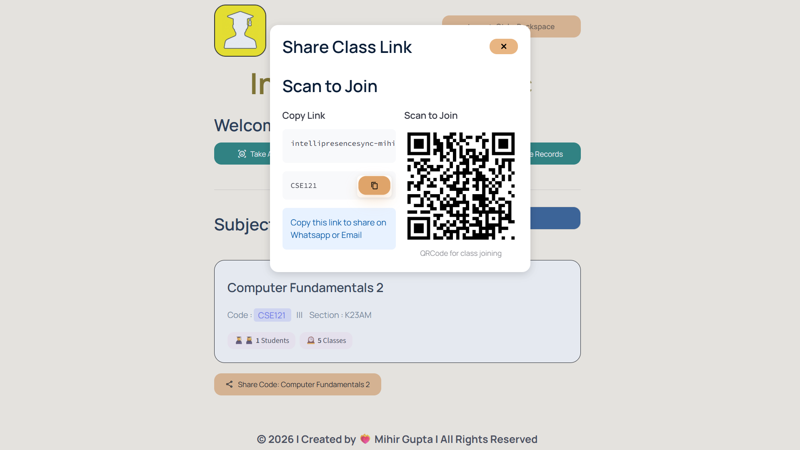

</p>

---

## Step 5 — Voice Attendance

<p align="center">

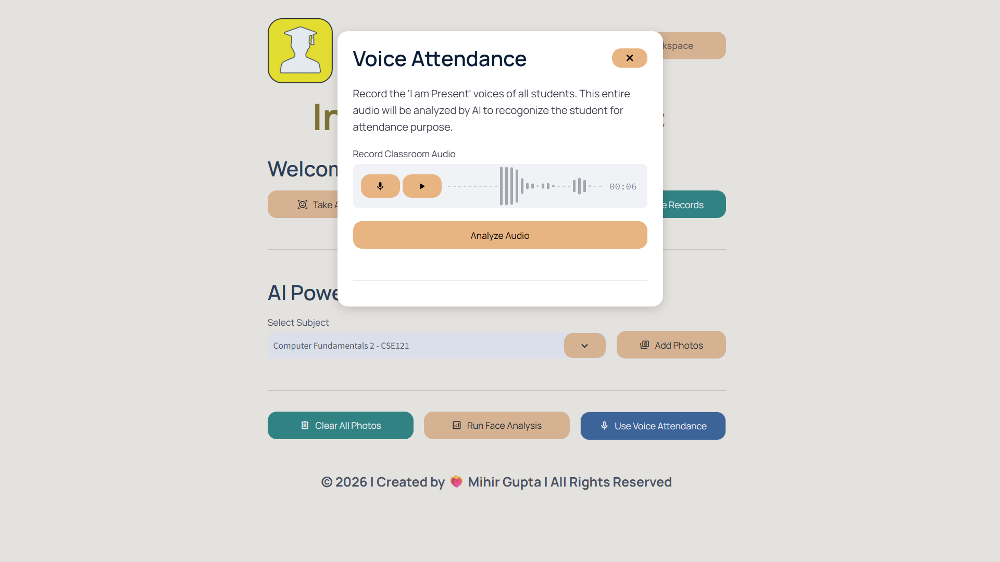

</p>

---

## Step 6 — Face Recognition Attendance

<p align="center">

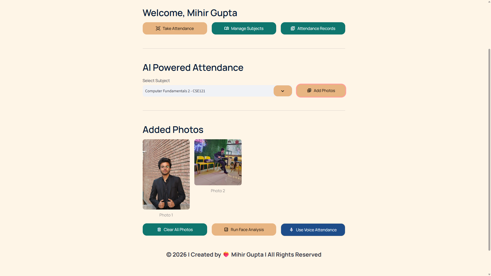

</p>

---

## Step 7 — Attendance Records

<p align="center">

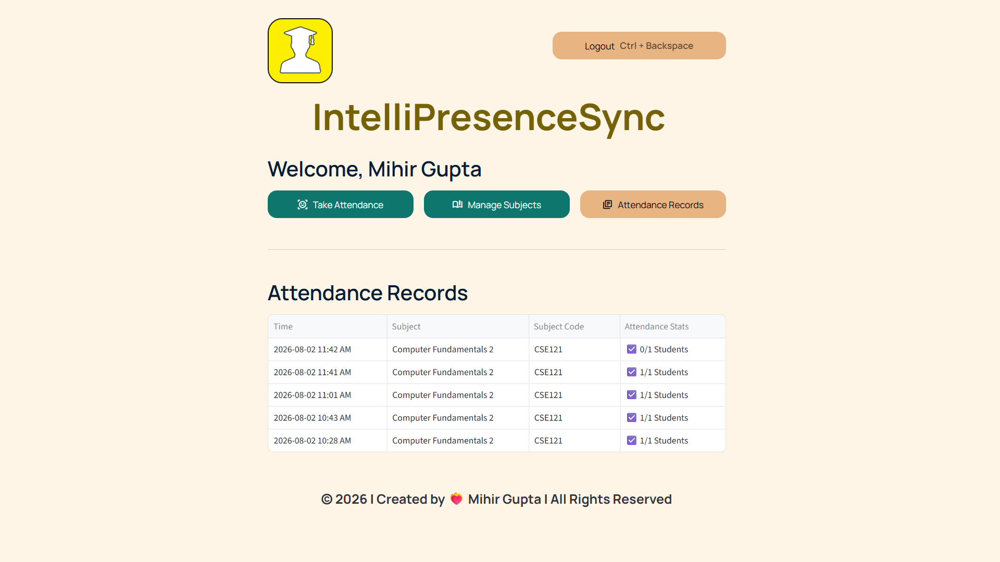

</p>

---

# 🏗️ System Architecture

IntelliPresenceSync uses two application layers connected through a centralized cloud database.

The Flask dashboard acts as the product-facing entry point, while the Streamlit application handles student management, teacher workflows, biometric processing, and attendance operations.

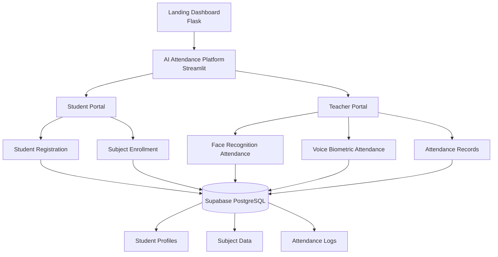

---

# 🤖 AI Attendance Workflow

The attendance engine combines two biometric pipelines.

Students provide biometric samples during registration. These representations are then used during teacher-initiated attendance verification.

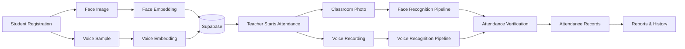

---

# 🧠 Artificial Intelligence Pipeline

## 📸 Face Recognition

The face pipeline uses facial embeddings and a machine-learning classifier to identify enrolled students.

### Pipeline

```text
Classroom Image
      ↓
Face Detection
      ↓
Face Landmark Processing
      ↓
128-Dimensional Face Embedding
      ↓
SVM Classification
      ↓
Student Identification
      ↓
Attendance Record
```

### Components

* Face detection
* Facial landmark processing
* 128-dimensional face embeddings
* SVM-based classification
* Multi-student recognition

---

## 🎙️ Voice Biometrics

The voice pipeline uses deep speaker embeddings to identify registered students from voice recordings.

### Pipeline

```text
Voice Recording
      ↓
Audio Preprocessing
      ↓
Silence Detection
      ↓
Audio Segmentation
      ↓
256-Dimensional Speaker Embedding
      ↓
Cosine Similarity Matching
      ↓
Speaker Identification
      ↓
Attendance Record
```

### Components

* Voice recording
* Audio preprocessing
* Silence-based segmentation
* 256-dimensional speaker embeddings
* Cosine similarity matching
* Sequential speaker identification

---

# 🛠️ Technology Stack

| Category                 | Technologies                                |
| ------------------------ | ------------------------------------------- |
| **Programming Language** | Python                                      |
| **Landing Dashboard**    | Flask, HTML5, CSS3, JavaScript              |
| **AI Application**       | Streamlit                                   |
| **Computer Vision**      | dlib, face_recognition_models, Scikit-Learn |
| **Voice Biometrics**     | Resemblyzer, Librosa                        |
| **Database**             | Supabase PostgreSQL                         |
| **Authentication**       | bcrypt                                      |
| **QR Generation**        | Segno                                       |
| **Image Processing**     | Pillow                                      |
| **Deployment**           | Vercel, Streamlit Community Cloud           |
| **Version Control**      | Git & GitHub                                |

---

# ☁️ Cloud Infrastructure

Supabase PostgreSQL provides the centralized persistence layer for the attendance ecosystem.

The application uses the database for managing:

* Student profiles
* Subject information
* Enrollments
* Biometric embeddings
* Attendance records
* Attendance history

The deployed applications communicate with the cloud database to maintain synchronized application data.

---

# 📌 System Modules

| Module                           | Purpose                                            |
| -------------------------------- | -------------------------------------------------- |
| 🌐 **Landing Dashboard**         | Product presentation and application gateway       |
| 👨‍🎓 **Student Portal**         | Student registration, enrollment, and dashboard    |
| 👩‍🏫 **Teacher Portal**         | Subject management and attendance operations       |
| 📸 **Face Recognition Engine**   | Classroom image-based student verification         |
| 🎙️ **Voice Recognition Engine** | Speaker-based student verification                 |
| ☁️ **Cloud Database**            | Centralized application persistence                |
| 📊 **Attendance Records**        | Attendance history and stored verification results |

---

# 📂 Repository Structure

IntelliPresenceSync is organized as **two separate repositories** that together form one complete project ecosystem.

### 🤖 AI Attendance System

Repository:

https://github.com/mihirgupta665/IntelliPresenceSync

```text
IntelliPresenceSync/
│
├── .streamlit/
│   └── config.toml
│
├── src/
│   ├── components/
│   ├── database/
│   ├── pipelines/
│   ├── screens/
│   └── ui/
│
├── app.py
├── requirements.txt
└── README.md
```

### 🌐 Landing Dashboard

Repository:

https://github.com/mihirgupta665/IntelliPresenceSync_LandingDashboard

```text
IntelliPresenceSync_LandingDashboard/
│
├── static/
│   ├── css/
│   ├── img/
│   │   └── demo/
│   ├── banner.png
│   ├── IntelliPresenceSyncGif.gif
│   └── IntelliPresenceSyncVideo.mp4
│
├── templates/
│   ├── base.html
│   ├── index.html
│   ├── features.html
│   ├── journey.html
│   └── tech.html
│
├── app.py
├── requirements.txt
└── README.md
```

---

# 🚀 Getting Started

IntelliPresenceSync contains two applications, so each application can be run independently during local development.

## Prerequisites

* Python 3.10+
* Git
* Supabase account
* Virtual environment

---

## 🤖 Run the AI Attendance System

Clone the AI application:

```bash
git clone https://github.com/mihirgupta665/IntelliPresenceSync.git
cd IntelliPresenceSync
```

Create a virtual environment:

```bash
python -m venv venv
```

### Windows

```bash
venv\Scripts\activate
```

### macOS / Linux

```bash
source venv/bin/activate
```

Install dependencies:

```bash
pip install -r requirements.txt
```

Configure the required environment variables according to the application configuration.

Run Streamlit:

```bash
streamlit run app.py
```

---

# 🌐 Run the Landing Dashboard

Clone the landing application separately:

```bash
git clone https://github.com/mihirgupta665/IntelliPresenceSync_LandingDashboard.git
cd IntelliPresenceSync_LandingDashboard
```

Create a virtual environment:

```bash
python -m venv venv
```

Activate the environment and install dependencies:

```bash
pip install -r requirements.txt
```

Run Flask:

```bash
python app.py
```

The landing dashboard runs locally at:

```text
http://127.0.0.1:5002
```

---

# 🔐 Environment Configuration

The AI attendance application uses Supabase credentials for cloud database connectivity.

Create the required environment configuration according to your local setup.

```env
SUPABASE_URL=YOUR_SUPABASE_URL
SUPABASE_KEY=YOUR_SUPABASE_ANON_KEY
```

**Never commit real credentials or secret keys to GitHub.**

---

# 🌍 Deployment

The two applications are deployed independently while sharing the same project ecosystem.

| Component               | Platform                  | Status |
| ----------------------- | ------------------------- | ------ |
| 🌐 Landing Dashboard    | Vercel                    | Live   |
| 🤖 AI Attendance System | Streamlit Community Cloud | Live   |
| ☁️ Database             | Supabase PostgreSQL       | Cloud  |

### Live Applications

**Landing Dashboard**

https://intelli-presence-sync-landing-dashb.vercel.app/

**AI Attendance System**

https://intellipresencesync-mihirlegacy.streamlit.app/

---

# 🛣️ Roadmap

## Completed

* Face Recognition Attendance
* Voice Biometric Attendance
* QR-Based Subject Enrollment
* Student Dashboard
* Teacher Dashboard
* Attendance Records
* Supabase Cloud Synchronization
* Responsive Interface
* Flask Landing Dashboard
* Streamlit AI Application
* Vercel Deployment
* Streamlit Community Cloud Deployment
* Professional Project Documentation

## Planned

* Face Anti-Spoofing
* Liveness Detection
* Multi-Camera Attendance
* Mobile Application
* REST API
* Docker Support
* CI/CD Pipeline
* Advanced Classroom Analytics
* Email Notifications
* Parent Portal
* Classroom Heatmaps
* Multi-Institution Support

---

# 💡 Key Learnings

Building IntelliPresenceSync provided practical experience across the complete software development lifecycle.

### Artificial Intelligence

* Computer Vision
* Facial Embeddings
* Speaker Recognition
* Machine Learning Classification
* Audio Processing

### Software Engineering

* Modular Python Architecture
* Flask Application Development
* Streamlit Application Development
* Database Integration
* Authentication
* Responsive UI Design

### Deployment

* Vercel Deployment
* Streamlit Community Cloud
* Supabase Cloud Database
* Environment Configuration
* Production Dependency Management

### Product Development

* System Architecture
* User Experience Design
* Technical Documentation
* Project Demonstration
* Portfolio Presentation

---

# 🙏 Acknowledgements

IntelliPresenceSync builds upon the work of the open-source community.

Special thanks to:

* [Streamlit](https://streamlit.io/)
* [Flask](https://flask.palletsprojects.com/)
* [Supabase](https://supabase.com/)
* [Scikit-Learn](https://scikit-learn.org/)
* [Dlib](http://dlib.net/)
* [Resemblyzer](https://github.com/resemble-ai/Resemblyzer)
* [Librosa](https://librosa.org/)
* [Pillow](https://python-pillow.org/)
* [Segno](https://github.com/heuer/segno)

---

# 👨‍💻 Author

<div align="center">

<h2>Mihir Gupta</h2>

<p>
AI & Machine Learning Engineer • Full Stack Developer
</p>

<p>
Building intelligent software solutions through Artificial Intelligence,
Machine Learning, and modern software engineering.
</p>

</div>

<p align="center">

<a href="https://github.com/mihirgupta665">

</a>

<a href="https://www.linkedin.com/in/mihir-gupta-980173299/">

</a>

<a href="mailto:mihirgupta665@gmail.com">

</a>

</p>

---

# ⭐ Show Your Support

If IntelliPresenceSync was useful, interesting, or inspiring, consider giving the project a ⭐ on GitHub.

Your support helps the project reach more developers and encourages continued experimentation with AI-powered educational technology.

---

# 📜 License

This project is licensed under the **MIT License**.

---

<div align="center">

<h2>IntelliPresenceSync</h2>

<p>
<strong>Reimagining Classroom Attendance with Artificial Intelligence</strong>
</p>

<p>
Face Recognition • Voice Biometrics • QR Enrollment • Cloud Synchronization
</p>

<br>

<p>
Built with Python, Artificial Intelligence, and a passion for creating smarter educational technology.
</p>

</div>
