<h1 align="center">
IntelliPresenceSync
</h1>

<p align="center">

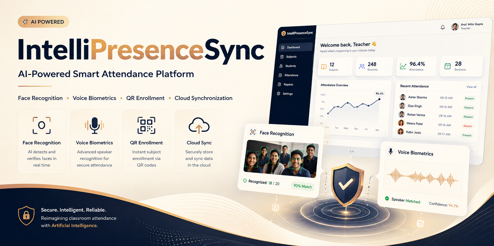

</p>

<h3 align="center">
AI-Powered Smart Attendance Platform for Modern Classrooms
</h3>

<p align="center">
Face Recognition • Voice Biometrics • QR Enrollment • Oracle Database
</p>

<p align="center">

<a href="https://github.com/mihirgupta665/IntelliPresenceSync">

</a>

<a href="static/IntelliPresenceSyncVideo.mp4">

</a>

</p>

<p align="center">


</p>

---

Administración institucional (tercer rol, migración 006):
[permisos, preparación y credenciales locales](docs/ADMINISTRACION.md).
Estado del trabajo: [roadmap](docs/ROADMAP.md).

<p align="center">

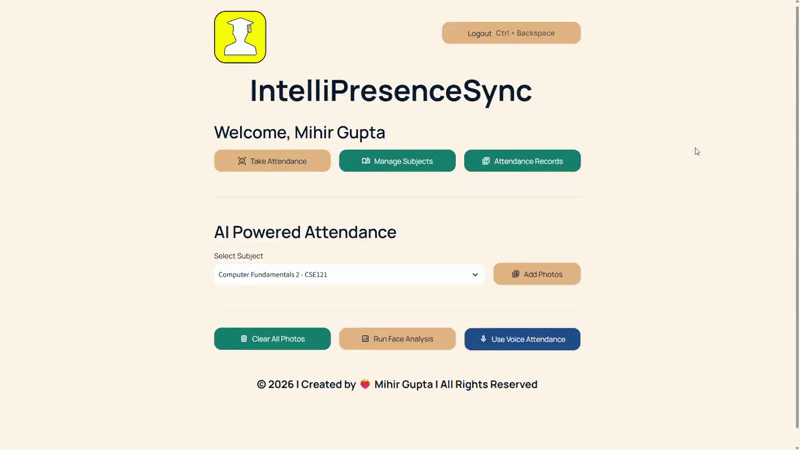

</p>

---

## 📑 Table of Contents

* [Overview](#-overview)
* [Why IntelliPresenceSync?](#-why-intellipresencesync)
* [Project Ecosystem](#-project-ecosystem)
* [Project Highlights](#-project-highlights)
* [Core Features](#-core-features)
* [Live Demonstration](#-live-demonstration)
* [Project Walkthrough](#-project-walkthrough)
* [Screenshot Gallery](#-screenshot-gallery)
* [System Architecture](#-system-architecture)
* [AI Workflow](#-ai-attendance-workflow)
* [Technology Stack](#-technology-stack)
* [AI Pipeline](#-artificial-intelligence-pipeline)
* [Repository Structure](#-repository-structure)
* [Getting Started](#-getting-started)
* [Deployment](#-deployment)
* [Roadmap](#-roadmap)
* [Key Learnings](#-key-learnings)
* [Acknowledgements](#-acknowledgements)
* [Author](#-author)

---

# 📖 Overview

Guías de trabajo actualizadas: [Roadmap completo](docs/ROADMAP.md),
[instalación por PC y HTTPS local](docs/INSTALACION.md), y
[SQL*Plus, PL/SQL y fase final de SQL Developer](docs/SQLPLUS_Y_SQLDEVELOPER.md).
Punto de entrada: [índice de documentación](docs/README.md) y [registro de cambios](docs/CAMBIOS.md).
La entrega 002 añade [cinco disparadores, historial y operaciones PL/SQL auditables](docs/DISPARADORES_Y_PLSQL.md).
La entrega 003 añade [clases, confirmación idempotente y revisión manual de asistencia](docs/CLASES_Y_REVISION.md).
La entrega 004 separa [ausencia, falta de muestra y análisis fallido](docs/ESTADOS_DETECCION.md).
La entrega 008 añade [excepciones biométricas autorizadas, acceso alternativo y auditoría](docs/EXCEPCIONES_BIOMETRICAS.md).
El punto 3 añade [validación de capturas y vectores antes del registro](docs/VALIDACION_MUESTRAS.md).
La entrega 005 añade [gestión de cuentas, archivo e historial](docs/REGLAS_NEGOCIO.md),
[respaldo cifrado y restauración verificada](docs/RECUPERACION.md) y un
[comparador de referencias con rechazo y evaluación](docs/RECONOCIMIENTO.md).
Estado de los puntos 1, 3 y 4: [evidencias y límites](docs/CIERRE_1_3_4.md).
El punto 2 renueva el [frontend, el arranque y la carga de modelos](docs/FRONTEND.md),
con recursos locales y comprobaciones visuales de escritorio y móvil.

**IntelliPresenceSync** is a Streamlit attendance application for classroom use. Students can register, enroll in subjects, and review attendance; teachers can manage subjects and record attendance using facial or voice recognition.

The application compares dlib facial embeddings by distance and Resemblyzer voice embeddings by cosine similarity, using rejection thresholds and identity margins. QR codes support subject enrollment, and Oracle Database stores application data.

---

# ❓ Why IntelliPresenceSync?

Traditional classroom attendance can introduce several practical challenges.

| Traditional Approach          | IntelliPresenceSync         |
| ----------------------------- | --------------------------- |
| Manual roll calls             | AI-assisted attendance      |
| Proxy attendance concerns     | Biometric verification      |
| Time-consuming verification   | Automated recognition       |
| Manual record management      | Oracle-backed records       |
| Repeated enrollment processes | QR-based subject enrollment |
| Limited accessibility         | Web-based experience        |

Students register and provide the biometric information used by the application's recognition workflows.

Teachers can subsequently verify attendance through:

* 📸 Classroom photographs
* 🎙️ Sequential voice recordings

Attendance records are stored in the configured Oracle database.

---

# 🚀 Project Ecosystem

```text
                    IntelliPresenceSync
                            │
                      Streamlit app
                    ┌───────┴───────┐
                    │               │
                    ▼               ▼
             Student portal   Teacher portal
                                    │
                         ┌──────────┴──────────┐
                         ▼                     ▼
                 Face recognition      Voice recognition
                         └──────────┬──────────┘
                                    ▼
                            Oracle Database
```

---

# ✨ Project Highlights

* Dual-biometric attendance verification
* Face recognition for classroom photographs
* Deep-learning speaker identification
* Dynamic QR-based subject enrollment
* Student and teacher dashboards
* Attendance history and record management
* Oracle Database integration
* Responsive custom interface
* Modular AI pipeline architecture

---

# ⭐ Core Features

| Feature                      | Description                                                                                                                   |
| ---------------------------- | ----------------------------------------------------------------------------------------------------------------------------- |
| 📸 **Face Recognition**      | Recognizes multiple enrolled students from classroom photographs using facial embeddings and machine learning classification. |
| 🎙️ **Voice Biometrics**     | Identifies registered speakers using deep-learning voice embeddings and similarity matching.                                  |
| 📲 **QR Enrollment**         | Allows students to enroll into subjects through dynamically generated QR codes or invitation links.                           |
| 👨‍🏫 **Teacher Dashboard**  | Provides subject management, attendance processing, and attendance record access.                                             |
| 👨‍🎓 **Student Dashboard**  | Provides student registration, subject enrollment, and profile-related functionality.                                         |
| 🗄️ **Database**             | Stores student information, biometric embeddings, subjects, and attendance records in Oracle Database.                     |
| 📱 **Responsive Interface**  | Designed to provide a consistent experience across different screen sizes.                                                    |
| 🔐 **Authentication**        | Uses password hashing with `bcrypt` for credential protection.                                                                |

---

# 🎥 Live Demonstration

| Resource                        | Link                                                                                            |
| ------------------------------- | ----------------------------------------------------------------------------------------------- |
| 🖥️ Local application             | Run `iniciar.cmd` after completing the setup below.                               |
| 🎥 Demo video                    | [View Demo Video](static/IntelliPresenceSyncVideo.mp4)                                          |

---

# 🎬 Project Walkthrough

The demonstration covers student enrollment, teacher attendance workflows, biometric verification, and attendance record management.

### Demonstration Flow

**Student Registration → Subject Enrollment → Teacher Dashboard → Face Attendance / Voice Attendance → Attendance Records**

The project demonstration video is available here:

<p align="center">

<a href="static/IntelliPresenceSyncVideo.mp4">

</a>

</p>

---

# 📸 Screenshot Gallery

The following gallery presents the complete user journey through IntelliPresenceSync.

Each section contains a single full-width screenshot to preserve visual clarity and storytelling.

---

# 👨‍🎓 Student Workflow

The student workflow focuses on one-time registration and subject enrollment.

Students can create their profile, enroll into available subjects, and provide the biometric information required for future attendance verification.

## Step 1 — Student Login

<p align="center">

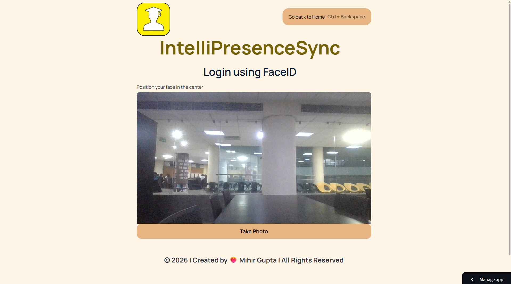

</p>

---

## Step 2 — Subject Enrollment

<p align="center">

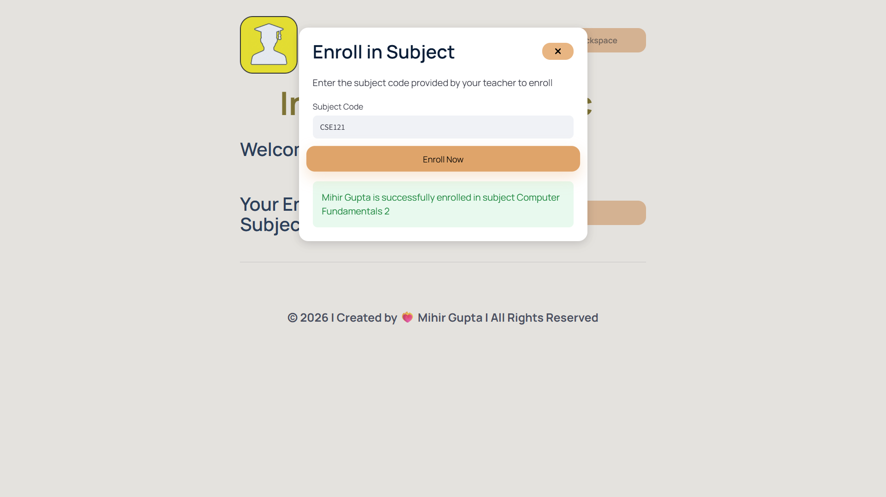

</p>

---

## Step 3 — Student Dashboard

<p align="center">

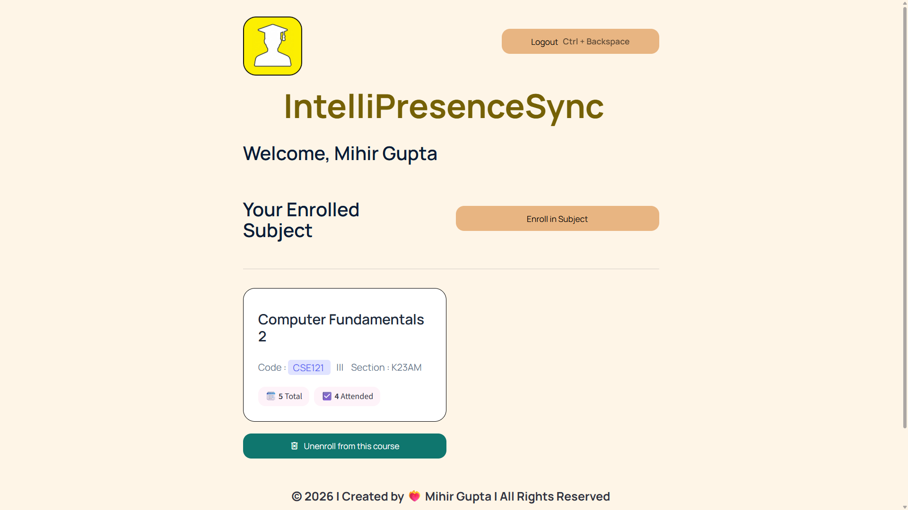

</p>

---

# 👩‍🏫 Teacher Workflow

The teacher workflow provides the tools required to create and manage subjects, enroll students, conduct AI-powered attendance, and review stored attendance records.

## Step 1 — Teacher Login

<p align="center">

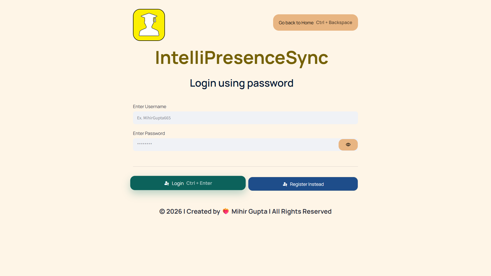

</p>

---

## Step 2 — Teacher Dashboard

<p align="center">

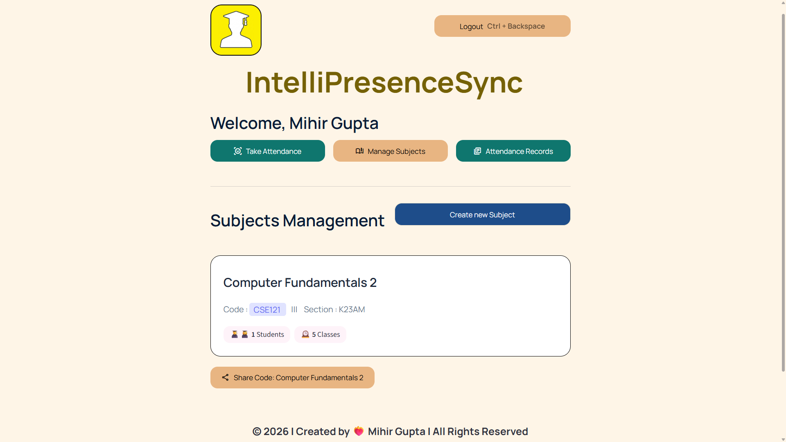

</p>

---

## Step 3 — Create Subject

<p align="center">

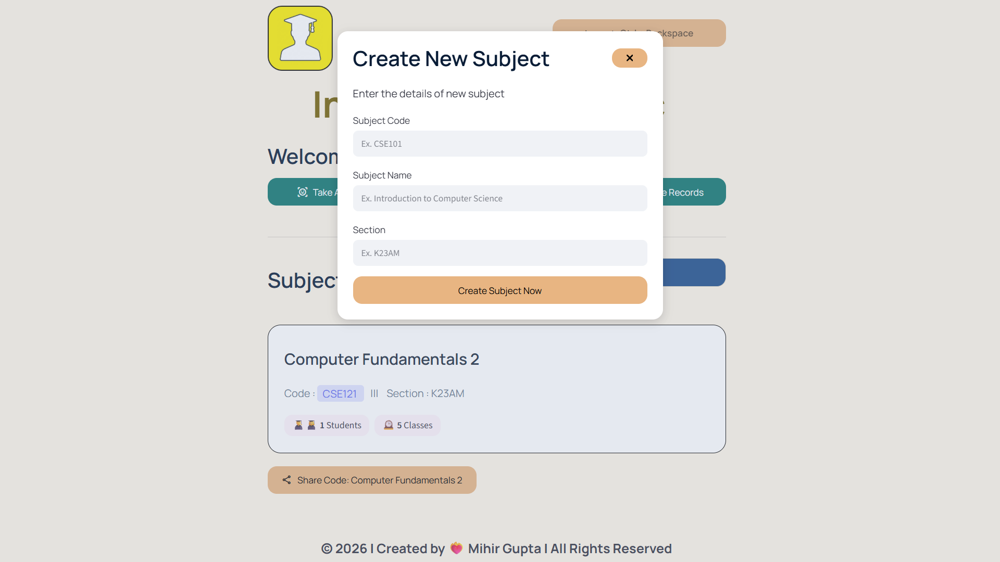

</p>

---

## Step 4 — Share QR Code / Invite Link

<p align="center">

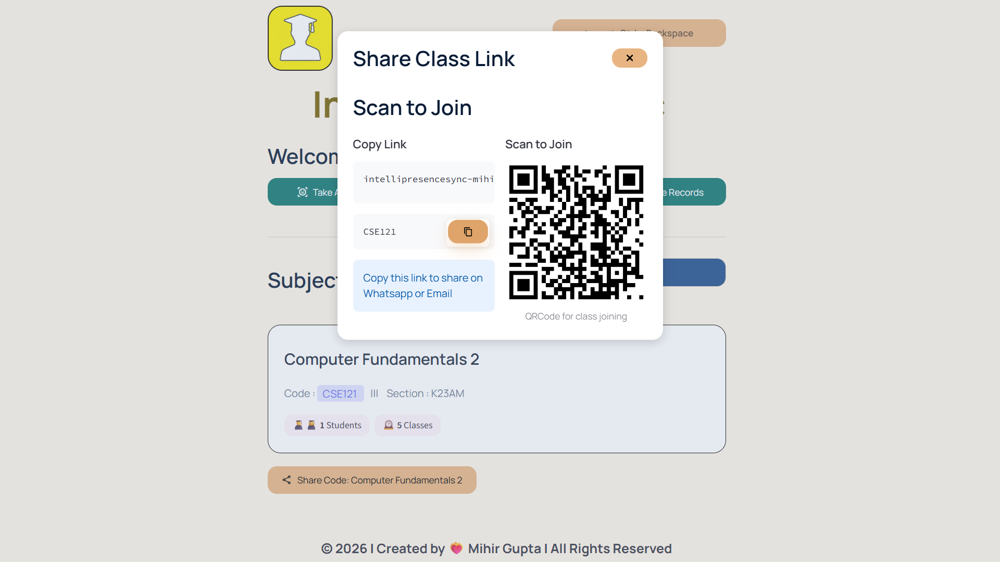

</p>

---

## Step 5 — Voice Attendance

<p align="center">

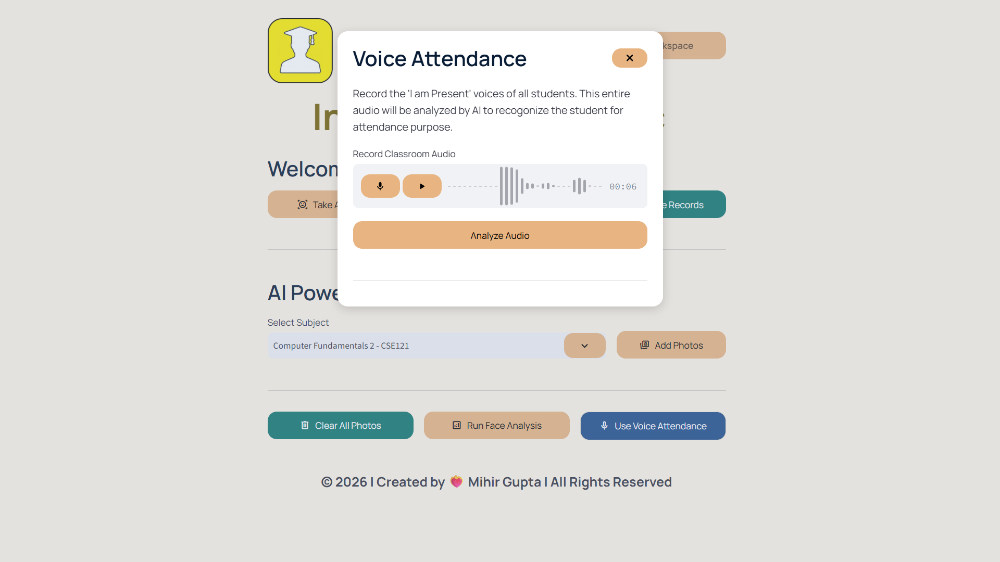

</p>

---

## Step 6 — Face Recognition Attendance

<p align="center">

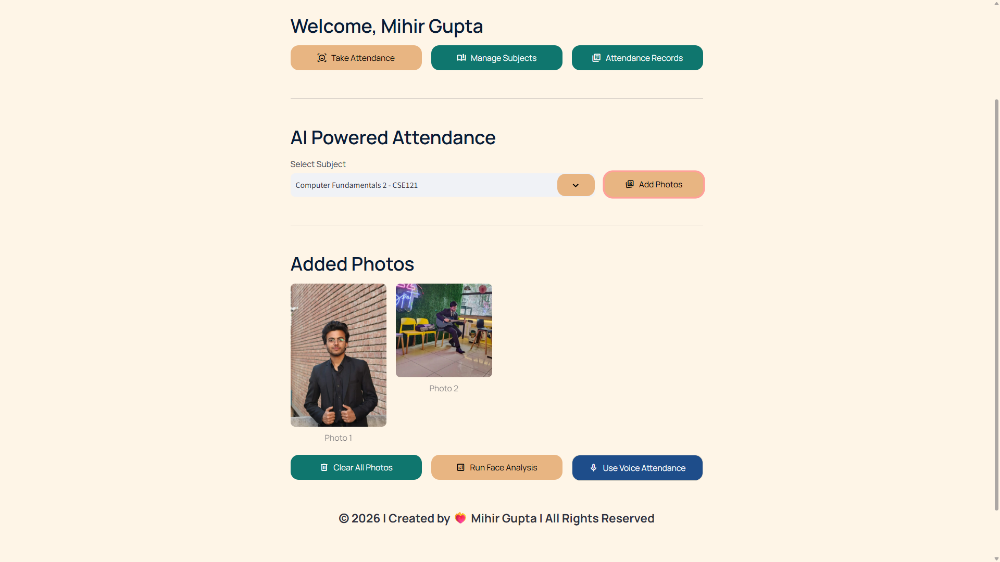

</p>

---

## Step 7 — Attendance Records

<p align="center">

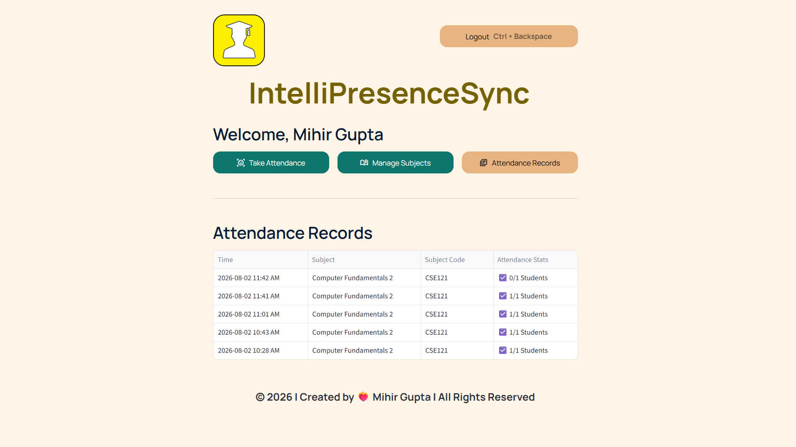

</p>

---

# 🏗️ System Architecture

The Streamlit application provides student and teacher workflows and connects to an Oracle database.

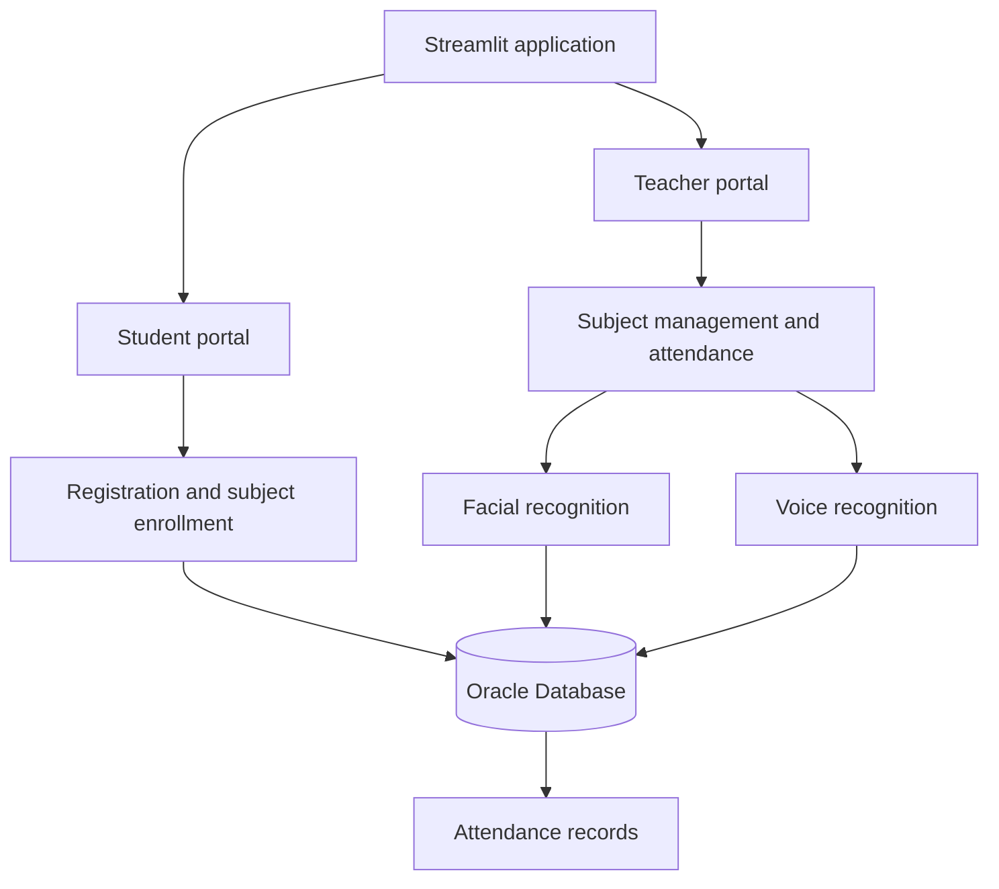

---

# 🤖 AI Attendance Workflow

The attendance engine combines two biometric pipelines.

Students provide biometric samples during registration. These representations are then used during teacher-initiated attendance verification.


---

# 🧠 Artificial Intelligence Pipeline

## 📸 Face Recognition

The face pipeline uses facial embeddings and a machine-learning classifier to identify enrolled students.

### Pipeline

```text
Classroom Image
      ↓
Face Detection
      ↓
Face Landmark Processing
      ↓
128-Dimensional Face Embedding
      ↓
SVM Classification
      ↓
Student Identification
      ↓
Attendance Record
```

### Components

* Face detection
* Facial landmark processing
* 128-dimensional face embeddings
* SVM-based classification
* Multi-student recognition

---

## 🎙️ Voice Biometrics

The voice pipeline uses deep speaker embeddings to identify registered students from voice recordings.

### Pipeline

```text
Voice Recording
      ↓
Audio Preprocessing
      ↓
Silence Detection
      ↓
Audio Segmentation
      ↓
256-Dimensional Speaker Embedding
      ↓
Cosine Similarity Matching
      ↓
Speaker Identification
      ↓
Attendance Record
```

### Components

* Voice recording
* Audio preprocessing
* Silence-based segmentation
* 256-dimensional speaker embeddings
* Cosine similarity matching
* Sequential speaker identification

---

# 🛠️ Technology Stack

| Category                 | Technologies                                |
| ------------------------ | ------------------------------------------- |
| **Programming Language** | Python                                      |
| **Application**          | Streamlit                                   |
| **Computer Vision**      | dlib, face_recognition_models, Scikit-Learn |
| **Voice Biometrics**     | Resemblyzer, Librosa                        |
| **Database**             | Oracle Database (`python-oracledb`)         |
| **Authentication**       | bcrypt                                      |
| **QR Generation**        | Segno                                       |
| **Image Processing**     | NumPy, Pillow                               |
| **Version Control**      | Git & GitHub                                |

---

# 🗄️ Database

Oracle Database provides the persistence layer for the application. The connection is configured through Streamlit secrets or environment variables.

The application uses the database for managing:

* Student profiles
* Subject information
* Enrollments
* Biometric embeddings
* Attendance records
* Attendance history

The Oracle connection defaults in the code target a local Oracle XE service; configure the connection values for the database instance being used.

---

# 📌 System Modules

| Module                           | Purpose                                            |
| -------------------------------- | -------------------------------------------------- |
| 👨‍🎓 **Student Portal**         | Student registration, enrollment, and dashboard    |
| 👩‍🏫 **Teacher Portal**         | Subject management and attendance operations       |
| 📸 **Face Recognition Engine**   | Classroom image-based student verification         |
| 🎙️ **Voice Recognition Engine** | Speaker-based student verification                 |
| 🗄️ **Oracle Database**           | Application persistence                            |
| 📊 **Attendance Records**        | Attendance history and stored verification results |

---

# 📂 Repository Structure

```text
Proyecto_base/
├── .streamlit/
│   └── secrets.toml.example
├── src/
│   ├── base_datos/       # Oracle connection and data operations
│   ├── canalizaciones/   # Face and voice recognition
│   ├── componentes/      # Streamlit dialogs and UI components
│   ├── interfaz/         # Shared styling
│   ├── pantallas/        # Student, teacher, and start screens
│   └── utilidades/       # URL generation and Colombia timezone
├── oracle_scripts.sql    # Oracle user/schema setup script
├── principal.py          # Streamlit entry point
└── requirements.txt
```

---

# 🚀 Getting Started

## Prerequisites

* Python 3.11, 64 bit (validated baseline)
* Git
* Oracle Database (Oracle XE or another compatible instance)

From the project directory, create and activate a virtual environment, then install the project dependencies:

```powershell
py -3.11 scripts/preparar_entorno.py
```

Configure Oracle credentials as described below, prepare the database schema if needed, and start the application:

```powershell
.\.venv\Scripts\python.exe scripts/preparar_oracle.py --os-auth --pdb XEPDB1
.\.venv\Scripts\python.exe scripts/iniciar.py
```

The Oracle preparation command uses SQL*Plus and local OS authentication on the database server. For a remote database, use `--admin SYSTEM --dsn host:1521/service`; the administrator password is requested privately. It refuses to replace existing users or local secrets. `oracle_scripts.sql` installs the initial tables, views and PL/SQL package in an empty application schema; it does not drop existing objects. See the [SQL*Plus guide](docs/SQLPLUS_Y_SQLDEVELOPER.md) for manual execution and recovery.

---

# 🔐 Environment Configuration

Database and QR configuration use process environment variables first, then Streamlit secrets, then non-sensitive defaults. The password has no default:

| Name | Purpose |
| ---- | ------- |
| `ORACLE_USUARIO` | Oracle database username |
| `ORACLE_CONTRASENA` | Oracle database password |
| `ORACLE_DSN` | Oracle connect identifier, for example `localhost:1521/XEPDB1` |
| `ORACLE_POOL_MINIMO` | Minimum connections in the pool |
| `ORACLE_POOL_MAXIMO` | Maximum connections in the pool |
| `APP_BASE_URL` | Base URL encoded in enrollment QR links; defaults to `https://localhost:8501` |

For local development, copy `.streamlit/secrets.toml.example` to `.streamlit/secrets.toml` and replace its example credentials with values for your database. Do not commit `secrets.toml` or real credentials.

`configuracion.py` defaults to the dedicated `UPC_ASISTENCIA` schema. The preparation command generates a per-installation password and writes it to the ignored `.streamlit/secrets.toml`; no passwords are included in public code or SQL. Existing unrelated Oracle users are not modified.

Enrollment QR codes use `https://localhost:8501` by default and include the URL-encoded `join-code` query parameter. Start with `iniciar.cmd` (or `scripts/iniciar.py`) to actually enable TLS. Certificates are generated per PC in `.certs`; trusting the public local CA in the browser is an explicit setup step. For a phone on the same LAN, use `iniciar.cmd --escuchar 0.0.0.0 --url https://YOUR_PC_IP:8501`, allow the port on the test network, and trust that PC's CA on the client device. `localhost` on a phone refers to the phone itself. See the [HTTPS guide](docs/INSTALACION.md). Empty rosters disable attendance actions and are checked before processing.

New attendance timestamps are timezone-aware and use `America/Bogota` (UTC-5). Historical timestamps without an offset are interpreted as UTC before display in Colombia time.

---

# 🌍 Deployment

The project directory contains the Streamlit application and Oracle client configuration. No deployment configuration for the current Oracle-backed application is included; deployment requires a reachable Oracle database and securely configured connection values.

---

# 🛣️ Roadmap

## Completed

* Face Recognition Attendance
* Voice Biometric Attendance
* QR-Based Subject Enrollment
* Student Dashboard
* Teacher Dashboard
* Attendance Records
* Oracle Database integration
* Streamlit application
* Student and teacher attendance workflows
* Professional Project Documentation

## Planned

* Face Anti-Spoofing
* Liveness Detection
* Multi-Camera Attendance
* Mobile Application
* REST API
* Docker Support
* CI/CD Pipeline
* Advanced Classroom Analytics
* Email Notifications
* Parent Portal
* Classroom Heatmaps
* Multi-Institution Support

---

# 💡 Key Learnings

Building IntelliPresenceSync provided practical experience across the complete software development lifecycle.

### Artificial Intelligence

* Computer Vision
* Facial Embeddings
* Speaker Recognition
* Machine Learning Classification
* Audio Processing

### Software Engineering

* Modular Python Architecture
* Streamlit Application Development
* Database Integration
* Authentication
* Responsive UI Design

### Deployment

* Oracle connection and environment configuration
* Python virtual environments and dependency management

### Product Development

* System Architecture
* User Experience Design
* Technical Documentation
* Project Demonstration
* Portfolio Presentation

---

# 🙏 Acknowledgements

IntelliPresenceSync builds upon the work of the open-source community.

Special thanks to:

* [Streamlit](https://streamlit.io/)
* [python-oracledb](https://python-oracledb.readthedocs.io/)
* [Scikit-Learn](https://scikit-learn.org/)
* [Dlib](http://dlib.net/)
* [Resemblyzer](https://github.com/resemble-ai/Resemblyzer)
* [Librosa](https://librosa.org/)
* [Pillow](https://python-pillow.org/)
* [Segno](https://github.com/heuer/segno)

---

# 👨‍💻 Author

<div align="center">

<h2>Mihir Gupta</h2>

<p>
AI & Machine Learning Engineer • Full Stack Developer
</p>

<p>
Building intelligent software solutions through Artificial Intelligence,
Machine Learning, and modern software engineering.
</p>

</div>

<p align="center">

<a href="https://github.com/mihirgupta665">

</a>

<a href="https://www.linkedin.com/in/mihir-gupta-980173299/">

</a>

<a href="mailto:mihirgupta665@gmail.com">

</a>

</p>

---

# ⭐ Show Your Support

If IntelliPresenceSync was useful, interesting, or inspiring, consider giving the project a ⭐ on GitHub.

Your support helps the project reach more developers and encourages continued experimentation with AI-powered educational technology.

---

# 📜 License

This project is licensed under the **MIT License**.

---

<div align="center">

<h2>IntelliPresenceSync</h2>

<p>
<strong>Reimagining Classroom Attendance with Artificial Intelligence</strong>
</p>

<p>
Face Recognition • Voice Biometrics • QR Enrollment • Oracle Database
</p>

<br>

<p>
Built with Python, Artificial Intelligence, and a passion for creating smarter educational technology.
</p>

</div>
