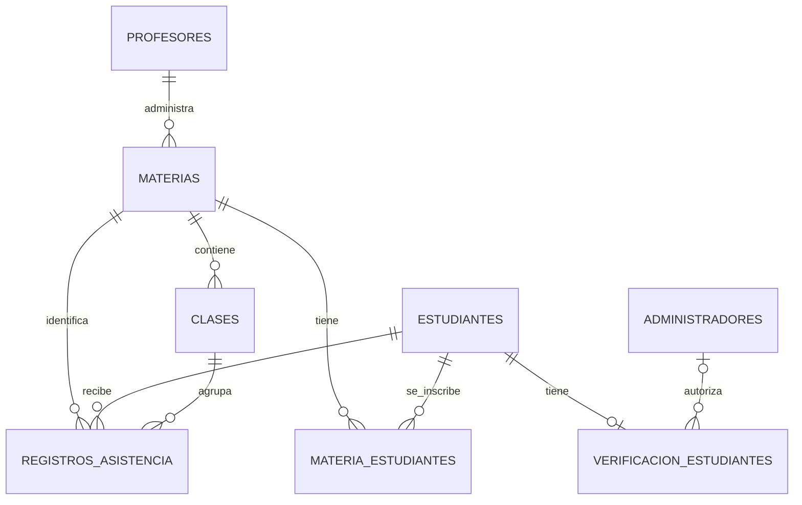

# Base de datos de UPC | Aula: funcionamiento y consulta

Consulta estructural realizada el **18 de noviembre de 2026** sobre el esquema
`UPC_ASISTENCIA`, servicio/PDB `XEPDB1`, versiones **001–008**.

Este documento describe la implementación existente. Se contrastaron los scripts del repositorio,
el acceso desde Python y el diccionario real de Oracle mediante una transacción `READ ONLY`.
No se ejecutaron migraciones, laboratorios, inserciones, actualizaciones ni borrados para prepararlo.
No se incluyen filas de usuarios, contraseñas, hashes reales ni muestras biométricas.

**Actualización documental del 21 de noviembre de 2026:** Autonomous UPCAULA ya tiene
las versiones 001–008 instaladas, TLS y acceso administrativo limitado verificados;
14 tablas, 11 vistas, 10 disparadores y siete paquetes con sus cuerpos válidos.
El diccionario detallado de columnas, restricciones e índices de esta guía conserva su
procedencia de la consulta local del 18/11; no se presenta como un nuevo inventario cloud.
La aplicación mantiene por ahora su conexión local. El catálogo SQL y el despliegue se
describen abajo y en [DESPLIEGUE.md](DESPLIEGUE.md). No se cambió la base para esta actualización.

## Índice

1. [Dónde está guardada la base](#1-dónde-está-guardada-la-base)
2. [Cómo se conecta el programa](#2-cómo-se-conecta-el-programa)
3. [Modelo y relaciones](#3-modelo-y-relaciones)
4. [Las catorce tablas](#4-las-catorce-tablas)
5. [Integridad, estados e identificadores](#5-integridad-estados-e-identificadores)
6. [Las once vistas](#6-las-once-vistas)
7. [Los diez disparadores actuales](#7-los-diez-disparadores-actuales)
8. [Los siete paquetes PL/SQL](#8-los-siete-paquetes-plsql)
9. [Los flujos completos](#9-los-flujos-completos)
10. [Catálogo de consultas de solo lectura](#10-catálogo-de-consultas-de-solo-lectura)
11. [Dónde encontrar las consultas del programa](#11-dónde-encontrar-las-consultas-del-programa)
12. [Visualización en SQL Developer](#12-visualización-en-sql-developer)
13. [Diccionario completo de columnas](#13-diccionario-completo-de-columnas)
14. [Restricciones e índices consultados](#14-restricciones-e-índices-consultados)

## 1. Dónde está guardada la base

Hay que distinguir **datos activos**, **scripts de construcción** y **copia de estructura**:

| Elemento | Ubicación | Qué contiene |
| --- | --- | --- |
| Datos de la aplicación local | Servidor Oracle XE; esquema `UPC_ASISTENCIA` dentro de `XEPDB1` | Las filas y objetos del entorno local al que sigue conectada la aplicación. |
| Esquema cloud instalado | Autonomous UPCAULA; esquema `UPC_ASISTENCIA` | Versiones 001–008 y objetos verificados; no implica que se hayan trasladado las filas locales. |
| Entrada de instalación | [oracle_scripts.sql](../oracle_scripts.sql) | Llama al instalador versionado. No es una copia de los datos. |
| Instalador | [sql/instalar.sql](../sql/instalar.sql) | Ordena estructura inicial y migraciones 002–008. |
| Tablas iniciales | [sql/01_tablas.sql](../sql/01_tablas.sql) | Solo las seis tablas de 001; por sí solo no representa la base actual. |
| Evolución del esquema | [sql/migraciones/](../sql/migraciones/) | Cambios que completan la estructura hasta 008. |
| Modelo consolidado generado en esta revisión | `exports/modelo_008.sql` | DDL de las 14 tablas, 9 FK, 11 índices adicionales y 11 vistas; sin filas de usuarios. Preparado para importar en Data Modeler. |
| Exportador general existente | [sql/06_exportar_ddl.sql](../sql/06_exportar_ddl.sql) | Puede generar `exports/esquema_ddl.sql`, incluyendo también paquetes y disparadores. |
| Catálogo de consultas | [sql/consultas/](../sql/consultas/README.md) | SQL que carga la aplicación; no instala la base ni contiene filas. |
| Configuración de conexión | [src/base_datos/configuracion.py](../src/base_datos/configuracion.py) y [transporte.py](../src/base_datos/transporte.py) | Pool y opciones TCP local o TLS/mTLS; no almacenan las tablas ni las filas. |
| Secretos del equipo | `.streamlit/secrets.toml` o variables de entorno | Credenciales y configuración de conexión; excluidos de Git. |

Oracle organiza el almacenamiento en tablespaces y archivos de datos. Las tablas de este
esquema local están asignadas a `USERS`; en el aprovisionamiento de Autonomous se usa `DATA`.
Los archivos físicos los administra Oracle y normalmente
tienen extensión `.dbf`. Un archivo de ese tipo no se abre como script SQL ni se edita desde VS Code.
La ruta física exacta de este equipo no se verificó con la cuenta del esquema. Referencia:
[Oracle: tablespaces y archivos de datos](https://docs.oracle.com/en/database/oracle/oracle-database/18/ntdbi/identifying-tablespaces-and-data-files.html).

**Para estudiar la base:** leer este documento y los scripts. **Para dibujarla:** consultar el
diccionario existente o importar `exports/modelo_008.sql`. **Para instalar una base nueva:**
seguir [INSTALACION.md](INSTALACION.md); el instalador no debe ejecutarse sobre la base existente
para obtener un diagrama.

El `.txt` de la raíz es una referencia al instalador. La estructura actual no depende de un
archivo SQLite, Access o un diccionario Python. Una copia de respaldo cifrada tampoco es un
modelo visual ni sustituye los archivos de instalación.

### Inventario verificado

| Objeto | Cantidad |
| --- | ---: |
| Tablas | 14 |
| Columnas visibles de tablas | 138 |
| Claves foráneas | 9 |
| Vistas | 11 |
| Paquetes / cuerpos PL/SQL | 7 / 7 |
| Rutinas públicas declaradas en los paquetes | 35 |
| Disparadores | 10, todos habilitados |
| Índices, incluidos los internos | 37 |
| Secuencias de identidades | 9 |
| Objetos inválidos / errores de compilación | 0 / 0 |

## 2. Cómo se conecta el programa

```text
Navegador HTTPS → Streamlit → servicios de aplicación → repositorios Python
                                                    ↓
                             conexión Oracle / contexto y sesión validados
                                                    ↓
                            SQL y paquetes PL/SQL → tablas / triggers / vistas
```

1. [src/configuracion.py](../src/configuracion.py) resuelve variables directas del proceso,
   archivos de texto `KEY_FILE`, secretos de Streamlit y valores predeterminados, en ese orden.
2. `src/base_datos/configuracion.py` usa python-oracledb en modo thin y un pool. La configuración
   habitual del proyecto es `localhost:1521/XEPDB1`; la contraseña no tiene valor predeterminado.
3. [bd.py](../src/base_datos/bd.py) toma una conexión, limpia el contexto anterior, valida la
   sesión web y establece el actor de auditoría antes de las operaciones protegidas.
4. Los repositorios cargan el SQL desde `sql/consultas/` mediante el lector compartido,
   envían datos como parámetros y llaman paquetes. Los servicios Python validan
   formatos, contraseñas y vectores; PL/SQL vuelve a comprobar las reglas que le corresponden.
5. Una escritura válida se confirma con `COMMIT`; ante un error se revierte. Antes de devolver
   una conexión al pool se hace limpieza de transacción/contexto para no atribuir una acción al usuario anterior.

**Una conexión Oracle no es una sesión de usuario de la aplicación.** La primera transporta SQL
y puede reutilizarse. La segunda está representada por `SESIONES_USUARIO` y el token del navegador.
Las variables de `PKG_AUDITORIA` pertenecen a la conexión Oracle; no son una tabla persistente.

Profesores y estudiantes todavía utilizan el propietario del esquema desde el backend. La
administración tiene una conexión técnica separada y limitada. Los estudiantes no reciben
directamente una cuenta Oracle: su rol se valida en la aplicación y los procedimientos.

## 3. Modelo y relaciones

El núcleo académico relaciona profesores, materias, estudiantes, matrículas, clases y resultados.
Las tablas de historial, seguridad y versiones complementan ese núcleo.



El diagrama representa las FK reales. Las seis tablas restantes no tienen FK: control de versiones,
historiales, eventos de gestión, límites de acceso y sesiones. Sus referencias se explican abajo.

### Las nueve claves foráneas

| Restricción | Origen → destino | Al borrar físicamente el padre |
| --- | --- | --- |
| `FK_MATERIAS_PROFESOR` | `materias.profesor_id → profesores.profesor_id` | Cascada. |
| `FK_CLASES_MATERIA` | `clases.materia_id → materias.materia_id` | Cascada. |
| `FK_ME_MATERIA` | `materia_estudiantes.materia_id → materias.materia_id` | Cascada. |
| `FK_ME_ESTUDIANTE` | `materia_estudiantes.estudiante_id → estudiantes.estudiante_id` | Cascada. |
| `FK_RA_MATERIA` | `registros_asistencia.materia_id → materias.materia_id` | Cascada. |
| `FK_RA_ESTUDIANTE` | `registros_asistencia.estudiante_id → estudiantes.estudiante_id` | Cascada. |
| `FK_RA_CLASE_MATERIA` | `(registros_asistencia.clase_id, materia_id) → clases(clase_id, materia_id)` | Cascada; además impide asociar un registro con una clase de otra materia. |
| `FK_VERIFICACION_EST` | `verificacion_estudiantes.estudiante_id → estudiantes.estudiante_id` | Cascada. |
| `FK_VERIFICACION_ADMIN` | `verificacion_estudiantes.autorizado_por → administradores.administrador_id` | Sin cascada: una referencia existente impide eliminar al aprobador. |

**Relaciones lógicas sin FK:** `clases.profesor_id` conserva al responsable de la clase;
`revisado_por` y los actores de auditoría identifican personas según su rol. Los IDs de historial
se conservan aunque desaparezca la fila original. `SESIONES_USUARIO` utiliza rol + ID porque
puede referirse a cualquiera de las tres tablas de cuentas. Data Modeler no dibujará estas
referencias lógicas automáticamente como si fueran FK.

## 4. Las catorce tablas

El [diccionario de columnas](#13-diccionario-completo-de-columnas) detalla cada campo, su tipo,
nulabilidad y significado. Aquí se explica el uso de cada tabla.

### 4.1 PROFESORES

Una fila por cuenta docente. La PK es `profesor_id`; `usuario` identifica el acceso y `contrasena`
almacena bcrypt, no texto recuperable. `activo` permite archivar la cuenta. `version_edicion` y
`actualizado_en` permiten detectar cambios y rechazar ediciones obsoletas.

Un profesor puede administrar varias materias. El usuario se normaliza y la unicidad también
se protege mediante un índice sobre su versión sin espacios laterales y sin diferencia de mayúsculas.
El código privado de alta docente no se almacena aquí: se obtiene de la configuración privada.

### 4.2 ESTUDIANTES

Una fila por estudiante, con nombre, código institucional, estado y plantillas de reconocimiento.
`embedding_facial` y `embedding_voz` son CLOB con JSON; no son fotografías ni grabaciones.
Python valida un vector facial de 128 dimensiones y uno de voz de 256. El `CHECK IS JSON`
garantiza formato JSON, pero no valida por sí solo las dimensiones ni la identidad de una persona.

El código institucional es distinto del documento de identidad. Se admite código nulo para datos
anteriores; las altas actuales lo exigen. Las muestras pueden ser nulas, especialmente en altas
por excepción o retiradas de biometría. El acceso alternativo vive en `VERIFICACION_ESTUDIANTES`.

### 4.3 MATERIAS

Una fila representa la materia con su sección/grupo y profesor responsable. No existen todavía
tablas independientes de período académico o de grupos. El código de materia es único; para
dos secciones se necesitan códigos distintos en el modelo actual.

Archivar una materia pone `activo=0` y conserva el historial. El panel administrativo permite
editarla con motivo y versión; si ya tiene clases, impide cambiar de profesor para conservar
la atribución histórica.

### 4.4 MATERIA_ESTUDIANTES

Tabla puente de matrícula: resuelve la relación muchos a muchos entre estudiantes y materias.
Su PK es **el par** `(materia_id, estudiante_id)`, por lo que una matrícula no puede repetirse.
`matriculado_en` registra el instante del alta actual.

Retirarse elimina esta relación, no al estudiante ni sus asistencias. El trigger de historial
registra el retiro. Una reinscripción posterior genera una nueva matrícula y otra entrada de alta.

### 4.5 CLASES

Identifica cada sesión académica. La materia, el instante UTC y el lote distinguen una clase;
`lote_legado=0` corresponde al flujo nuevo y los lotes adicionales preservan duplicados históricos.
`profesor_id` es una instantánea del responsable al crearla.

Empieza como `BORRADOR / PENDIENTE`. Después de revisar la propuesta se confirma con origen
`FACIAL` o `VOZ`, clave de confirmación y JSON de resultados. Ese JSON contiene la propuesta
canónica de asistencia, no las plantillas biométricas. `LEGADO` identifica registros de compatibilidad.

La clave de confirmación y el contenido permiten reconocer un reintento idéntico sin duplicar
resultados. Tras confirmar, la identidad, la propuesta y la cantidad original quedan protegidas.
Para clases normales, `registros_confirmados` es la cantidad de la confirmación, no un contador
que deba reinterpretarse como número actual de filas después de un borrado auditable.

### 4.6 REGISTROS_ASISTENCIA

Un resultado por estudiante y clase. La restricción `(clase_id, estudiante_id)` evita duplicados.
La FK compuesta comprueba que la materia del registro sea la de la clase.

- `presente`: decisión final, 1 asistió / 0 no asistió.
- `presente_detectado`: resultado inicial 1/0, o nulo si no hubo muestra utilizable.
- `estado_deteccion`: `PRESENTE`, `AUSENTE` o `SIN_MUESTRA`.
- `corregido_manual` y campos de revisión: documentan una decisión manual **antes de confirmar**.
- `fecha_hora`: instante del análisis; el día/hora de la clase está en `CLASES.FECHA_HORA`.

`SIN_MUESTRA` no significa ausente: exige decisión del docente y motivo antes de guardar.
Un análisis fallido no se confirma como si fuera una ausencia. Una corrección posterior cambia
`presente` mediante el procedimiento auditable; no reescribe los campos de detección/revisión inicial.

### 4.7 AUDITORIA_ASISTENCIA

Historial de cambios de asistencia. Guarda `UPDATE` relevante o `DELETE`, valores anteriores y
nuevos, clase, detección inicial, revisión original, actor, motivo, instante y contexto técnico.
Una primera inserción no produce una entrada en este historial: su resultado está en el registro
y su revisión inicial; el historial sigue las modificaciones/bajas posteriores.

No tiene FK hacia el registro original para poder conservar el rastro de una eliminación.
Un `UPDATE` que deje iguales presencia y fecha no crea un evento adicional. No contiene las
fotografías o audios del reconocimiento.

### 4.8 HISTORIAL_MATRICULAS

Conserva las altas y retiros de matrícula (`ALTA` / `RETIRO`), IDs, fecha de matrícula, actor,
motivo y contexto técnico. Se alimenta automáticamente desde `MATERIA_ESTUDIANTES`.
No tiene FK a las cuentas/materias para que la historia no dependa de la supervivencia del padre.

### 4.9 EVENTOS_GESTION

Bitácora general: archivo y edición de cuentas/materias, reinicios de contraseña, preparación de
exportaciones y acciones de verificación. La entidad y su ID señalan qué se intentó o cambió.
Los JSON opcionales `valores_anteriores` y `valores_nuevos` son instantáneas seleccionadas por
los procedimientos, no copias completas de una cuenta ni de sus hashes o vectores.

Se escribe explícitamente desde paquetes/servicios: no existe un trigger general que registre
cualquier SQL ejecutado por el propietario. Para validaciones previas al acceso el actor puede
ser `SISTEMA`; el ID de entidad puede ser 0 si todavía no se identifica al estudiante.

### 4.10 LIMITES_ACCESO

Contador persistente contra intentos reiterados. La PK `clave` es una huella del identificador
de acceso, con ámbitos separados para administración, recuperación y excepción. No es una contraseña.
Contiene intentos, inicio de ventana y vencimiento del bloqueo.

Los servicios aplican cinco fallos / quince minutos y limpian límites vencidos. Esta política
no depende de que el navegador permanezca abierto. Una clave con bloqueo futuro no acredita
identidad: solo explica que hay que esperar antes de intentar otra vez.

### 4.11 ADMINISTRADORES

Cuentas del rol administrativo de la aplicación: usuario, nombre, bcrypt, estado y fechas.
No son lo mismo que el usuario técnico de Oracle ni que SYS/SYSTEM. Su identificador aparece
como aprobador de excepciones. Su usuario tiene unicidad normalizada mediante un índice.

La contraseña inicial se prepara en privado con la herramienta correspondiente; no está en
la documentación ni en el repositorio. Esta tabla no tiene `version_edicion`; su trigger actual
solo actualiza `actualizado_en`.

### 4.12 SESIONES_USUARIO

La PK `(rol, actor_id)` admite una única fila vigente por cuenta. Contiene SHA-256 del token,
creación, última actividad, vencimiento absoluto y revocación. El token original queda en el
estado de la aplicación; no se guarda en texto en Oracle.

Un nuevo acceso reemplaza el token de esa cuenta. Las operaciones del token anterior se rechazan;
su cierre no puede cerrar la sesión nueva. La política actual es treinta minutos de inactividad
y ocho horas máximas. El rol selecciona la tabla de cuenta que hay que comprobar; no hay una FK
genérica hacia tres tablas a la vez.

### 4.13 VERIFICACION_ESTUDIANTES

Relación opcional uno a uno con el estudiante. Separa dos cosas:

- **Permiso excepcional:** bandera, categoría, referencia, aprobador, fecha y vigencia.
- **Último resultado de verificación:** estado, fecha y factores comprobados/requeridos.

El documento se representa con HMAC y últimos cuatro caracteres, no con su número completo.
`clave_hash` contiene bcrypt. La clave HMAC original se conserva fuera de Git y fuera de esta tabla.
`version_credencial` cambia para invalidar pruebas anteriores y evitar sobreescrituras concurrentes.

Los estados son `PENDIENTE`, `BIOMETRICA_COMPLETA` y `EXCEPCIONAL`. Un permiso concedido no implica
que ya se haya completado un acceso. Revocarlo conserva el último resultado histórico, mientras
inhabilita nuevas entradas y sesiones anteriores. La política facial actual acredita 1/1;
una excepción acredita 0 factores biométricos y se identifica expresamente como tal.

La entrega de la contraseña por el profesor mediante correo, similar a `ALTA_DOCENTE`, está
**anotada como pendiente**: no describe una funcionalidad implementada.

### 4.14 VERSIONES_ESQUEMA

Registro de las migraciones aplicadas: versión, descripción y fecha. Permite saber si la base
dispone de las tablas y reglas que espera la aplicación. No guarda versiones de Python ni
commits de Git. La versión se registra al terminar/verificar cada instalación o migración.

## 5. Integridad, estados e identificadores

### Reglas que hace cumplir Oracle

- PK: identifica inequívocamente cada fila; varias son compuestas o utilizan una huella en lugar de un número.
- FK: exige la existencia del padre y, en la asistencia, la correspondencia clase–materia.
- UNIQUE e índices únicos: impiden duplicar usuarios, códigos, matrículas, propuestas y asistencia por clase.
- CHECK: limita banderas a 0/1, valida JSON y combina campos de estado/revisión/autorización.
- NOT NULL: exige datos obligatorios. En Oracle una cadena vacía se trata como nula.
- Triggers: añaden fechas/versiones, rechazan cambios prohibidos y producen historial.
- Paquetes: comprueban actor, propiedad, actividad, motivos y coherencia de una operación completa.

Las identidades numéricas son secuencias administradas por Oracle. Pueden tener huecos por
reintentos, caché o transacciones revertidas; no son una numeración de filas consecutiva.
`INSTANTE_UTC` se calcula a partir de la fecha de clase; no se rellena manualmente.

### Archivo, retiro y borrado físico

Archivar una cuenta o materia cambia su estado; retirar una matrícula borra la relación actual.
Estos flujos conservan el historial académico correspondiente. Las FK heredadas con cascada
siguen existiendo: un borrado físico directo del padre puede eliminar datos relacionados.
La interfaz no ofrece borrar físicamente cuentas como sustituto del archivo.

### Quién confirma la transacción

Los paquetes de negocio no realizan `COMMIT` interno; Python decide confirmar o revertir.
Los triggers de historial tampoco usan transacciones autónomas: el evento se confirma junto
con la operación o se revierte con ella. Los `SAVEPOINT` permiten deshacer una operación incompleta.
Los bloqueos `FOR UPDATE` serializan cambios; **no son consultas inocuas para ejecutar en esta revisión**.

La confirmación de clase bloquea y comprueba la matrícula completa, exige una fila por estudiante,
valida el JSON y guarda todo o nada. Un reintento idéntico devuelve el resultado ya confirmado;
otra propuesta para la misma clase se rechaza.

### Límites del modelo actual

- Las vistas simplifican consultas, pero no implementan por sí mismas aislamiento de filas por usuario.
  La identidad y los filtros se aplican desde servicios/paquetes; no hay una política VPD documentada aquí.
- El contexto de auditoría declara actor/motivo; por sí solo no autentica a quien conoce la contraseña Oracle.
- La conexión administrativa limitada tiene EXECUTE a paquetes y SELECT a tres vistas de historial,
  no edición directa de las tablas de negocio. La separación del propietario para los otros roles sigue pendiente.
- La auditoría está protegida por los flujos/permisos de la aplicación; el propietario del esquema conserva
  facultades superiores. No es un registro inmutable frente a un DBA.
- Algunas reglas, como dimensiones de vectores y fortaleza/formato de credenciales, también dependen de Python.

## 6. Las once vistas

Una vista es una consulta almacenada. Estas vistas no duplican filas como una copia de datos ni
son diagramas de tablas. Algunas conservan campos históricos de versiones anteriores.

| Vista | Qué consulta y para qué sirve |
| --- | --- |
| `V_PROFESORES` | ID, usuario, nombre y creación; omite bcrypt. |
| `V_ESTUDIANTES` | ID, nombre, creación y banderas de disponibilidad de rostro/voz; omite los vectores. |
| `V_MATERIAS` | Materia y nombre de su profesor mediante JOIN. |
| `V_MATERIA_ESTUDIANTES` | Matrículas con nombres de materia y estudiante. |
| `V_REGISTROS_ASISTENCIA` | Resultado final, detección inicial, clase, materia, estudiante y revisión. |
| `V_RESUMEN_MATERIAS` | Cantidades y promedio de asistencia, con clases confirmadas. |
| `V_VERSIONES_ESQUEMA` | Versiones aplicadas y fechas. |
| `V_AUDITORIA_ASISTENCIA` | Cambios/bajas de asistencia y su contexto. |
| `V_HISTORIAL_MATRICULAS` | Altas/retiros y su contexto. |
| `V_CLASES` | Clases con nombre/código de materia, estado, origen y cantidad de confirmación. |
| `V_EVENTOS_GESTION` | Eventos administrativos y de acceso, con instantáneas JSON cuando corresponden. |

`V_ESTUDIANTES` no muestra código institucional ni estado activo; para esos campos se consulta
la tabla o el procedimiento administrativo. Las vistas generales de cuentas/matrículas no
filtran automáticamente todos los archivados: el filtro depende del uso.
`V_REGISTROS_ASISTENCIA.ESTADO` es la decisión final; `ESTADO_DETECCION` conserva la detección original.
`V_RESUMEN_MATERIAS` devuelve porcentaje 0 si no hay resultados; ese valor de presentación
no demuestra ausencias. Su conteo de tomas procede de las clases confirmadas, incluso si una
de ellas no tiene filas de asistencia.

Las definiciones se reparten entre [02_vistas.sql](../sql/02_vistas.sql),
[10_disparadores.sql](../sql/10_disparadores.sql), [20_vistas_estados.sql](../sql/20_vistas_estados.sql)
y las migraciones posteriores. El diccionario Oracle es la referencia de lo instalado actualmente.

## 7. Los diez disparadores actuales

Todos estaban `ENABLED` al consultar. Son disparadores por fila, no tareas programadas.
Que existan diez objetos actuales no significa que se sumen todas las definiciones repetidas
de los scripts: `CREATE OR REPLACE` reemplaza la versión del mismo trigger.

| Disparador | Momento y acción | Función y efecto |
| --- | --- | --- |
| `TRG_PROFESORES_ACTUALIZADO` | BEFORE UPDATE en profesores | Fija `actualizado_en` e incrementa `version_edicion` desde el valor anterior. |
| `TRG_ESTUDIANTES_ACTUALIZADO` | BEFORE UPDATE en estudiantes | Igual control de fecha y versión para cuentas estudiantiles. |
| `TRG_MATERIAS_ACTUALIZADO` | BEFORE UPDATE en materias | Igual control de fecha y versión para materias. |
| `TRG_ADMINISTRADORES_ACTUALIZADO` | BEFORE UPDATE en administradores | Fija `actualizado_en`; no añade un contador de versión. |
| `TRG_MATRICULA_ACTIVA` | BEFORE INSERT OR UPDATE en materia_estudiantes | Rechaza estudiante inactivo/inexistente o materia/profesor inactivo. |
| `TRG_MATRICULAS_HIST` | AFTER INSERT OR DELETE en materia_estudiantes | Inserta un ALTA o RETIRO en historial_matriculas con actor y contexto. |
| `TRG_ASISTENCIA_ACTIVA` | BEFORE INSERT en registros_asistencia | Rechaza asistencia nueva de estudiante, materia o profesor inactivo. |
| `TRG_ASISTENCIA_CLASE` | BEFORE INSERT OR UPDATE en registros_asistencia | Resuelve compatibilidad legada, bloquea la clase y protege identidad/detección/revisión inicial. |
| `TRG_CLASES_IDENTIDAD` | BEFORE UPDATE en clases | Protege materia, responsable, horario, lote y confirmación; impide reabrir una clase confirmada. |
| `TRG_ASISTENCIA_AUD` | AFTER UPDATE OR DELETE en registros_asistencia | Registra cambios relevantes de presencia/fecha y bajas en auditoria_asistencia. |

### Qué sucede en casos concretos

- **Actualizar una cuenta/materia sin cambiar sus valores visibles:** los triggers de fecha/versión
  siguen ejecutándose; la versión se incrementa porque hubo un UPDATE.
- **Matricular:** primero se exige actividad; después del INSERT se registra el alta histórica.
- **Retirar:** el DELETE de la matrícula registra el retiro; los registros de asistencia permanecen.
- **Insertar asistencia sin `clase_id`:** la compatibilidad llama `PKG_CLASES.CLASE_LEGADA`, que puede
  crear una clase histórica. En una clase normal ya confirmada no admite filas adicionales.
- **Alterar el estudiante, clase, materia o revisión inicial de una asistencia existente:** el
  trigger de integridad lo rechaza. Se corrige la presencia mediante el flujo auditable.
- **Cambiar solo a un `presente` igual al anterior:** no se añade auditoría de asistencia innecesaria.
- **Cambiar presencia o fecha:** sí se registra auditoría. El programa corrige presencia a través del paquete.
- **Eliminar una asistencia:** queda la instantánea anterior; no se conserva una fila activa ficticia.
- **Revocar una excepción o acceder:** no hay un trigger de verificación; lo escriben los servicios/paquetes.

Fuentes vigentes: [31_versiones_edicion.sql](../sql/31_versiones_edicion.sql),
[006_administracion.sql](../sql/migraciones/006_administracion.sql),
[10_disparadores.sql](../sql/10_disparadores.sql),
[19_integridad_estados.sql](../sql/19_integridad_estados.sql) y
[24_politicas_gestion.sql](../sql/24_politicas_gestion.sql).
La definición de asistencia de `10_disparadores.sql` fue reemplazada posteriormente por la de `19_integridad_estados.sql`.

## 8. Los siete paquetes PL/SQL

Un paquete reúne una especificación pública y un cuerpo. Los auxiliares privados del cuerpo
validan datos, actores y versiones. Las llamadas siguientes se describen para entender el programa;
**no se ejecutaron durante esta consulta**.

### PKG_AUDITORIA

Fuente: especificación en [09_paquete_auditoria.sql](../sql/09_paquete_auditoria.sql), cuerpo vigente
en [27_contexto_administrativo.sql](../sql/27_contexto_administrativo.sql).

| Rutina | Qué hace |
| --- | --- |
| `establecer_contexto` | Declara rol, actor y motivo en la conexión; comprueba existencia del actor y actividad administrativa. |
| `limpiar_contexto` | Borra esas variables de conexión. |
| `fijar_motivo` | Cambia el motivo de la operación actual, con límite de longitud. |
| `rol_actual`, `actor_actual`, `motivo_actual` | Devuelven el contexto para validaciones y triggers. |

### PKG_ASISTENCIA

Fuente vigente: [11_paquete_asistencia.sql](../sql/11_paquete_asistencia.sql).

| Rutina | Qué hace |
| --- | --- |
| `porcentaje_asistencia` | Consulta `AVG(presente)*100`, opcionalmente por materia; devuelve 0 sin registros. |
| `matricular_estudiante` | Inserta una matrícula y traduce el error de duplicado. |
| `registrar_asistencia` | Compatibilidad de registro individual: valida presencia, fecha y matrícula. |
| `corregir_asistencia` | Exige profesor propietario/motivo, bloquea el registro y cambia la presencia; el trigger audita. |
| `eliminar_asistencia` | Misma comprobación de propiedad/motivo, seguida de baja auditable. |
| `retirar_estudiante` | Permite el retiro por el estudiante correspondiente o profesor propietario; el trigger conserva historia. |

La función de porcentaje no filtra explícitamente clases confirmadas. El perfil nuevo utiliza
otra consulta que sí lo hace. Tampoco es una consulta de control de permisos por estudiante:
quien pueda ejecutarla necesita los controles de acceso de su contexto de uso.

### PKG_GESTION

Fuente: [23_paquete_gestion.sql](../sql/23_paquete_gestion.sql).

| Rutina | Efecto |
| --- | --- |
| `crear_materia` | Crea materia para el profesor activo del contexto y devuelve ID. |
| `matricular` | Verifica rol, propiedad/cuenta y actividad antes de delegar la matrícula. |
| `retirar` | Verifica actor y motivo antes de retirar la relación actual. |
| `archivar_materia` | Desactiva la materia y registra el motivo. |
| `retirar_biometria` | Vacía las dos plantillas del estudiante y registra la retirada. |
| `archivar_estudiante` | Retira matrículas, desactiva cuenta y vacía plantillas; conserva asistencias/historial. |
| `archivar_profesor` | Desactiva docente y sus materias, con evento de gestión. |

### PKG_CLASES

Fuente vigente: [25_paquete_clases_gestion.sql](../sql/25_paquete_clases_gestion.sql).

| Rutina | Efecto |
| --- | --- |
| `abrir_clase` | Reutiliza la clase de materia/instante o crea un borrador; exige propietario activo. |
| `confirmar_clase` | Valida la propuesta completa y la matrícula, registra resultados y confirma de forma atómica e idempotente. |
| `clase_legada` | Compatibilidad: busca o crea una clase de origen LEGADO para un registro individual antiguo. |

**Una función PL/SQL no es necesariamente de solo lectura:** `clase_legada` puede insertar.
Por eso no forma parte del catálogo de consultas de este documento.

### PKG_ADMINISTRACION

Fuente: [28_paquete_administracion.sql](../sql/28_paquete_administracion.sql).

| Rutina | Efecto |
| --- | --- |
| `cuentas` | Consulta profesores o estudiantes con campos permitidos y versión de edición. |
| `listar_materias` | Consulta materias, responsable, actividad, versión y existencia de clases. |
| `auditoria` | Consulta historial de asistencia, matrículas o gestión con fechas/límite. |
| `editar_profesor` | Edita datos/estado; admite hash de contraseña nuevo y conserva instantáneas sin ese hash. |
| `editar_estudiante` | Edita identidad/estado; al desactivar retira matrículas y vacía plantillas. |
| `editar_materia` | Edita materia, limita cambio de profesor cuando existen clases y registra instantáneas. |
| `registrar_exportacion` | Registra preparación de CSV; no altera las filas históricas exportadas. |

Todas exigen administrador activo. Las ediciones utilizan versión para rechazar un formulario
obsoleto. Consultas de cuentas/materias limitan la lista a 500; auditoría permite hasta 10 000.

### PKG_SESIONES

Fuente: [32_paquete_sesiones.sql](../sql/32_paquete_sesiones.sql), reaplicada en 008.

| Rutina | Efecto |
| --- | --- |
| `abrir` | Inserta/reemplaza la sesión del rol/cuenta y comprueba actividad. |
| `validar` | Bloquea y comprueba token, revocación, caducidad y cuenta; puede renovar actividad si se solicita. |
| `cerrar` | Revoca solo el token correspondiente; un token antiguo no cierra el nuevo. |

La validación estudiantil también comprueba vigencia de la autorización si el último acceso fue
excepcional. El broker Python confirma la prueba de identidad y el estado en la misma transacción
de apertura, por lo que llamar al paquete no describe todo el flujo de autenticación web.

### PKG_EXCEPCIONES

Fuente: [34_paquete_excepciones.sql](../sql/34_paquete_excepciones.sql).

| Rutina | Efecto |
| --- | --- |
| `listar` | Consulta estudiantes, estado de verificación, autorización y documento enmascarado. |
| `autorizar` | Autoriza/renueva; puede crear una cuenta sin biometría; guarda hash/HMAC y revoca sesiones anteriores. |
| `revocar` | Deshabilita el permiso, retira el hash alternativo, incrementa versión y revoca la sesión. |

No expone una rutina para fingir una validación facial correcta. El servicio de identidad
comprueba credenciales/pruebas, registra el acceso y confirma el estado desde el backend.

## 9. Los flujos completos

| Flujo | Recorrido por la base |
| --- | --- |
| Alta docente | Autorización privada en Python → bcrypt → nueva fila PROFESORES. |
| Login docente | PROFESORES activo + bcrypt en Python + LIMITES_ACCESO → apertura en SESIONES_USUARIO. |
| Recuperación docente | Autorización privada + cuenta activa → contraseña nueva, revocación de sesión, limpieza de límites y EVENTOS_GESTION. |
| Alta facial estudiantil | Muestra validada en Python → ESTUDIANTES con código/vectores → prueba facial → apertura de sesión/estado. |
| Acceso facial | Comparación en Python → prueba firmada → sesión + VERIFICACION_ESTUDIANTES + evento en una transacción. |
| Acceso excepcional | Documento HMAC + bcrypt + autorización vigente → prueba de corta vida → sesión + estado EXCEPCIONAL + auditoría. |
| Crear materia | Profesor activo del contexto → PKG_GESTION → MATERIAS. |
| Inscribirse por código/enlace/QR | Consulta de materia → comprobación de cuenta/materia → MATERIA_ESTUDIANTES → trigger de historial. El QR no crea otra tabla. |
| Preparar clase | PKG_CLASES abre/reutiliza BORRADOR → análisis/revisión en la aplicación, sin confirmar todavía todas las asistencias. |
| Confirmar clase | Propuesta completa → validación de matrícula/estados → registros → CLASES CONFIRMADA → COMMIT conjunto. |
| Corregir después | Profesor propietario + motivo → UPDATE presente → TRG_ASISTENCIA_AUD. |
| Retirar/archivar | Paquete de gestión → cambio de actividad o relación → historial/eventos según la acción. |
| Perfil y calendario | JOIN de estudiante, matrículas, materias y resultados de clases confirmadas → agregados/calendario en Python. |
| Administración y exportación | Sesión administrativa validada → paquetes/vistas limitados → preparación CSV con evento de gestión. |
| Salir o cambiar dispositivo | Token revocado/reemplazado en SESIONES_USUARIO → las operaciones posteriores vuelven a validar. |

La prueba de identidad firmada dura 90 segundos y su versión impide reutilización. El orden de
bloqueos en acceso/credenciales es sesión → verificación → cuenta cuando corresponde. La cuenta
con excepción puede entrar sin biometría, pero su entrada no añade una asistencia de clase.

El perfil acumula asistidas / registros confirmados; no calcula el promedio simple de los
porcentajes de materias. Conserva materias históricas aunque ya no estén matriculadas y cuenta
como matrículas actuales las relaciones vigentes con materias activas. El calendario usa el
día de clase presentado en America/Bogota, no necesariamente la fecha del análisis.

## 10. Catálogo de consultas de solo lectura

SQL permite combinar filtros y JOIN de innumerables formas. Este catálogo cubre las familias
de consulta actuales y ejemplos de exploración; el apartado 11 localiza las implementaciones
concretas. No pretende enumerar todas las combinaciones SQL matemáticamente posibles.
Son **42 casos de consulta con 43 sentencias SELECT**, validadas contra la estructura instalada
sin devolver filas de datos. No se ejecutaron procedimientos de escritura para comprobarlas.

Las consultas están pensadas para estudio autorizado como propietario del esquema. No sustituyen
los permisos de los portales. Los parámetros `:estudiante_id`, `:materia_id`, etc. se introducen
como variables enlazadas en el cliente. No se muestran hashes, tokens, números completos de
documento ni plantillas biométricas. Para consultas por fecha, usar intervalos [desde, hasta).

### Q01. Esquema y PDB de la conexión

```sql
SELECT USER esquema, SYS_CONTEXT('USERENV','CON_NAME') pdb FROM dual;
```

### Q02. Versiones instaladas

```sql
SELECT version, descripcion, aplicado_en FROM versiones_esquema ORDER BY version;
```

### Q03. Profesores, sin contraseñas

```sql
SELECT profesor_id, usuario, nombre, activo, version_edicion
FROM profesores ORDER BY nombre;
```

### Q04. Estudiantes y disponibilidad de muestras

```sql
SELECT estudiante_id, nombre, codigo_institucional, activo,
       CASE WHEN embedding_facial IS NULL THEN 'NO' ELSE 'SI' END tiene_rostro,
       CASE WHEN embedding_voz IS NULL THEN 'NO' ELSE 'SI' END tiene_voz
FROM estudiantes ORDER BY nombre;
```

La consulta solo comprueba presencia de plantillas; no las extrae ni acredita una verificación.

### Q05. Administradores, sin contraseñas

```sql
SELECT administrador_id, usuario, nombre, activo FROM administradores ORDER BY nombre;
```

### Q06. Materias activas de un profesor

```sql
SELECT materia_id, codigo_materia, nombre, seccion
FROM materias WHERE profesor_id=:profesor_id AND activo=1 ORDER BY nombre;
```

### Q07. Materia activa por código

```sql
SELECT materia_id, codigo_materia, nombre, seccion
FROM materias WHERE UPPER(TRIM(codigo_materia))=UPPER(TRIM(:codigo_materia)) AND activo=1;
```

### Q08. Matrículas actuales de un estudiante

```sql
SELECT m.materia_id, m.codigo_materia, m.nombre, m.seccion, me.matriculado_en
FROM materia_estudiantes me JOIN materias m ON m.materia_id=me.materia_id
WHERE me.estudiante_id=:estudiante_id AND m.activo=1 ORDER BY m.nombre;
```

### Q09. Lista de estudiantes de una materia

```sql
SELECT e.estudiante_id, e.codigo_institucional, e.nombre, me.matriculado_en
FROM materia_estudiantes me JOIN estudiantes e ON e.estudiante_id=me.estudiante_id
WHERE me.materia_id=:materia_id AND e.activo=1 ORDER BY e.nombre;
```

### Q10. Comprobar una matrícula sin modificarla

```sql
SELECT COUNT(*) matriculas FROM materia_estudiantes
WHERE materia_id=:materia_id AND estudiante_id=:estudiante_id;
```

### Q11. Cantidad de inscritos por materia, incluyendo las vacías

```sql
SELECT m.materia_id, m.codigo_materia, m.nombre, COUNT(me.estudiante_id) inscritos
FROM materias m LEFT JOIN materia_estudiantes me ON me.materia_id=m.materia_id
GROUP BY m.materia_id, m.codigo_materia, m.nombre ORDER BY m.nombre;
```

### Q12. Clases de una materia y propietario

```sql
SELECT c.clase_id, c.fecha_hora, c.estado, c.origen, c.registros_confirmados
FROM clases c JOIN materias m ON m.materia_id=c.materia_id
WHERE c.materia_id=:materia_id AND m.profesor_id=:profesor_id
ORDER BY c.fecha_hora DESC, c.clase_id DESC;
```

### Q13. Borradores pendientes de confirmar

```sql
SELECT clase_id, materia_id, fecha_hora, creado_en FROM clases
WHERE estado='BORRADOR' ORDER BY fecha_hora;
```

### Q14. Resultado individual de una clase

```sql
SELECT r.estudiante_id, e.nombre, r.presente, r.presente_detectado,
       r.estado_deteccion, r.corregido_manual, r.motivo_correccion
FROM registros_asistencia r JOIN estudiantes e ON e.estudiante_id=r.estudiante_id
WHERE r.clase_id=:clase_id ORDER BY e.nombre;
```

### Q15. Historial confirmado del estudiante

```sql
SELECT c.clase_id, c.fecha_hora fecha_clase, m.codigo_materia, m.nombre,
       r.presente, r.estado_deteccion
FROM registros_asistencia r JOIN clases c ON c.clase_id=r.clase_id
JOIN materias m ON m.materia_id=r.materia_id
WHERE r.estudiante_id=:estudiante_id AND c.estado='CONFIRMADA'
ORDER BY c.fecha_hora DESC;
```

### Q16. Porcentaje acumulado general

```sql
SELECT COUNT(*) clases_registradas, NVL(SUM(r.presente),0) asistidas,
       NVL(SUM(1-r.presente),0) ausencias,
       ROUND(100*SUM(r.presente)/NULLIF(COUNT(*),0),2) porcentaje
FROM registros_asistencia r JOIN clases c ON c.clase_id=r.clase_id
WHERE r.estudiante_id=:estudiante_id AND c.estado='CONFIRMADA';
```

Sin registros, el porcentaje es nulo (sin datos), no una ausencia demostrada. No cuenta clases
en las que no exista registro para ese estudiante ni calcula el promedio simple por materia.

### Q17. Asistencia por materia

```sql
SELECT m.materia_id, m.codigo_materia, m.nombre, COUNT(*) clases_registradas,
       SUM(r.presente) asistidas, ROUND(AVG(r.presente)*100,2) porcentaje
FROM registros_asistencia r JOIN materias m ON m.materia_id=r.materia_id
JOIN clases c ON c.clase_id=r.clase_id
WHERE r.estudiante_id=:estudiante_id AND c.estado='CONFIRMADA'
GROUP BY m.materia_id, m.codigo_materia, m.nombre ORDER BY m.nombre;
```

### Q18. Matrículas activas y materias históricas del perfil

```sql
SELECT materia_id FROM materia_estudiantes WHERE estudiante_id=:estudiante_id
UNION
SELECT r.materia_id FROM registros_asistencia r JOIN clases c ON c.clase_id=r.clase_id
WHERE r.estudiante_id=:estudiante_id AND c.estado='CONFIRMADA';
```

El UNION elimina repeticiones y conserva las materias que solo aparecen en el historial.

### Q19. Calendario mensual de un estudiante

```sql
SELECT TO_CHAR(c.fecha_hora AT TIME ZONE 'America/Bogota','YYYY-MM-DD') dia,
       COUNT(*) registros, SUM(r.presente) asistidas, SUM(1-r.presente) ausencias
FROM registros_asistencia r JOIN clases c ON c.clase_id=r.clase_id
WHERE r.estudiante_id=:estudiante_id AND c.estado='CONFIRMADA'
  AND TO_CHAR(c.fecha_hora AT TIME ZONE 'America/Bogota','YYYY-MM')=:mes
GROUP BY TO_CHAR(c.fecha_hora AT TIME ZONE 'America/Bogota','YYYY-MM-DD') ORDER BY dia;
```

`:mes` usa formato `YYYY-MM`. Un día puede tener resultados mixtos en distintas materias;
un día sin registros no se convierte automáticamente en ausencia.

### Q20. Matrículas actuales sin registro en una clase

```sql
SELECT e.estudiante_id, e.nombre
FROM materia_estudiantes me JOIN estudiantes e ON e.estudiante_id=me.estudiante_id
JOIN clases c ON c.materia_id=me.materia_id
WHERE c.clase_id=:clase_id AND NOT EXISTS
 (SELECT 1 FROM registros_asistencia r WHERE r.clase_id=c.clase_id AND r.estudiante_id=e.estudiante_id);
```

Es una consulta de revisión; una matrícula actual pudo ocurrir después de la clase. No prueba
por sí sola una ausencia ni genera registros.

### Q21. Cantidad original confirmada y cantidad actual

```sql
SELECT c.clase_id, c.registros_confirmados cantidad_confirmacion,
       COUNT(r.asistencia_id) registros_actuales
FROM clases c LEFT JOIN registros_asistencia r ON r.clase_id=c.clase_id
WHERE c.estado='CONFIRMADA'
GROUP BY c.clase_id, c.registros_confirmados ORDER BY c.clase_id;
```

Una baja posterior puede explicar una diferencia; no debe calificarse automáticamente como error.

### Q22. Revisiones manuales iniciales

```sql
SELECT asistencia_id, clase_id, estudiante_id, estado_deteccion, presente_detectado,
       presente, motivo_correccion, revisado_por, revisado_en
FROM registros_asistencia WHERE corregido_manual=1 ORDER BY revisado_en DESC;
```

### Q23. Historial de correcciones y bajas

```sql
SELECT auditoria_id, operacion, asistencia_id, presente_anterior, presente_nuevo,
       actor_rol, actor_id, motivo, ocurrido_en
FROM auditoria_asistencia WHERE asistencia_id=:asistencia_id ORDER BY auditoria_id;
```

### Q24. Historia de una matrícula

```sql
SELECT historial_id, accion, matriculado_en, ocurrido_en, actor_rol, actor_id, motivo
FROM historial_matriculas WHERE estudiante_id=:estudiante_id AND materia_id=:materia_id
ORDER BY historial_id;
```

### Q25. Eventos administrativos o de verificación

```sql
SELECT evento_id, entidad, entidad_id, accion, actor_rol, actor_id, ocurrido_en, motivo
FROM eventos_gestion WHERE entidad=:entidad ORDER BY evento_id DESC;
```

Usar, por ejemplo, `VERIFICACION`, `PROFESOR`, `ESTUDIANTE`, `MATERIA` o `AUDITORIA` según el evento.

### Q26. Estado de identidad de todos los estudiantes

```sql
SELECT e.estudiante_id, e.nombre, NVL(v.estado_verificacion,'PENDIENTE') estado,
       NVL(v.excepcion_activa,0) excepcion_activa, v.expira_en, v.verificado_en
FROM estudiantes e LEFT JOIN verificacion_estudiantes v ON v.estudiante_id=e.estudiante_id
ORDER BY e.estudiante_id;
```

### Q27. Excepciones vigentes

```sql
SELECT e.estudiante_id, e.nombre, v.categoria, v.referencia, v.autorizado_por,
       v.autorizado_en, v.expira_en, v.estado_verificacion
FROM verificacion_estudiantes v JOIN estudiantes e ON e.estudiante_id=v.estudiante_id
WHERE v.excepcion_activa=1 AND e.activo=1 AND (v.expira_en IS NULL OR v.expira_en>SYSTIMESTAMP);
```

### Q28. Resumen de verificaciones, incluyendo pendientes sin fila propia

```sql
SELECT NVL(v.estado_verificacion,'PENDIENTE') estado, COUNT(*) estudiantes
FROM estudiantes e LEFT JOIN verificacion_estudiantes v ON v.estudiante_id=e.estudiante_id
GROUP BY NVL(v.estado_verificacion,'PENDIENTE');
```

### Q29. Estado de sesiones, sin extraer tokens ni hashes

```sql
SELECT rol, actor_id, creada_en, actividad_en, expira_en, revocada_en,
 CASE WHEN revocada_en IS NOT NULL THEN 'REVOCADA'
      WHEN expira_en<=SYSTIMESTAMP OR actividad_en+INTERVAL '30' MINUTE<=SYSTIMESTAMP THEN 'CADUCADA'
      ELSE 'DENTRO_DE_PLAZO' END estado_temporal
FROM sesiones_usuario ORDER BY rol, actor_id;
```

El estado temporal no sustituye `PKG_SESIONES.VALIDAR`: también importan cuenta, token y permiso excepcional.

### Q30. Recuento de bloqueos de acceso vigentes

```sql
SELECT COUNT(*) identificadores_bloqueados FROM limites_acceso
WHERE bloqueado_hasta>SYSTIMESTAMP;
```

### Q31. Filtrar eventos por período

```sql
SELECT evento_id, entidad, accion, actor_rol, ocurrido_en
FROM eventos_gestion
WHERE ocurrido_en>=TO_TIMESTAMP_TZ(:desde,'YYYY-MM-DD HH24:MI:SS TZH:TZM')
  AND ocurrido_en<TO_TIMESTAMP_TZ(:hasta,'YYYY-MM-DD HH24:MI:SS TZH:TZM')
ORDER BY ocurrido_en DESC;
```

Ejemplo de formato de parámetro: `2026-11-01 00:00:00 -05:00`.

### Q32. Resumen general ya preparado en una vista

```sql
SELECT materia_id, codigo_materia, nombre, registros, tomas_registradas, porcentaje_asistencia
FROM v_resumen_materias ORDER BY codigo_materia;
```

### Q33. Función PL/SQL de consulta existente

```sql
SELECT pkg_asistencia.porcentaje_asistencia(:estudiante_id,:materia_id) porcentaje FROM dual;
```

Materia nula significa todas las materias. Esta función devuelve 0 sin registros y no contiene
el filtro de confirmación del perfil; revisar esa diferencia antes de comparar resultados.

### Q34. Tablas y ubicación lógica

```sql
SELECT table_name, tablespace_name FROM user_tables ORDER BY table_name;
```

### Q35. Diccionario de columnas de una tabla

```sql
SELECT column_name, data_type, data_length, char_length, nullable, identity_column, virtual_column
FROM user_tab_cols WHERE table_name=UPPER(:tabla) AND hidden_column='NO' ORDER BY column_id;
```

### Q36. Restricciones y columnas

```sql
SELECT c.table_name, c.constraint_name, c.constraint_type, cc.column_name, cc.position, c.status
FROM user_constraints c JOIN user_cons_columns cc ON cc.constraint_name=c.constraint_name
WHERE c.table_name=UPPER(:tabla) ORDER BY c.constraint_name, cc.position;
```

### Q37. Todas las relaciones físicas

```sql
SELECT f.constraint_name, f.table_name tabla_hija, fc.column_name columna_hija,
       p.table_name tabla_padre, pc.column_name columna_padre, f.delete_rule
FROM user_constraints f JOIN user_constraints p ON p.constraint_name=f.r_constraint_name
JOIN user_cons_columns fc ON fc.constraint_name=f.constraint_name
JOIN user_cons_columns pc ON pc.constraint_name=p.constraint_name AND pc.position=fc.position
WHERE f.constraint_type='R' ORDER BY f.constraint_name, fc.position;
```

La FK compuesta de asistencia aparece en dos líneas, una por columna; sigue siendo una sola FK.

### Q38. Disparadores y su estado

```sql
SELECT trigger_name, table_name, triggering_event, trigger_type, status
FROM user_triggers ORDER BY trigger_name;
```

### Q39. Código instalado de un paquete o trigger

```sql
SELECT type, line, text FROM user_source
WHERE name=UPPER(:objeto) ORDER BY type, line;
```

### Q40. Índices de una tabla

```sql
SELECT index_name, uniqueness, index_type, status
FROM user_indexes WHERE table_name=UPPER(:tabla) ORDER BY index_name;
```

### Q41. Objetos inválidos y errores de compilación

```sql
SELECT object_name, object_type, status FROM user_objects
WHERE status<>'VALID' ORDER BY object_type, object_name;
```

```sql
SELECT name, type, line, position, text FROM user_errors ORDER BY name, sequence;
```

### Q42. Vistas disponibles

```sql
SELECT view_name FROM user_views ORDER BY view_name;
```

Para preservar el alcance de consulta no se incluyen ejemplos ejecutables de INSERT/UPDATE/DELETE,
ni llamadas a procedimientos que los realicen. Los ejemplos se pueden usar en una sesión de
estudio con transacción de solo lectura y cerrar esa transacción después de consultar.

## 11. Dónde encontrar las consultas del programa

Desde el 21/11 las sentencias de nueve módulos están en `sql/consultas/`: 88 consultas
únicas y dos plantillas de identificadores, extraídas de 104 apariciones originales.
[consultas.py](../src/base_datos/consultas.py) valida rutas, mantiene caché y limita las
plantillas a identificadores Oracle permitidos. Los módulos siguientes conservan la
coordinación, los parámetros y las transacciones; sus descripciones señalan las operaciones
que solicitan, aunque el texto SQL esté en el catálogo externo. La generación de DDL de
respaldo continúa como excepción técnica. Esta organización no traslada reglas a PL/SQL.

| Archivo | Funciones/consultas relevantes |
| --- | --- |
| [bd.py](../src/base_datos/bd.py) | `existe_profesor`, `crear_profesor`, `iniciar_sesion_profesor`; estudiantes y vectores; creación/búsqueda de materias; comprobación/matrícula/retiro; listas por rol; registros y resúmenes. |
| [clases.py](../src/base_datos/clases.py) | `abrir_clase`, `obtener_clases_profesor`, `confirmar_clase`; traducción de errores y transacción. |
| [gestion.py](../src/base_datos/gestion.py) | Lista permitida de operaciones y llamadas a PKG_GESTION; archivo y retirada biométrica. |
| [administracion.py](../src/base_datos/administracion.py) | Autenticación administrativa, pool limitado, cuentas, materias, auditoría, edición y exportación. |
| [perfil_estudiante.py](../src/base_datos/perfil_estudiante.py) | CTE de clases confirmadas, UNION de materias actuales/históricas, verificación del actor y JOIN de perfil. |
| [servicio de perfil](../src/servicios/perfil_estudiante.py) | Cálculo de porcentajes, clasificación y agrupación de calendario a partir de la consulta. |
| [sesiones_servidor.py](../src/servicios/sesiones_servidor.py) | Broker de tokens y llamadas a PKG_SESIONES; prueba de identidad y apertura atómica. |
| [verificacion_identidad.py](../src/servicios/verificacion_identidad.py) | HMAC del documento, límites, bcrypt, pruebas firmadas, estado y eventos de validación. |
| [excepciones_biometricas.py](../src/servicios/excepciones_biometricas.py) | Autorización administrativa Python y llamadas a PKG_EXCEPCIONES. |
| [recuperacion_acceso.py](../src/servicios/recuperacion_acceso.py) | Recuperación docente, bloqueo, contraseña nueva y revocación de sesión. |
| [recuperacion.py](../src/base_datos/recuperacion.py) | Inventario/DDL, lectura consistente y cifrado de copias; restauración solo en destino vacío. No es el repositorio de consultas del panel. |

Los paquetes de SQL completan las validaciones descritas en el apartado 8. Las consultas de
autenticación sí utilizan hashes y los motores necesitan vectores, pero esos valores no se
incluyen en este catálogo de lectura ni en las vistas generales.

## 12. Visualización en SQL Developer

**Sí: el esquema actual se puede visualizar sin reconstruir la base.** Hay dos vías:
importar el diccionario existente o importar un DDL consolidado a un modelo local. Oracle
documenta ambas como fuentes de modelos relacionales:
[Data Modeler: importación de diseños y metadatos](https://docs.oracle.com/en/database/oracle/sql-developer-data-modeler/24.3/dmdug/data-modeler-concepts-usage.html).

### A. Desde la base existente

La conexión local siguiente se conserva para XE. También puede visualizarse el esquema
de Autonomous desde SQL Developer mediante la conexión TLS o mTLS correspondiente a esa
base y sus credenciales privadas. No utilizar `localhost`/`XEPDB1` para cloud ni ejecutar
el instalador para generar el diagrama. Ver [despliegue](DESPLIEGUE.md).

Crear una conexión básica al mismo servicio de la aplicación:

| Campo | Configuración local habitual |
| --- | --- |
| Nombre de conexión | `UPC_AULA` (etiqueta libre) |
| Usuario | `UPC_ASISTENCIA` |
| Contraseña | La privada del equipo; no copiarla al documento. |
| Host / puerto | `localhost` / `1521` |
| Tipo | Nombre de servicio, no SID. |
| Servicio | `XEPDB1` |
| Rol | Default; no necesita SYSDBA para importar el esquema propio. |

En SQL Developer, buscar **File → Data Modeler → Import → Data Dictionary**; en Data Modeler
independiente, **File → Import → Data Dictionary**. Elegir la conexión, el esquema y sus 14 tablas,
incluir las relaciones y finalizar la importación. Guardar el diseño en un archivo `.dmd` y su
carpeta asociada. El modelo se guarda localmente; modificarlo no cambia la base por sí solo.

También se puede abrir una tabla y su pestaña **Model**, usar **Open in Data Modeler** y después
**Show Parent and Child Tables**. Esa ruta muestra las tablas conectadas por FK; las tablas
independientes deben añadirse aparte. Referencia:
[Oracle: Data Modeler integrado en SQL Developer](https://docs.oracle.com/en/database/oracle/sql-developer/18.3/rptug/sql-developer-concepts-usage.html).

### B. Desde el archivo de estructura preparado

`exports/modelo_008.sql` se generó en esta revisión leyendo `DBMS_METADATA`; no se ejecutaron
sus definiciones. Contiene las tablas, FK, índices adicionales y vistas actuales. En la opción
**Import → DDL File** del Data Modeler, seleccionar ese archivo, elegir Oracle y generar el
modelo relacional. Los nombres exactos de menús pueden variar con la edición instalada.

Importar DDL para construir un dibujo es distinto de ejecutarlo en una SQL Worksheet.
Para esta revisión se trata de **importar o inspeccionar**, sin ejecutar CREATE/ALTER/DROP
ni aplicar sincronización del modelo sobre el diccionario. La importación visual no se realizó
automáticamente en la interfaz de SQL Developer; el archivo queda disponible para ese paso.

### Por qué no importar solamente 01_tablas.sql

Ese archivo representa 001, con seis tablas. Los scripts posteriores tienen bloques PL/SQL
dinámicos, comprobaciones y evolución del esquema que un importador de DDL no tiene por qué
interpretar como si ejecutara toda la instalación. El diccionario real y el DDL consolidado
reflejan mejor la versión 008.

### Vistas y diagramas son cosas diferentes

El modelo relacional dibuja tablas y sus FK. Una SQL VIEW es una consulta almacenada sobre
tablas. Dibujar todas las tablas no crea una vista por tabla ni muestra relaciones que solo
existen como referencias lógicas. Los diez triggers y siete paquetes se inspeccionan en los
nodos correspondientes de la conexión o en su SQL fuente; no todos se representan como cajas
de entidad en el diagrama.

## Fuentes y alcance de la revisión

Fuentes del proyecto: diccionario de Oracle consultado con la cuenta del esquema, scripts 001–008,
repositorios Python y guías existentes. Evidencia estructural local: `.local/documentacion_bd/inventario.json`.
El modelo generado queda en `exports/`, excluido de Git como los demás archivos de exportación.
La documentación de flujos del resto del programa está organizada en [docs/README.md](README.md).

El servidor de pruebas se inicia con el mecanismo HTTPS existente. Las comprobaciones de esta
revisión no ejecutan las pruebas Oracle que crean fixtures, aunque luego utilicen rollback.
La consulta no certifica otros equipos ni sustituye el ensayo funcional con personas reales.

Validación documental: 43 SELECT comprobados con filtro externo `WHERE 1=0`, 122 enlaces locales
revisados y cobertura de las 14 tablas, 11 vistas, 7 paquetes y 10 triggers consultados.
Resultado local: `.local/documentacion_bd/validacion.json`; cero errores de compilación u
objetos inválidos. El localhost HTTPS respondió `200 ok` durante la revisión.

<!-- DICCIONARIO_GENERADO -->

## 13. Diccionario completo de columnas

Incluye las **138 columnas visibles de las 14 tablas**. PK: clave primaria; FK: clave foránea;
ID: identidad generada por Oracle; virtual: calculada. Las columnas internas de índices no son campos de la aplicación.
Los valores predeterminados mostrados son expresiones del esquema, no valores de usuarios.

### ADMINISTRADORES

| Columna | Tipo | Admite NULL | Clave / generación | Valor predeterminado | Significado |
| --- | --- | --- | --- | --- | --- |
| `administrador_id` | `NUMBER` | No | PK, ID | Identidad Oracle | PK generada de la cuenta administrativa de la aplicación. |
| `usuario` | `VARCHAR2(100 CHAR)` | No |  |  | Identificador de acceso; la aplicación lo normaliza. |
| `nombre` | `VARCHAR2(200 CHAR)` | No |  |  | Nombre legible de la persona o materia. |
| `contrasena` | `VARCHAR2(255 CHAR)` | No |  |  | Hash bcrypt; no permite consultar la contraseña en texto. |
| `activo` | `NUMBER(1)` | No |  | 1 | 1: cuenta/materia activa; 0: archivada o deshabilitada. |
| `creado_en` | `TIMESTAMP(6) WITH TIME ZONE` | No |  | SYSTIMESTAMP | Instante de creación de la fila. |
| `actualizado_en` | `TIMESTAMP(6) WITH TIME ZONE` | No |  | SYSTIMESTAMP | Instante actualizado automáticamente por su trigger al hacer UPDATE. |

### AUDITORIA_ASISTENCIA

| Columna | Tipo | Admite NULL | Clave / generación | Valor predeterminado | Significado |
| --- | --- | --- | --- | --- | --- |
| `auditoria_id` | `NUMBER` | No | PK, ID | Identidad Oracle | PK generada del evento de auditoría. |
| `operacion` | `VARCHAR2(10 CHAR)` | No |  |  | UPDATE relevante o DELETE; no registra el INSERT inicial. |
| `asistencia_id` | `NUMBER` | No |  |  | ID histórico del registro afectado; se conserva sin FK. |
| `materia_anterior` | `NUMBER` | No |  |  | Materia antes de la operación. |
| `estudiante_anterior` | `NUMBER` | No |  |  | Estudiante antes de la operación. |
| `fecha_anterior` | `TIMESTAMP(6) WITH TIME ZONE` | No |  |  | Fecha de análisis anterior. |
| `presente_anterior` | `NUMBER(1)` | No |  |  | Decisión de asistencia anterior. |
| `materia_nueva` | `NUMBER` | Sí |  |  | Materia después de la operación; nula en una baja. |
| `estudiante_nuevo` | `NUMBER` | Sí |  |  | Estudiante después de la operación; nulo en una baja. |
| `fecha_nueva` | `TIMESTAMP(6) WITH TIME ZONE` | Sí |  |  | Fecha de análisis posterior; nula en una baja. |
| `presente_nuevo` | `NUMBER(1)` | Sí |  |  | Decisión posterior; nula en una baja. |
| `ocurrido_en` | `TIMESTAMP(6) WITH TIME ZONE` | No |  | SYSTIMESTAMP | Instante de creación del evento histórico. |
| `usuario_bd` | `VARCHAR2(128 CHAR)` | No |  |  | Usuario técnico Oracle que ejecutó la operación, distinto del actor de la aplicación. |
| `actor_rol` | `VARCHAR2(20 CHAR)` | No |  |  | Rol declarado para la acción; puede incluir SISTEMA o NO_IDENTIFICADO en los historiales. |
| `actor_id` | `NUMBER` | Sí |  |  | Identificador del actor, interpretado según el rol; no es una FK polimórfica. |
| `motivo` | `VARCHAR2(500 CHAR)` | Sí |  |  | Justificación de la acción; debe excluir contraseñas y detalles médicos. |
| `modulo` | `VARCHAR2(64 CHAR)` | Sí |  |  | Módulo técnico informado por la sesión Oracle. |
| `identificador_cliente` | `VARCHAR2(64 CHAR)` | Sí |  |  | Identificador técnico de cliente de la sesión Oracle. |
| `clase_anterior` | `NUMBER` | Sí |  |  | Clase anterior, conservada como dato histórico. |
| `clase_nueva` | `NUMBER` | Sí |  |  | Clase después de la operación; nula en una baja. |
| `detectado_anterior` | `NUMBER(1)` | Sí |  |  | Detección inicial conservada al producirse el cambio/baja. |
| `correccion_inicial` | `NUMBER(1)` | Sí |  |  | Bandera de revisión inicial del registro afectado. |
| `motivo_inicial` | `VARCHAR2(500 CHAR)` | Sí |  |  | Motivo de la revisión inicial, distinto del motivo del cambio posterior. |
| `revisor_inicial` | `NUMBER` | Sí |  |  | Docente que realizó la revisión inicial. |
| `estado_anterior` | `VARCHAR2(20 CHAR)` | Sí |  |  | Estado de detección original del registro afectado. |

### CLASES

| Columna | Tipo | Admite NULL | Clave / generación | Valor predeterminado | Significado |
| --- | --- | --- | --- | --- | --- |
| `clase_id` | `NUMBER` | No | PK, UNIQUE, ID | Identidad Oracle | PK generada para una sesión académica. |
| `materia_id` | `NUMBER` | No | FK, UNIQUE |  | FK a materias; interviene en la unicidad del horario. |
| `profesor_id` | `NUMBER` | No |  |  | Responsable al crear la clase, protegido como instantánea; no tiene FK propia. |
| `fecha_hora` | `TIMESTAMP(6) WITH TIME ZONE` | No |  |  | Inicio de la clase con zona horaria; fecha que utiliza el calendario. |
| `instante_utc` | `TIMESTAMP(6)` | Sí | UNIQUE, virtual | SYS_EXTRACT_UTC(fecha_hora) | Columna virtual SYS_EXTRACT_UTC(fecha_hora), usada en la unicidad. |
| `lote_legado` | `NUMBER` | No | UNIQUE | 0 | 0 en el flujo nuevo; permite preservar ocurrencias históricas adicionales. |
| `estado` | `VARCHAR2(12 CHAR)` | No |  | 'BORRADOR' | BORRADOR o CONFIRMADA. |
| `origen` | `VARCHAR2(12 CHAR)` | No |  | 'PENDIENTE' | PENDIENTE, FACIAL, VOZ o LEGADO. |
| `clave_confirmacion` | `VARCHAR2(32 CHAR)` | Sí | UNIQUE |  | Clave hexadecimal de propuesta (32 caracteres) para reconocer reintentos. |
| `propuesta_confirmada` | `CLOB` | Sí |  |  | JSON canónico de los resultados confirmados; no contiene vectores. |
| `registros_confirmados` | `NUMBER` | No |  | 0 | Cantidad al confirmar; inmutable para clases normales ya confirmadas. |
| `creado_en` | `TIMESTAMP(6) WITH TIME ZONE` | No |  | SYSTIMESTAMP | Instante de creación de la fila. |
| `confirmado_en` | `TIMESTAMP(6) WITH TIME ZONE` | Sí |  |  | Instante en que quedó confirmada; nulo en borrador. |

### ESTUDIANTES

| Columna | Tipo | Admite NULL | Clave / generación | Valor predeterminado | Significado |
| --- | --- | --- | --- | --- | --- |
| `estudiante_id` | `NUMBER` | No | PK, ID | Identidad Oracle | PK generada por Oracle para la cuenta estudiantil. |
| `nombre` | `VARCHAR2(200 CHAR)` | No |  |  | Nombre legible de la persona o materia. |
| `embedding_facial` | `CLOB` | Sí |  |  | Plantilla facial serializada como JSON; Python valida 128 dimensiones. Puede faltar. |
| `embedding_voz` | `CLOB` | Sí |  |  | Plantilla de hablante serializada como JSON; Python valida 256 dimensiones. Opcional. |
| `creado_en` | `TIMESTAMP(6) WITH TIME ZONE` | No |  | SYSTIMESTAMP | Instante de creación de la fila. |
| `actualizado_en` | `TIMESTAMP(6) WITH TIME ZONE` | No |  | SYSTIMESTAMP | Instante actualizado automáticamente por su trigger al hacer UPDATE. |
| `activo` | `NUMBER(1)` | No |  | 1 | 1: cuenta/materia activa; 0: archivada o deshabilitada. |
| `codigo_institucional` | `VARCHAR2(50 CHAR)` | Sí |  |  | Código institucional único normalizado; no es el documento de identidad. |
| `version_edicion` | `NUMBER` | No |  | 0 | Contador de edición que incrementa el trigger; detecta formularios obsoletos. |

### EVENTOS_GESTION

| Columna | Tipo | Admite NULL | Clave / generación | Valor predeterminado | Significado |
| --- | --- | --- | --- | --- | --- |
| `evento_id` | `NUMBER` | No | PK, ID | Identidad Oracle | PK generada de la bitácora general. |
| `entidad` | `VARCHAR2(20 CHAR)` | No |  |  | Tipo de objeto afectado: cuenta, materia, auditoría o verificación. |
| `entidad_id` | `NUMBER` | No |  |  | ID interpretado según entidad; 0 puede representar identidad todavía desconocida. |
| `accion` | `VARCHAR2(30 CHAR)` | No |  |  | Nombre de la operación registrada por el paquete/servicio. |
| `motivo` | `VARCHAR2(500 CHAR)` | No |  |  | Justificación de la acción; debe excluir contraseñas y detalles médicos. |
| `actor_rol` | `VARCHAR2(20 CHAR)` | No |  |  | Rol declarado para la acción; puede incluir SISTEMA o NO_IDENTIFICADO en los historiales. |
| `actor_id` | `NUMBER` | Sí |  |  | Identificador del actor, interpretado según el rol; no es una FK polimórfica. |
| `ocurrido_en` | `TIMESTAMP(6) WITH TIME ZONE` | No |  | SYSTIMESTAMP | Instante de creación del evento histórico. |
| `valores_anteriores` | `CLOB` | Sí |  |  | JSON opcional con campos seleccionados antes de editar. |
| `valores_nuevos` | `CLOB` | Sí |  |  | JSON opcional con campos seleccionados después de editar. |

### HISTORIAL_MATRICULAS

| Columna | Tipo | Admite NULL | Clave / generación | Valor predeterminado | Significado |
| --- | --- | --- | --- | --- | --- |
| `historial_id` | `NUMBER` | No | PK, ID | Identidad Oracle | PK generada del evento de matrícula. |
| `accion` | `VARCHAR2(10 CHAR)` | No |  |  | ALTA o RETIRO. |
| `materia_id` | `NUMBER` | No |  |  | Materia de la matrícula histórica; sin FK. |
| `estudiante_id` | `NUMBER` | No |  |  | Estudiante de la matrícula histórica; sin FK. |
| `matriculado_en` | `TIMESTAMP(6) WITH TIME ZONE` | No |  |  | Fecha de alta de esa relación de matrícula. |
| `ocurrido_en` | `TIMESTAMP(6) WITH TIME ZONE` | No |  | SYSTIMESTAMP | Instante de creación del evento histórico. |
| `usuario_bd` | `VARCHAR2(128 CHAR)` | No |  |  | Usuario técnico Oracle que ejecutó la operación, distinto del actor de la aplicación. |
| `actor_rol` | `VARCHAR2(20 CHAR)` | No |  |  | Rol declarado para la acción; puede incluir SISTEMA o NO_IDENTIFICADO en los historiales. |
| `actor_id` | `NUMBER` | Sí |  |  | Identificador del actor, interpretado según el rol; no es una FK polimórfica. |
| `motivo` | `VARCHAR2(500 CHAR)` | Sí |  |  | Justificación de la acción; debe excluir contraseñas y detalles médicos. |
| `modulo` | `VARCHAR2(64 CHAR)` | Sí |  |  | Módulo técnico informado por la sesión Oracle. |
| `identificador_cliente` | `VARCHAR2(64 CHAR)` | Sí |  |  | Identificador técnico de cliente de la sesión Oracle. |

### LIMITES_ACCESO

| Columna | Tipo | Admite NULL | Clave / generación | Valor predeterminado | Significado |
| --- | --- | --- | --- | --- | --- |
| `clave` | `VARCHAR2(64 CHAR)` | No | PK |  | PK: huella del identificador/ámbito de acceso, no la contraseña. |
| `intentos` | `NUMBER` | No |  | 0 | Número de fallos en la ventana vigente. |
| `ventana_en` | `TIMESTAMP(6) WITH TIME ZONE` | No |  | SYSTIMESTAMP | Inicio de la ventana de recuento. |
| `bloqueado_hasta` | `TIMESTAMP(6) WITH TIME ZONE` | Sí |  |  | Fin del bloqueo; nulo si no se impuso. |

### MATERIA_ESTUDIANTES

| Columna | Tipo | Admite NULL | Clave / generación | Valor predeterminado | Significado |
| --- | --- | --- | --- | --- | --- |
| `materia_id` | `NUMBER` | No | FK, PK |  | Parte de la PK compuesta y FK a materias. |
| `estudiante_id` | `NUMBER` | No | FK, PK |  | Parte de la PK compuesta y FK a estudiantes. |
| `matriculado_en` | `TIMESTAMP(6) WITH TIME ZONE` | No |  | SYSTIMESTAMP | Fecha de alta de esa relación de matrícula. |

### MATERIAS

| Columna | Tipo | Admite NULL | Clave / generación | Valor predeterminado | Significado |
| --- | --- | --- | --- | --- | --- |
| `materia_id` | `NUMBER` | No | PK, ID | Identidad Oracle | PK generada por Oracle para la materia/sección. |
| `codigo_materia` | `VARCHAR2(50 CHAR)` | No | UNIQUE |  | Código único de la materia/sección, normalizado por la aplicación. |
| `nombre` | `VARCHAR2(200 CHAR)` | No |  |  | Nombre legible de la persona o materia. |
| `seccion` | `VARCHAR2(100 CHAR)` | Sí |  |  | Nombre o código descriptivo del grupo; no referencia otra tabla de grupos. |
| `profesor_id` | `NUMBER` | No | FK |  | FK al profesor responsable de la materia. |
| `creado_en` | `TIMESTAMP(6) WITH TIME ZONE` | No |  | SYSTIMESTAMP | Instante de creación de la fila. |
| `actualizado_en` | `TIMESTAMP(6) WITH TIME ZONE` | No |  | SYSTIMESTAMP | Instante actualizado automáticamente por su trigger al hacer UPDATE. |
| `activo` | `NUMBER(1)` | No |  | 1 | 1: cuenta/materia activa; 0: archivada o deshabilitada. |
| `version_edicion` | `NUMBER` | No |  | 0 | Contador de edición que incrementa el trigger; detecta formularios obsoletos. |

### PROFESORES

| Columna | Tipo | Admite NULL | Clave / generación | Valor predeterminado | Significado |
| --- | --- | --- | --- | --- | --- |
| `profesor_id` | `NUMBER` | No | PK, ID | Identidad Oracle | PK generada por Oracle para la cuenta docente. |
| `usuario` | `VARCHAR2(100 CHAR)` | No | UNIQUE |  | Identificador de acceso; la aplicación lo normaliza. |
| `contrasena` | `VARCHAR2(255 CHAR)` | No |  |  | Hash bcrypt; no permite consultar la contraseña en texto. |
| `nombre` | `VARCHAR2(200 CHAR)` | No |  |  | Nombre legible de la persona o materia. |
| `creado_en` | `TIMESTAMP(6) WITH TIME ZONE` | No |  | SYSTIMESTAMP | Instante de creación de la fila. |
| `actualizado_en` | `TIMESTAMP(6) WITH TIME ZONE` | No |  | SYSTIMESTAMP | Instante actualizado automáticamente por su trigger al hacer UPDATE. |
| `activo` | `NUMBER(1)` | No |  | 1 | 1: cuenta/materia activa; 0: archivada o deshabilitada. |
| `version_edicion` | `NUMBER` | No |  | 0 | Contador de edición que incrementa el trigger; detecta formularios obsoletos. |

### REGISTROS_ASISTENCIA

| Columna | Tipo | Admite NULL | Clave / generación | Valor predeterminado | Significado |
| --- | --- | --- | --- | --- | --- |
| `asistencia_id` | `NUMBER` | No | PK, ID | Identidad Oracle | PK generada del resultado individual. |
| `materia_id` | `NUMBER` | No | FK |  | Identificador de la materia/sección. |
| `estudiante_id` | `NUMBER` | No | FK, UNIQUE |  | Identificador del estudiante. |
| `fecha_hora` | `TIMESTAMP(6) WITH TIME ZONE` | No |  |  | Fecha/hora del análisis, distinta de la fecha de clase. |
| `presente` | `NUMBER(1)` | No |  | 0 | Decisión final: 1 asistió, 0 no asistió. |
| `clase_id` | `NUMBER` | No | FK, UNIQUE |  | Clase del resultado; participa en la FK compuesta clase/materia y en la unicidad por estudiante. |
| `presente_detectado` | `NUMBER(1)` | Sí |  |  | Detección inicial 1/0; nulo para SIN_MUESTRA. |
| `corregido_manual` | `NUMBER(1)` | No |  | 0 | Indica revisión manual inicial, no cualquier corrección posterior. |
| `motivo_correccion` | `VARCHAR2(500 CHAR)` | Sí |  |  | Motivo de la revisión manual antes de confirmar. |
| `revisado_por` | `NUMBER` | Sí |  |  | Docente de esa revisión inicial; referencia lógica sin FK. |
| `revisado_en` | `TIMESTAMP(6) WITH TIME ZONE` | Sí |  |  | Instante de la revisión manual inicial. |
| `estado_deteccion` | `VARCHAR2(20 CHAR)` | No |  |  | PRESENTE, AUSENTE o SIN_MUESTRA; se conserva tras corregir la presencia. |

### SESIONES_USUARIO

| Columna | Tipo | Admite NULL | Clave / generación | Valor predeterminado | Significado |
| --- | --- | --- | --- | --- | --- |
| `rol` | `VARCHAR2(20 CHAR)` | No | PK |  | Parte de PK: PROFESOR, ESTUDIANTE o ADMINISTRADOR. |
| `actor_id` | `NUMBER` | No | PK |  | Parte de PK: ID de la cuenta dentro de su rol; referencia lógica. |
| `token_hash` | `VARCHAR2(64 CHAR)` | No |  |  | SHA-256 hexadecimal del token de sesión, nunca su valor original. |
| `creada_en` | `TIMESTAMP(6) WITH TIME ZONE` | No |  |  | Inicio de la sesión que ocupa actualmente la fila. |
| `actividad_en` | `TIMESTAMP(6) WITH TIME ZONE` | No |  |  | Última actividad validada para calcular inactividad. |
| `expira_en` | `TIMESTAMP(6) WITH TIME ZONE` | No |  |  | Vencimiento absoluto de la sesión (ocho horas en la política actual). |
| `revocada_en` | `TIMESTAMP(6) WITH TIME ZONE` | Sí |  |  | Instante de revocación; nulo mientras no se haya revocado explícitamente. |

### VERIFICACION_ESTUDIANTES

| Columna | Tipo | Admite NULL | Clave / generación | Valor predeterminado | Significado |
| --- | --- | --- | --- | --- | --- |
| `estudiante_id` | `NUMBER` | No | FK, PK |  | PK compartida y FK a estudiantes: como máximo una fila por estudiante. |
| `documento_huella` | `VARCHAR2(64 CHAR)` | Sí | UNIQUE |  | HMAC-SHA-256 de tipo/número normalizado; único cuando existe. |
| `tipo_documento` | `VARCHAR2(2 CHAR)` | Sí |  |  | CC, TI, CE o PA. |
| `documento_final` | `VARCHAR2(4 CHAR)` | Sí |  |  | Últimos cuatro caracteres para mostrar el documento enmascarado. |
| `clave_hash` | `VARCHAR2(255 CHAR)` | Sí |  |  | Bcrypt de la contraseña alternativa; se retira al revocar. |
| `excepcion_activa` | `NUMBER(1)` | No |  | 0 | 1 habilita el permiso sujeto a vigencia/cuenta; 0 lo deshabilita. |
| `categoria` | `VARCHAR2(20 CHAR)` | Sí |  |  | FISICA, MEDICA, TECNICA o ADMINISTRATIVA; no es un diagnóstico. |
| `referencia` | `VARCHAR2(100 CHAR)` | Sí |  |  | Referencia administrativa del expediente de autorización. |
| `autorizado_por` | `NUMBER` | Sí | FK |  | FK al administrador que aprobó o renovó. |
| `autorizado_en` | `TIMESTAMP(6) WITH TIME ZONE` | Sí |  |  | Fecha de aprobación/renovación. |
| `expira_en` | `TIMESTAMP(6) WITH TIME ZONE` | Sí |  |  | Fin de la autorización; la interfaz exige vigencia de 1 a 365 días. |
| `estado_verificacion` | `VARCHAR2(25 CHAR)` | No |  | 'PENDIENTE' | Resultado del último acceso confirmado: PENDIENTE, BIOMETRICA_COMPLETA o EXCEPCIONAL. |
| `verificado_en` | `TIMESTAMP(6) WITH TIME ZONE` | Sí |  |  | Instante de esa verificación; nulo si está PENDIENTE. |
| `factores_verificados` | `NUMBER(2)` | No |  | 0 | Cantidad de factores biométricos comprobados en ese acceso. |
| `factores_requeridos` | `NUMBER(2)` | No |  | 1 | Cantidad mínima de factores de la política registrada para ese acceso. |
| `version_credencial` | `NUMBER` | No |  | 0 | Contador para concurrencia e invalidación de pruebas/credenciales anteriores. |

### VERSIONES_ESQUEMA

| Columna | Tipo | Admite NULL | Clave / generación | Valor predeterminado | Significado |
| --- | --- | --- | --- | --- | --- |
| `version` | `VARCHAR2(20 BYTE)` | No | PK |  | PK textual de la migración, por ejemplo 008. |
| `descripcion` | `VARCHAR2(200 BYTE)` | No |  |  | Resumen de la versión instalada. |
| `aplicado_en` | `TIMESTAMP(6) WITH TIME ZONE` | No |  | SYSTIMESTAMP | Instante de aplicación de la migración. |

## 14. Restricciones e índices consultados

### Restricciones con nombre del proyecto

Las reglas NOT NULL autogeneradas se reflejan en la columna «Admite NULL» del diccionario.
Las nueve FK se explican en el apartado 3; aquí se enumeran las PK, UNIQUE y CHECK nombradas.

| Tabla | Restricción | Regla |
| --- | --- | --- |
| `ADMINISTRADORES` | `CK_ADMINISTRADORES_ACTIVO` | activo IN (0,1) |
| `ADMINISTRADORES` | `PK_ADMINISTRADORES` | PRIMARY KEY (administrador_id) |
| `AUDITORIA_ASISTENCIA` | `CK_AUDASIST_ANT` | presente_anterior IN (0, 1) |
| `AUDITORIA_ASISTENCIA` | `CK_AUDASIST_NUEVO` | presente_nuevo IN (0, 1) |
| `AUDITORIA_ASISTENCIA` | `CK_AUDASIST_OPERACION` | operacion IN ('UPDATE', 'DELETE') |
| `AUDITORIA_ASISTENCIA` | `CK_AUDASIST_ROL` | actor_rol IN ('PROFESOR','ESTUDIANTE','ADMINISTRADOR','SISTEMA','NO_IDENTIFICADO') |
| `AUDITORIA_ASISTENCIA` | `PK_AUDITORIA_ASISTENCIA` | PRIMARY KEY (auditoria_id) |
| `CLASES` | `CK_CLASES_CANTIDAD` | registros_confirmados>=0 AND registros_confirmados=TRUNC(registros_confirmados) |
| `CLASES` | `CK_CLASES_CONFIRMADA` | (estado='BORRADOR' AND origen='PENDIENTE' AND clave_confirmacion IS NULL AND propuesta_confirmada IS NULL AND confirmado_en IS NULL) OR (estado='CONFIRMADA' AND origen='LEGADO' AND clave_confirmacion IS NULL AND confirmado_en IS NOT NULL) OR (estado='CONFIRMADA' AND origen IN ('FACIAL','VOZ') AND LENGTH(clave_confirmacion)=32 AND clave_confirmacion IS NOT NULL AND propuesta_confirmada IS NOT NULL AND confirmado_en IS NOT NULL) |
| `CLASES` | `CK_CLASES_ESTADO` | estado IN ('BORRADOR','CONFIRMADA') |
| `CLASES` | `CK_CLASES_JSON` | propuesta_confirmada IS JSON |
| `CLASES` | `CK_CLASES_LOTE` | lote_legado>=0 AND lote_legado=TRUNC(lote_legado) AND (lote_legado=0 OR origen='LEGADO') |
| `CLASES` | `CK_CLASES_ORIGEN` | origen IN ('PENDIENTE','FACIAL','VOZ','LEGADO') |
| `CLASES` | `PK_CLASES` | PRIMARY KEY (clase_id) |
| `CLASES` | `UQ_CLASES_CONFIRMACION` | UNIQUE (clave_confirmacion) |
| `CLASES` | `UQ_CLASES_INSTANTE` | UNIQUE (materia_id, instante_utc, lote_legado) |
| `CLASES` | `UQ_CLASES_MATERIA` | UNIQUE (clase_id, materia_id) |
| `ESTUDIANTES` | `CK_ESTUDIANTES_ACTIVO` | activo IN (0,1) |
| `ESTUDIANTES` | `CK_ESTUDIANTES_CODIGO` | codigo_institucional IS NULL OR REGEXP_LIKE(codigo_institucional,'^[A-Z0-9][A-Z0-9_.-]{0,49}$') |
| `ESTUDIANTES` | `CK_ESTUDIANTES_FACIAL_JSON` | embedding_facial IS JSON |
| `ESTUDIANTES` | `CK_ESTUDIANTES_VOZ_JSON` | embedding_voz IS JSON |
| `ESTUDIANTES` | `PK_ESTUDIANTES` | PRIMARY KEY (estudiante_id) |
| `EVENTOS_GESTION` | `CK_EVENTOS_ANTES_JSON` | valores_anteriores IS JSON |
| `EVENTOS_GESTION` | `CK_EVENTOS_DESPUES_JSON` | valores_nuevos IS JSON |
| `EVENTOS_GESTION` | `PK_EVENTOS_GESTION` | PRIMARY KEY (evento_id) |
| `HISTORIAL_MATRICULAS` | `CK_HISTMAT_ACCION` | accion IN ('ALTA', 'RETIRO') |
| `HISTORIAL_MATRICULAS` | `CK_HISTMAT_ROL` | actor_rol IN ('PROFESOR','ESTUDIANTE','ADMINISTRADOR','SISTEMA','NO_IDENTIFICADO') |
| `HISTORIAL_MATRICULAS` | `PK_HISTORIAL_MATRICULAS` | PRIMARY KEY (historial_id) |
| `LIMITES_ACCESO` | `CK_LIMITES_INTENTOS` | intentos>=0 AND intentos=TRUNC(intentos) |
| `LIMITES_ACCESO` | `PK_LIMITES_ACCESO` | PRIMARY KEY (clave) |
| `MATERIA_ESTUDIANTES` | `PK_MATERIA_ESTUDIANTES` | PRIMARY KEY (materia_id, estudiante_id) |
| `MATERIAS` | `CK_MATERIAS_ACTIVO` | activo IN (0,1) |
| `MATERIAS` | `PK_MATERIAS` | PRIMARY KEY (materia_id) |
| `MATERIAS` | `UQ_MATERIAS_CODIGO` | UNIQUE (codigo_materia) |
| `PROFESORES` | `CK_PROFESORES_ACTIVO` | activo IN (0,1) |
| `PROFESORES` | `PK_PROFESORES` | PRIMARY KEY (profesor_id) |
| `PROFESORES` | `UQ_PROFESORES_USUARIO` | UNIQUE (usuario) |
| `REGISTROS_ASISTENCIA` | `CK_ASISTENCIA_PRESENTE` | presente IN (0, 1) |
| `REGISTROS_ASISTENCIA` | `CK_RA_CORREGIDO` | corregido_manual IN (0,1) |
| `REGISTROS_ASISTENCIA` | `CK_RA_DETECCION_COHERENTE` | (estado_deteccion='SIN_MUESTRA' AND presente_detectado IS NULL AND corregido_manual=1) OR (estado_deteccion='PRESENTE' AND presente_detectado IS NOT NULL AND presente_detectado=1) OR (estado_deteccion='AUSENTE' AND presente_detectado IS NOT NULL AND presente_detectado=0) |
| `REGISTROS_ASISTENCIA` | `CK_RA_DETECTADO` | presente_detectado IN (0,1) |
| `REGISTROS_ASISTENCIA` | `CK_RA_ESTADO_DETECCION` | estado_deteccion IN ('PRESENTE','AUSENTE','SIN_MUESTRA') |
| `REGISTROS_ASISTENCIA` | `CK_RA_REVISION` | (corregido_manual=0 AND motivo_correccion IS NULL AND revisado_por IS NULL AND revisado_en IS NULL) OR (corregido_manual=1 AND TRIM(motivo_correccion) IS NOT NULL AND revisado_por IS NOT NULL AND revisado_en IS NOT NULL) |
| `REGISTROS_ASISTENCIA` | `PK_REGISTROS_ASISTENCIA` | PRIMARY KEY (asistencia_id) |
| `REGISTROS_ASISTENCIA` | `UQ_RA_CLASE_ESTUDIANTE` | UNIQUE (clase_id, estudiante_id) |
| `SESIONES_USUARIO` | `CK_SESIONES_ACTOR` | actor_id>0 AND actor_id=TRUNC(actor_id) |
| `SESIONES_USUARIO` | `CK_SESIONES_FECHAS` | expira_en>creada_en AND actividad_en>=creada_en |
| `SESIONES_USUARIO` | `CK_SESIONES_HASH` | REGEXP_LIKE(token_hash,'^[a-f0-9]{64}$','c') |
| `SESIONES_USUARIO` | `CK_SESIONES_ROL` | rol IN ('PROFESOR','ESTUDIANTE','ADMINISTRADOR') |
| `SESIONES_USUARIO` | `PK_SESIONES_USUARIO` | PRIMARY KEY (rol, actor_id) |
| `VERIFICACION_ESTUDIANTES` | `CK_VERIFICACION_ACTIVA` | excepcion_activa IN (0,1) |
| `VERIFICACION_ESTUDIANTES` | `CK_VERIFICACION_APROBADA` | excepcion_activa=0 OR (documento_huella IS NOT NULL AND tipo_documento IS NOT NULL AND documento_final IS NOT NULL AND clave_hash IS NOT NULL AND categoria IS NOT NULL AND referencia IS NOT NULL AND autorizado_por IS NOT NULL AND autorizado_en IS NOT NULL) |
| `VERIFICACION_ESTUDIANTES` | `CK_VERIFICACION_CATEGORIA` | categoria IN ('FISICA','MEDICA','TECNICA','ADMINISTRATIVA') |
| `VERIFICACION_ESTUDIANTES` | `CK_VERIFICACION_ESTADO` | estado_verificacion IN ('PENDIENTE','BIOMETRICA_COMPLETA','EXCEPCIONAL') |
| `VERIFICACION_ESTUDIANTES` | `CK_VERIFICACION_FACTORES` | factores_verificados BETWEEN 0 AND 3 AND factores_requeridos BETWEEN 1 AND 3 |
| `VERIFICACION_ESTUDIANTES` | `CK_VERIFICACION_HUELLA` | REGEXP_LIKE(documento_huella,'^[a-f0-9]{64}$','c') |
| `VERIFICACION_ESTUDIANTES` | `CK_VERIFICACION_RESULTADO` | (estado_verificacion='PENDIENTE' AND verificado_en IS NULL AND factores_verificados=0) OR (estado_verificacion='EXCEPCIONAL' AND verificado_en IS NOT NULL AND factores_verificados=0) OR (estado_verificacion='BIOMETRICA_COMPLETA' AND verificado_en IS NOT NULL AND factores_verificados>=factores_requeridos) |
| `VERIFICACION_ESTUDIANTES` | `CK_VERIFICACION_TIPO` | tipo_documento IN ('CC','TI','CE','PA') |
| `VERIFICACION_ESTUDIANTES` | `CK_VERIFICACION_VERSION` | version_credencial>=0 AND version_credencial=TRUNC(version_credencial) |
| `VERIFICACION_ESTUDIANTES` | `PK_VERIFICACION_EST` | PRIMARY KEY (estudiante_id) |
| `VERIFICACION_ESTUDIANTES` | `UQ_VERIFICACION_DOC` | UNIQUE (documento_huella) |
| `VERSIONES_ESQUEMA` | `PK_VERSIONES_ESQUEMA` | PRIMARY KEY (version) |

### Los 37 índices

Los de PK/UNIQUE respaldan sus restricciones. Los adicionales aceleran búsquedas o normalizan
la unicidad de usuarios/códigos. Los LOB son internos de Oracle para CLOB; no son índices biométricos.
Los nombres `SYS_*` pueden cambiar en otra instalación. `DESC` y columnas ocultas pueden aparecer
como expresiones funcionales en el diccionario aunque el índice sea una optimización de fecha.

| Índice | Tabla | Unicidad | Columnas / expresión | Función estructural |
| --- | --- | --- | --- | --- |
| `PK_ADMINISTRADORES` | `ADMINISTRADORES` | UNIQUE | ADMINISTRADOR_ID | Índice de clave primaria |
| `UQ_ADMINISTRADORES_USUARIO` | `ADMINISTRADORES` | UNIQUE | LOWER(TRIM("USUARIO")) | Adicional de búsqueda o unicidad normalizada |
| `IX_AUDASIST_REGISTRO` | `AUDITORIA_ASISTENCIA` | NONUNIQUE | ASISTENCIA_ID, SYS_EXTRACT_UTC("OCURRIDO_EN") | Adicional de búsqueda o unicidad normalizada |
| `PK_AUDITORIA_ASISTENCIA` | `AUDITORIA_ASISTENCIA` | UNIQUE | AUDITORIA_ID | Índice de clave primaria |
| `PK_CLASES` | `CLASES` | UNIQUE | CLASE_ID | Índice de clave primaria |
| `SYS_IL0000075521C00010$$` | `CLASES` | UNIQUE | LOB interno | Interno para CLOB |
| `UQ_CLASES_CONFIRMACION` | `CLASES` | UNIQUE | CLAVE_CONFIRMACION | Índice de restricción UNIQUE |
| `UQ_CLASES_INSTANTE` | `CLASES` | UNIQUE | MATERIA_ID, SYS_EXTRACT_UTC("FECHA_HORA"), LOTE_LEGADO | Índice de restricción UNIQUE |
| `UQ_CLASES_MATERIA` | `CLASES` | UNIQUE | CLASE_ID, MATERIA_ID | Índice de restricción UNIQUE |
| `PK_ESTUDIANTES` | `ESTUDIANTES` | UNIQUE | ESTUDIANTE_ID | Índice de clave primaria |
| `SYS_IL0000075271C00003$$` | `ESTUDIANTES` | UNIQUE | LOB interno | Interno para CLOB |
| `SYS_IL0000075271C00004$$` | `ESTUDIANTES` | UNIQUE | LOB interno | Interno para CLOB |
| `UQ_ESTUDIANTES_CODIGO` | `ESTUDIANTES` | UNIQUE | UPPER(TRIM("CODIGO_INSTITUCIONAL")) | Adicional de búsqueda o unicidad normalizada |
| `PK_EVENTOS_GESTION` | `EVENTOS_GESTION` | UNIQUE | EVENTO_ID | Índice de clave primaria |
| `SYS_IL0000075561C00009$$` | `EVENTOS_GESTION` | UNIQUE | LOB interno | Interno para CLOB |
| `SYS_IL0000075561C00010$$` | `EVENTOS_GESTION` | UNIQUE | LOB interno | Interno para CLOB |
| `IX_HISTMAT_MATERIA_ESTUDIANTE` | `HISTORIAL_MATRICULAS` | NONUNIQUE | MATERIA_ID, ESTUDIANTE_ID, SYS_EXTRACT_UTC("OCURRIDO_EN") | Adicional de búsqueda o unicidad normalizada |
| `PK_HISTORIAL_MATRICULAS` | `HISTORIAL_MATRICULAS` | UNIQUE | HISTORIAL_ID | Índice de clave primaria |
| `PK_LIMITES_ACCESO` | `LIMITES_ACCESO` | UNIQUE | CLAVE | Índice de clave primaria |
| `IX_ME_ESTUDIANTE` | `MATERIA_ESTUDIANTES` | NONUNIQUE | ESTUDIANTE_ID | Adicional de búsqueda o unicidad normalizada |
| `PK_MATERIA_ESTUDIANTES` | `MATERIA_ESTUDIANTES` | UNIQUE | MATERIA_ID, ESTUDIANTE_ID | Índice de clave primaria |
| `IX_MATERIAS_PROFESOR` | `MATERIAS` | NONUNIQUE | PROFESOR_ID | Adicional de búsqueda o unicidad normalizada |
| `PK_MATERIAS` | `MATERIAS` | UNIQUE | MATERIA_ID | Índice de clave primaria |
| `UQ_MATERIAS_CODIGO` | `MATERIAS` | UNIQUE | CODIGO_MATERIA | Índice de restricción UNIQUE |
| `UQ_MATERIAS_CODIGO_CI` | `MATERIAS` | UNIQUE | UPPER(TRIM("CODIGO_MATERIA")) | Adicional de búsqueda o unicidad normalizada |
| `PK_PROFESORES` | `PROFESORES` | UNIQUE | PROFESOR_ID | Índice de clave primaria |
| `UQ_PROFESORES_USUARIO` | `PROFESORES` | UNIQUE | USUARIO | Índice de restricción UNIQUE |
| `UQ_PROFESORES_USUARIO_CI` | `PROFESORES` | UNIQUE | LOWER(TRIM("USUARIO")) | Adicional de búsqueda o unicidad normalizada |
| `IX_RA_ESTUDIANTE` | `REGISTROS_ASISTENCIA` | NONUNIQUE | ESTUDIANTE_ID | Adicional de búsqueda o unicidad normalizada |
| `IX_RA_FECHA` | `REGISTROS_ASISTENCIA` | NONUNIQUE | SYS_EXTRACT_UTC("FECHA_HORA") | Adicional de búsqueda o unicidad normalizada |
| `IX_RA_MATERIA` | `REGISTROS_ASISTENCIA` | NONUNIQUE | MATERIA_ID | Adicional de búsqueda o unicidad normalizada |
| `PK_REGISTROS_ASISTENCIA` | `REGISTROS_ASISTENCIA` | UNIQUE | ASISTENCIA_ID | Índice de clave primaria |
| `UQ_RA_CLASE_ESTUDIANTE` | `REGISTROS_ASISTENCIA` | UNIQUE | CLASE_ID, ESTUDIANTE_ID | Índice de restricción UNIQUE |
| `PK_SESIONES_USUARIO` | `SESIONES_USUARIO` | UNIQUE | ROL, ACTOR_ID | Índice de clave primaria |
| `PK_VERIFICACION_EST` | `VERIFICACION_ESTUDIANTES` | UNIQUE | ESTUDIANTE_ID | Índice de clave primaria |
| `UQ_VERIFICACION_DOC` | `VERIFICACION_ESTUDIANTES` | UNIQUE | DOCUMENTO_HUELLA | Índice de restricción UNIQUE |
| `PK_VERSIONES_ESQUEMA` | `VERSIONES_ESQUEMA` | UNIQUE | VERSION | Índice de clave primaria |

### Identidades

Las nueve secuencias internas corresponden a las PK numéricas generadas. No necesitan otra tabla de contadores.

| Tabla | Columna de identidad | Generación |
| --- | --- | --- |
| `ADMINISTRADORES` | `ADMINISTRADOR_ID` | ALWAYS |
| `AUDITORIA_ASISTENCIA` | `AUDITORIA_ID` | ALWAYS |
| `CLASES` | `CLASE_ID` | ALWAYS |
| `ESTUDIANTES` | `ESTUDIANTE_ID` | ALWAYS |
| `EVENTOS_GESTION` | `EVENTO_ID` | ALWAYS |
| `HISTORIAL_MATRICULAS` | `HISTORIAL_ID` | ALWAYS |
| `MATERIAS` | `MATERIA_ID` | ALWAYS |
| `PROFESORES` | `PROFESOR_ID` | ALWAYS |
| `REGISTROS_ASISTENCIA` | `ASISTENCIA_ID` | ALWAYS |
