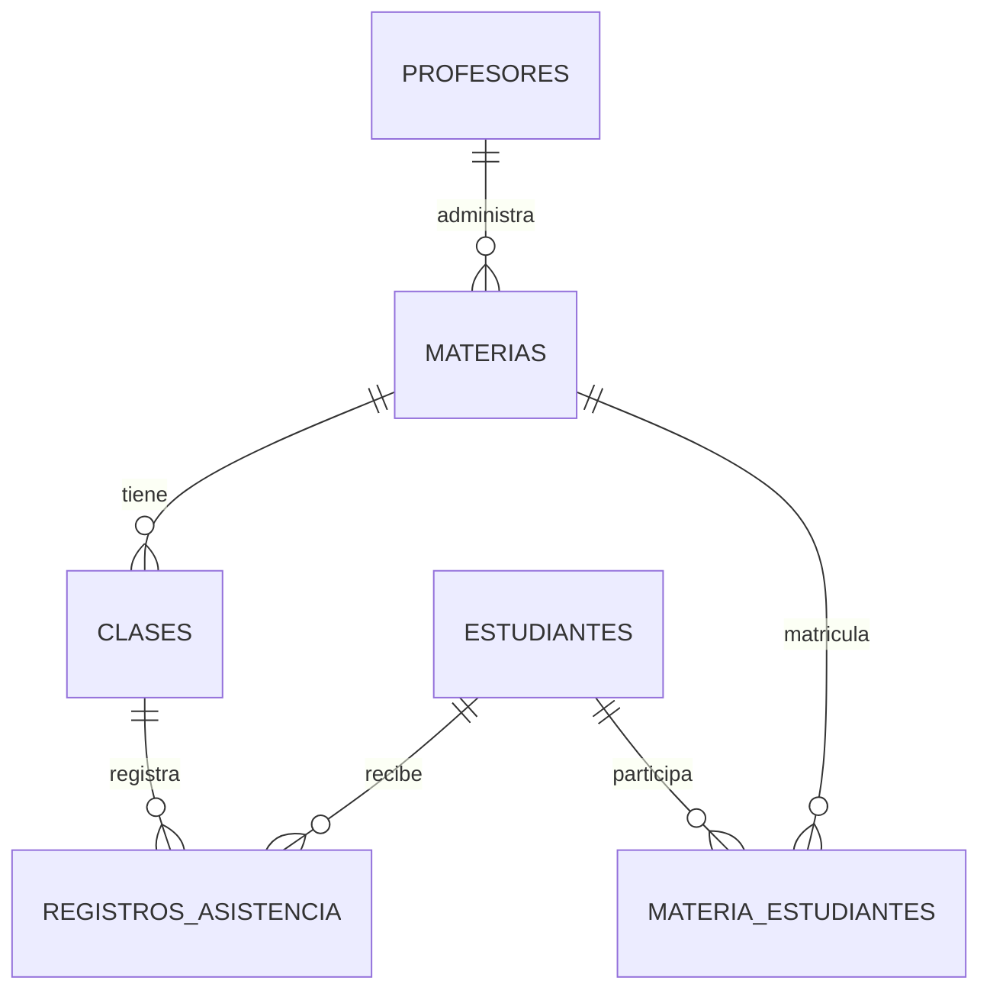

# Clases y revisión de asistencia — versión 003

Implementado y comprobado en Oracle XE 18c / XEPDB1 el 11 de noviembre de 2026.
La versión 004 amplía este modelo con [sin muestra y análisis fallido](ESTADOS_DETECCION.md).

## Uso en la aplicación

1. Iniciar sesión como profesor y seleccionar la materia.
2. Elegir una clase pendiente o desplegar **Crear o abrir una clase** e indicar su fecha y hora
   de inicio en Colombia. El mismo horario de la misma materia abre la misma clase.
3. Agregar fotos o grabar voz y ejecutar el análisis.
4. Revisar el resultado. Solo son editables **Decisión** y **Motivo del cambio**; la detección,
   los identificadores y las fuentes/puntajes permanecen visibles y sin edición.
5. Cada cambio de presente a ausente, o viceversa, requiere un motivo de 1 a 500 caracteres.
   Una revisión inválida conserva la propuesta para completarla.
6. Confirmar. La clase queda cerrada a nuevas propuestas; los registros muestran su ID, horario,
   origen y cantidad de correcciones. Cambiar de clase elimina las capturas/resultados pendientes.

Cerrar y volver a abrir el formulario usa el estado disponible de la sesión; no sustituye la
confirmación en Oracle. Una clase confirmada en otra pestaña se rechaza también al intentar guardar
desde un diálogo que había quedado abierto. Para refrescar el listado puede recargarse la pantalla.

## Modelo y reglas



`CLASES` guarda responsable al crear, horario con zona, instante UTC calculado, estado,
origen final, momento de confirmación, clave de propuesta y contenido confirmado sin biometría.
El instante UTC normaliza horarios equivalentes: `08:00 -05:00` y `13:00 +00:00` son la misma clase.
La app pide el horario explícitamente; dos horarios distintos representan clases distintas.
Los segundos/microsegundos del histórico se conservan, aunque el selector de clases nuevas trabaja
normalmente con minutos.

| Regla | Aplicación en Oracle |
| --- | --- |
| Una clase por materia y horario | `UQ_CLASES_INSTANTE` sobre materia, UTC y lote histórico; clases nuevas usan lote 0. |
| Una asistencia por estudiante y clase | `UQ_RA_CLASE_ESTUDIANTE`, incluso al insertar directamente con SQL. |
| Clase y materia coherentes | FK compuesta `FK_RA_CLASE_MATERIA`. |
| Detección y presencia válidas | Presencia final 0/1 obligatoria; detección coherente con su estado desde 004. |
| Corrección inicial justificable | `CK_RA_REVISION` exige motivo, autor y fecha si hay corrección manual. |
| Evitar otra confirmación | Estado y bloqueo de la clase en `PKG_CLASES`; trigger impide añadir filas a una clase moderna confirmada. |

`REGISTROS_ASISTENCIA.FECHA_HORA` conserva el instante del análisis. El horario académico se
obtiene de `CLASES.FECHA_HORA`. Los reportes agrupan por `CLASE_ID`, sin truncar fechas al segundo.
Desde 004 la presencia final sigue siendo 0/1 obligatoria; la detección puede ser NULL únicamente
para `SIN_MUESTRA`, con decisión manual justificada. Los fallos y decisiones pendientes no se confirman.
Los campos `PRESENTE_DETECTADO`, `CORREGIDO_MANUAL`, `MOTIVO_CORRECCION`, `REVISADO_POR` y
`REVISADO_EN` conservan la revisión previa a la primera confirmación. El autor se obtiene del
contexto Oracle autenticado por la aplicación; no de una columna editable del navegador.
Las correcciones posteriores mediante `PKG_ASISTENCIA` siguen generando auditoría transaccional.
La revisión inicial permanece como instantánea y no se modifica al corregir posteriormente la presencia.

## Transacción, concurrencia e idempotencia

`PKG_CLASES.ABRIR_CLASE` valida al profesor, bloquea la materia y reutiliza o crea el horario.
No confirma la transacción: Python hace el COMMIT. Esta operación puede reintentarse por su clave
de negocio. La selección de clase no crea filas; solo el botón explícito lo hace.

`CONFIRMAR_CLASE` comprueba el contexto de profesor y la propiedad actual de la materia, bloquea
materia/clase y compara la clave, el origen y el contenido canónico de la propuesta. Si una clase
ya confirmada recibe exactamente la misma solicitud, devuelve la cantidad originalmente confirmada
sin escribir otra vez. Si recibe otra propuesta, la rechaza. La protección sigue funcionando entre
sesiones y pestañas, aunque se repita el análisis o se cambie entre voz y foto.

Durante una confirmación nueva, adquiere `LOCK TABLE materia_estudiantes IN SHARE MODE NOWAIT`
para impedir altas/retiros mientras valida y guarda la lista completa. Si otra transacción ya
está escribiendo matrículas, devuelve un aviso para revisar después. Este bloqueo afecta brevemente
a la tabla completa: es una solución conservadora para el proyecto local; una instalación con mayor
concurrencia debería diseñar bloqueos por materia en todos los escritores.

Valida lista completa, IDs únicos, matrícula vigente, fechas de análisis coincidentes, estados
y motivos. Una excepción revierte todas las filas de la confirmación mediante SAVEPOINT; no deja
una clase parcialmente confirmada. Python cierra el cursor, confirma al completar o hace rollback
al fallar. La app consume la propuesta antes del intento de escritura y no reintenta automáticamente
un COMMIT incierto. La garantía durable de idempotencia existe igualmente en el procedimiento para
clientes que repitan la misma clave y carga. Tras un error incierto, consultar los registros antes
de ejecutar otro análisis.

## Migración, histórico y respaldo

Desde la raíz del proyecto, con la aplicación detenida:

```powershell
.\.venv\Scripts\python.exe -B scripts\oracle.py migrar
.\.venv\Scripts\python.exe -B scripts\oracle.py verificar
.\.venv\Scripts\python.exe -B scripts\oracle.py demostrar-clases
```

`migrar` respalda primero el esquema en `.local/respaldos/<fecha>_<id>/`. Desde la entrega 005
las copias son V2, cifradas y autenticadas, e incluyen DDL, comentarios, datos, tipos, cantidades
y versiones. Las primeras copias de 003 usaban JSONL en claro (V1). Los respaldos pueden incluir
hashes de acceso y vectores biométricos: son privados. NUMBER y fechas se transportan como texto
para conservar precisión y zona horaria. Ver [RECUPERACION.md](RECUPERACION.md) para la clave,
los comandos actuales y las restricciones del destino.

La copia previa original de este equipo está en `.local/respaldos/20261111T073901Z_fe29acfd/`;
las copias posteriores conservan los estados previos a reejecuciones. La restauración automatizada
V2 y su ensayo en un esquema separado están implementados. Las copias V1 se comprueban pero no
se ejecutan automáticamente; JSONL no es un script SQL directamente ejecutable.

La migración requiere 002 y solo registra 003 después de verificar objetos y restricciones. Al
repetirla no vuelve a agrupar los datos de una versión 003 registrada ni duplica la fila de versión.
En caso de fallo anterior al registro, puede recuperar sus pasos DDL sin borrar tablas.
Oracle hace COMMIT implícito en DDL: el respaldo y la aplicación detenida siguen siendo necesarios.
No reejecutar 002 sobre 003, pues reemplazaría definiciones posteriores; se añadió una guardia.
El cliente 18c utiliza rutas `@sql/...` para inclusiones entre directorios y UTF-8 en la automatización.

Los registros anteriores se agrupan por materia e instante UTC. Si un estudiante aparece más de
una vez en ese grupo, su segunda/tercera ocurrencia se asigna a lotes históricos 1/2, sin eliminar
filas ni cambiar IDs, presencia, fechas o relaciones existentes. Las clases históricas llevan origen
`LEGADO`; su responsable corresponde al propietario de la materia al migrar, pues el modelo anterior
no guardaba el autor original. No se inventa esa identidad histórica.

Las herramientas SQL anteriores que insertan sin `CLASE_ID` usan la ruta de compatibilidad del
trigger: asigna una clase `LEGADO` por materia/instante. Conservan la restricción de unicidad, aunque
no ofrecen la confirmación de clase completa ni las comprobaciones del flujo moderno. La app utiliza
siempre la ruta de clases explícitas. El usuario propietario del esquema puede ejecutar SQL directamente;
el contexto declarado no sustituye la futura separación entre cuenta de despliegue y ejecución.

## Justificación de disparadores adicionales

| Disparador | Acciones y justificación |
| --- | --- |
| `TRG_ASISTENCIA_CLASE` | BEFORE INSERT: asigna compatibilidad histórica y rechaza nuevos registros en clases modernas confirmadas. BEFORE UPDATE: impide trasladar una asistencia a otra clase/estudiante o alterar la instantánea de revisión inicial. Las FK/CHECK/UNIQUE siguen resolviendo las reglas declarativas. |
| `TRG_CLASES_IDENTIDAD` | BEFORE UPDATE: conserva materia, horario, responsable y lote; impide reabrir una clase confirmada o cambiar su clave, carga original y cantidad confirmada. Evita perder la identidad que comparten las pestañas y los reintentos. |
| `TRG_ASISTENCIA_AUD` (ampliación) | AFTER UPDATE/DELETE: añade clase, detección y autor/motivo inicial a la instantánea del historial. Permite entender una baja incluso después de una cascada. Se conserva el comportamiento de no auditar UPDATE sin cambios reales. |

Ningún trigger confirma transacciones ni usa transacciones autónomas. La validación de una lista
completa y su confirmación corresponden al procedimiento, donde pueden bloquearse y comprobarse
como una unidad, en lugar de intentar reconstruirlas desde un trigger de fila.

## Evidencia y trabajo pendiente

La verificación local comprende apertura con offsets equivalentes, profesor incorrecto, matrícula
modificada/en curso, restricciones SQL, rollback de una segunda fila inválida, revisión manual y
reintento. Dos conexiones reales prueban a la vez la misma clave y dos claves diferentes: el resultado
final mantiene una sola fila por clase/estudiante. Esos fixtures se confirman brevemente para hacerlos
visibles entre conexiones y se eliminan después por IDs exclusivos, incluido su historial; las demás
pruebas usan rollback.
La aceptación suma 65 pruebas aprobadas (suite general y regresiones posteriores del editor/reportes);
el laboratorio SQL*Plus de 003 y la reejecución de
la migración se verifican además por separado. El esquema final tiene nueve tablas, diez vistas,
tres paquetes con sus cuerpos y siete triggers activos, sin errores de compilación.

El esquema de este equipo estaba vacío al migrar. El reparto histórico de duplicados, offsets
equivalentes y microsegundos se comprobó con datos sintéticos de solo lectura. Sigue pendiente un
ensayo de actualización/restauración con un esquema separado y un volumen histórico representativo.
AppTest comprueba el editor, motivos obligatorios, aislamiento por clase y bloqueo de capturas tras
la confirmación; no sustituye el ensayo del navegador con cámara/micrófono reales.

La entrega 004 resuelve la separación de fallo/sin muestra/decisión pendiente. Siguen pendientes
la calibración biométrica real, la reapertura autorizada de una clase y el rediseño visual.
La política de archivo y retirada biométrica se implementó en 005, con límites documentados
en [REGLAS_NEGOCIO.md](REGLAS_NEGOCIO.md).
Las cascadas existentes se conservan; el historial de auditoría permite registrar las bajas, pero no
sustituye una política académica de conservación.

Referencias de implementación: [Oracle 18c: SYS_EXTRACT_UTC](https://docs.oracle.com/en/database/oracle/oracle-database/18/sqlrf/SYS_EXTRACT_UTC.html),
[tipos JSON de PL/SQL](https://docs.oracle.com/en/database/oracle/oracle-database/18/arpls/json-types.html) y
[bloqueos de tablas](https://docs.oracle.com/en/database/oracle/oracle-database/19/sqlrf/LOCK-TABLE.html).
