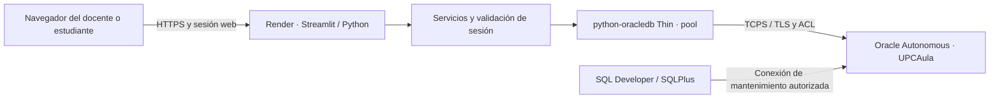

# Cómo se conecta UPC | Aula con Oracle

La aplicación se ejecuta en Render y los datos académicos residen en Oracle Autonomous
UPCAula. Render no guarda la base Oracle dentro del contenedor. SQL Developer y SQL*Plus
son clientes de consulta y mantenimiento, al igual que Python es un cliente de la base.



## Recorrido de una operación

1. El navegador abre la web y envía una acción a Streamlit. No recibe credenciales Oracle.
2. El servidor valida la sesión del usuario de la aplicación. El docente, estudiante y
   administrador académico son filas del proyecto; no son usuarios Oracle personales.
3. `src/configuracion.py` lee variables de entorno o secretos locales. El entorno tiene
   prioridad. El nombre del secreto no revela su contenido.
4. `src/base_datos/configuracion.py` crea/reutiliza el pool principal. El esquema de trabajo
   se establece en el propietario; esto no concede por sí mismo permisos adicionales.
5. La capa de base de datos valida el token con `PKG_SESIONES` y establece el contexto
   de rol/actor en `PKG_AUDITORIA` antes de ejecutar consultas y paquetes.
6. Las escrituras confirman la transacción; los fallos la revierten. Las conexiones se
   devuelven limpias al pool para evitar que un actor herede el contexto de otro.

## Las tres cuentas técnicas

| Cuenta | Función | Uso |
| --- | --- | --- |
| `UPC_ASISTENCIA` | Propietario de tablas, vistas y paquetes | Instalación, migración, respaldo y catálogo |
| `UPC_AULA_APP` | Runtime con contrato de 53 permisos directos | Operaciones ordinarias del portal |
| `UPC_ADMIN_APP` | Conexión restringida: EXECUTE de cinco paquetes y lectura de tres vistas de auditoría | Administración y paquete de excepciones docentes; sin DML directo a tablas |

El paquete de excepciones docentes verifica rol PROFESOR, propiedad de la materia,
matrícula y versión. Usar la cuenta técnica administrativa no transforma al docente en
administrador académico. `PKG_EXCEPCIONES` sigue exigiendo rol ADMINISTRADOR.

## Configuración y conectividad

- `ORACLE_USUARIO`, `ORACLE_CONTRASENA`, `ORACLE_ESQUEMA` y `ORACLE_DSN` identifican
  la conexión ordinaria y su esquema. El DSN designa host/puerto/servicio de Oracle;
  no es la URL pública de Render.
- `ORACLE_ADMIN_USUARIO` y `ORACLE_ADMIN_CONTRASENA` preparan el segundo pool.
- `ORACLE_TLS_MODO=tls` y el descriptor TCPS protegen el transporte y verifican el
  servidor. La ACL de Autonomous permite las redes de salida mostradas por Render.
- La contraseña del usuario web docente se verifica contra un hash de su fila; la
  contraseña alternativa del estudiante se verifica contra su credencial autorizada.
  Ambas son distintas de las contraseñas de las conexiones Oracle.

En desarrollo, `.streamlit/secrets.toml` conserva la configuración privada. En Render
se administra en Environment y Secret Files. Los archivos `.env` no se suben a GitHub.
El contenedor nuevo reutiliza Oracle; no recupera datos desde un archivo local del contenedor.

## Visualización desde SQL Developer

Usar la conexión de mantenimiento existente, sin copiar contraseñas a la documentación.
Expandir **Tables** permite inspeccionar columnas, claves, restricciones y dependencias.
La pestaña **Data** consulta registros reales y se usa solo cuando se necesitan.

Para una presentación sin datos personales, abrir el [catálogo exportado](base_datos/index.html)
y el [diccionario](DICCIONARIO_DATOS.md). Son instantáneas de metadatos, no pantallas de
administración ni una conexión abierta al público. La [guía SQLPlus/SQL Developer](SQLPLUS_Y_SQLDEVELOPER.md)
detalla el flujo de desarrollo.

## Regenerar el catálogo

```powershell
.\.venv\Scripts\python.exe scripts\generar_catalogo_bd.py --configuracion .local\oracle_cloud\credenciales_tecnicas.toml
```

El generador lee tablas del diccionario, columnas, restricciones y versiones. No exporta
filas de estudiantes, documentos, vectores, hashes de contraseñas ni la configuración
de la conexión. Actualiza JSON, HTML autónomo y Markdown; revisar el diff antes de publicar.
