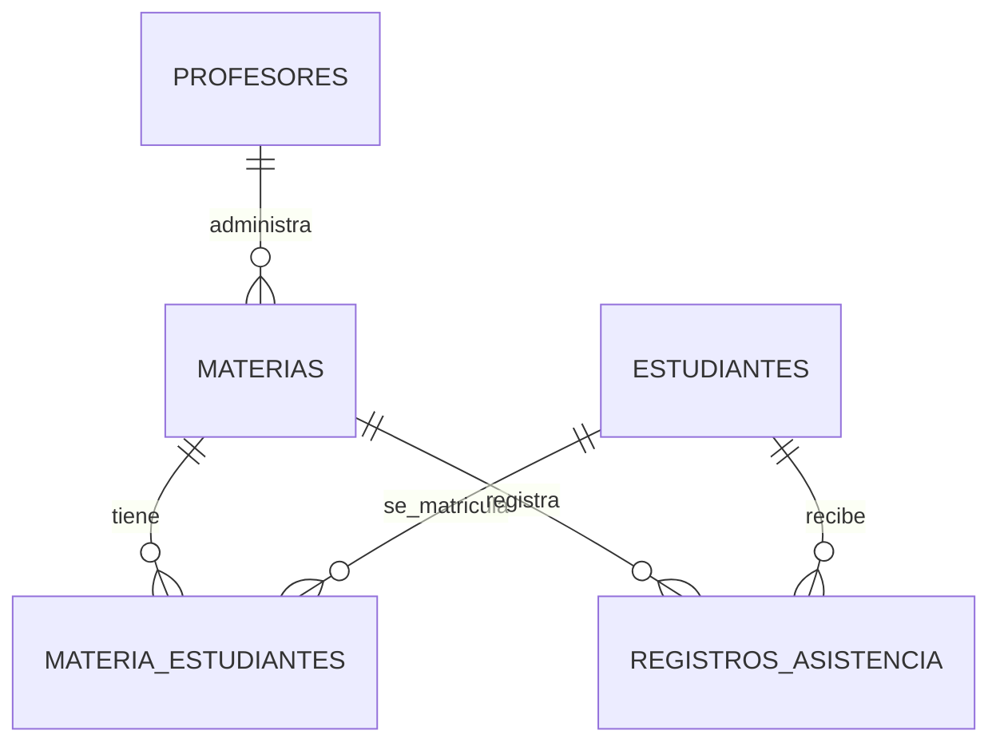

# Oracle: SQL*Plus primero, SQL Developer al final

Los datos viven en Oracle. SQL*Plus, SQL Developer y Python se conectan al mismo servicio y
esquema. SQL Developer no es una base adicional ni requiere copiarle los datos de SQL*Plus.

## Archivos y orden de ejecución

| Archivo | Conexión y objetivo |
| --- | --- |
| `sql/00_crear_usuario.sql` | Administrador en el PDB: crea usuario, cuota y privilegios de desarrollo. Pide clave oculta. |
| `oracle_scripts.sql` | Usuario de la app: entrada de la instalación inicial. |
| `sql/01_tablas.sql` | Seis tablas: cinco funcionales y control de versiones. Solo esquema vacío. |
| `sql/02_vistas.sql` | Siete vistas de consulta y presentación, sin hashes ni vectores. |
| `sql/03_paquete_asistencia.sql` | Especificación y cuerpo de `PKG_ASISTENCIA`. |
| `sql/04_verificar.sql` | Usuario, PDB, tablas, vistas, estado y errores de compilación. |
| `sql/05_demostracion.sql` | Consultas y ejemplo de función PL/SQL, sin cambios de datos. |
| `sql/06_exportar_ddl.sql` | Exportación de definiciones usando `DBMS_METADATA`, sin datos. |
| `sql/07_registrar_version.sql` | Registro de versión después de superar la verificación de toda la instalación. |
| `sql/migraciones/002_auditoria.sql` | Actualización de 001 a 002 conservando datos; añade historial, paquetes y disparadores. |
| `sql/09_paquete_auditoria.sql` | Contexto de actor y motivo por sesión Oracle. |
| `sql/10_disparadores.sql` | Cinco disparadores y dos vistas de historial. |
| `sql/11_paquete_asistencia.sql` | Versión 002 del paquete, con operaciones de corrección, eliminación y retiro. |
| `sql/12_demostracion_disparadores.sql` | Laboratorio PL/SQL con fixtures y rollback final. |
| `sql/migraciones/003_clases.sql` | Añade clases, revisión inicial y unicidad de asistencia sin borrar el histórico. |
| `sql/13_paquete_clases.sql` | Abre clases y confirma propuestas de forma atómica e idempotente. |
| `sql/14_integridad_clases.sql` | Dos triggers de integridad y ampliación del trigger de auditoría. |
| `sql/15_vistas_clases.sql` | Vistas de clases, revisión inicial y reportes por identificador. |
| `sql/16_verificar_clases.sql` | Verifica estructura, restricciones y objetos de 003. |
| `sql/17_demostracion_clases.sql` | Laboratorio de confirmación, revisión y reintento con rollback. |
| `sql/migraciones/004_estados_deteccion.sql` | Separa detección desconocida de ausencia y exige resolución manual. |
| `sql/18_paquete_clases_estados.sql` | Versión 004 de `PKG_CLASES`, con validación de estados. |
| `sql/19_integridad_estados.sql` | Integridad y auditoría de detección desconocida. |
| `sql/20_vistas_estados.sql` y `sql/21_verificar_estados.sql` | Vistas y comprobaciones de 004. |
| `sql/22_demostracion_estados.sql` | Fallos no confirmables y sin muestra con motivo, con rollback final. |
| `sql/migraciones/005_gestion.sql` | Cuentas activas, código institucional, archivo y límites de acceso. |
| `sql/23_paquete_gestion.sql` | PKG_GESTION: materias, matrícula, retiro, archivo y retirada biométrica. |
| `sql/24_politicas_gestion.sql` | Dos triggers de cuentas activas y vista de eventos de gestión. |
| `sql/25_paquete_clases_gestion.sql` | Versión actual de PKG_CLASES; impide operar con materias/docentes archivados. |
| `sql/26_verificar_gestion.sql` | Verificación adicional del esquema 005. |
| `sql/migraciones/006_administracion.sql` | Administradores, contexto del tercer rol, instantáneas de cambios y versiones de edición. |
| `sql/27_contexto_administrativo.sql` | Cuerpo de PKG_AUDITORIA con validación del administrador activo. |
| `sql/28_paquete_administracion.sql` | Consultas, edición autorizada y registro de preparación de CSV. |
| `sql/29_verificar_administracion.sql` | Verificación adicional de 006. |
| `sql/30_permisos_administracion.sql` | SYS en el PDB: conexión técnica limitada y grants a paquetes/vistas. |
| `sql/31_versiones_edicion.sql` | Versiones incrementales para rechazar ediciones obsoletas. |
| `sql/migraciones/007_sesiones.sql` | Registro único y revocación de sesiones para los tres roles. |
| `sql/32_paquete_sesiones.sql` y `sql/33_verificar_sesiones.sql` | Apertura, validación, cierre y verificación de 007. |

El `.txt` antiguo solo remite al punto de entrada; ya no contiene otra copia del esquema ni
credenciales. No hay `DROP USER`, borrado de tablas ni privilegios DBA en los scripts de instalación.
El ensayo de recuperación sí crea y elimina únicamente sus cuentas temporales UPC_RT, con controles
de nombre y existencia previa; no opera sobre la cuenta de la aplicación.
El usuario de desarrollo recibe cuota de 100 MB en USERS, no `UNLIMITED TABLESPACE`.
Administración ya utiliza una conexión limitada separada; falta extender esa separación a los
otros roles. Ver [ADMINISTRACION.md](ADMINISTRACION.md).
En la versión 006 hay **doce tablas, once vistas, cinco paquetes con sus cuerpos y diez disparadores**.
En 005 había once tablas, once vistas, cuatro paquetes con sus cuerpos y nueve disparadores.
En 004 había nueve tablas, diez vistas, tres paquetes y siete
disparadores. La versión 002 tenía ocho tablas, nueve vistas y cinco triggers.
Seis tablas y siete vistas corresponden a la base original 001.
La justificación de cada trigger y sus límites está en [DISPARADORES_Y_PLSQL.md](DISPARADORES_Y_PLSQL.md).

## CMD / SQL*Plus: crear el usuario manualmente

Desde la carpeta del proyecto, en el servidor Oracle y con un usuario Windows autorizado:

```bat
sqlplus / as sysdba
```

Dentro de SQL*Plus:

```sql
SHOW CON_NAME
SHOW PDBS
ALTER SESSION SET CONTAINER = XEPDB1;
@sql/00_crear_usuario.sql
```

Aceptar `UPC_ASISTENCIA` o elegir un nombre nuevo. La contraseña se introduce dos veces en el
comando PASSWORD. Usar una clave propia; para XE 18c el generador mantiene su longitud por debajo
de 30 bytes. No usar caracteres de control. Si el usuario ya existe, el script se detiene.

También puede conectarse directamente al PDB con SYSTEM; SQL*Plus pedirá la clave:

```bat
sqlplus -L /nolog
```

```sql
CONNECT SYSTEM@"//localhost:1521/XEPDB1"
@sql/00_crear_usuario.sql
```

En este cliente se entrecomilla el descriptor Easy Connect. Para crear tablas, salir de la
sesión administrativa y conectarse como usuario de la aplicación:

```sql
CONNECT UPC_ASISTENCIA@"//localhost:1521/XEPDB1"
@oracle_scripts.sql
@sql/04_verificar.sql
@sql/05_demostracion.sql
```

La instalación inicial rechaza un esquema no vacío. Oracle confirma implícitamente las sentencias
DDL: si una instalación se interrumpe, no asumir que un ROLLBACK eliminó las tablas ya creadas.
No repetir automáticamente ni borrar el usuario para “arreglarlo”; revisar objetos y completar
las sentencias pendientes con una migración o reparación explícita.

Para una instalación 001 existente, conceder CREATE TRIGGER con
`sql/00_habilitar_disparadores.sql` como administrador del PDB y ejecutar, desde la raíz:

```bat
.venv\Scripts\python.exe scripts\oracle.py migrar
.venv\Scripts\python.exe scripts\oracle.py demostrar-disparadores
.venv\Scripts\python.exe scripts\oracle.py demostrar-clases
.venv\Scripts\python.exe scripts\oracle.py demostrar-estados
```

`migrar` crea y verifica primero un respaldo cifrado V2 en `.local/respaldos/`, aplica los pasos
pendientes y termina en 007. La migración 007 es reejecutable y no vacía tablas; `instalar` sigue
reservado a un esquema nuevo. No reejecutar migraciones anteriores sobre una base posterior.
La demostración ejercita los disparadores y revierte sus fixtures e historial al finalizar.
Detener la aplicación al migrar y volver a iniciarla después para renovar conexiones y estado PL/SQL.
Detalles del modelo, copias y límites: [CLASES_Y_REVISION.md](CLASES_Y_REVISION.md).
Estados de detección y contrato actual: [ESTADOS_DETECCION.md](ESTADOS_DETECCION.md).
Gestión actual: [REGLAS_NEGOCIO.md](REGLAS_NEGOCIO.md). Restauración en destino vacío,
clave privada de respaldo y ensayo aislado: [RECUPERACION.md](RECUPERACION.md).

## Automatización con secretos locales

La alternativa `scripts/preparar_oracle.py` ejecuta los mismos SQL mediante SQL*Plus, genera
la clave y la conserva únicamente en `.streamlit/secrets.toml`, ignorado por Git.
No pasa contraseñas como argumentos del proceso ni las imprime.

Después, estos comandos leen la configuración privada:

```bat
.venv\Scripts\python.exe scripts\oracle.py verificar
.venv\Scripts\python.exe scripts\oracle.py demostrar
.venv\Scripts\python.exe scripts\oracle.py exportar
```

El último guarda `exports/esquema_ddl.sql`. Ese export es material de revisión y presentación;
emite primero todas las tablas, después sus claves foráneas y luego índices, comentarios, vistas
y PL/SQL, y finalmente los disparadores. El paquete de auditoría precede al de asistencia.
Omite el nombre del esquema de origen para poder revisar la estructura en otro usuario.
No incluye filas de `VERSIONES_ESQUEMA`; la instalación de la app y las futuras migraciones se
mantienen en los scripts versionados. `001` solo se registra al terminar correctamente la instalación,
para que un fallo creando vistas o compilando el paquete no deje una versión aparentemente completa.

El informe privado de acceso del equipo está en `.local/ACCESO_ORACLE.md`. La fuente de configuración
de la app sigue siendo `.streamlit/secrets.toml`; si se cambia la clave, actualizar ambos archivos.

## Recuperación de una preparación interrumpida

- Si existe `.local/credenciales_oracle_pendientes.toml`, el generador conserva la clave candidata.
  No compartirlo. Comprobar como administrador si la cuenta se creó y si su autenticación sigue en NONE.
- Solo para una cuenta recién creada **sin autenticación y sin objetos**, se puede completar la activación:

```bat
.venv\Scripts\python.exe scripts\preparar_oracle.py --os-auth --pdb XEPDB1 --reanudar
```

- La recuperación rechaza cuentas activas o con objetos; no cambia claves de otros usuarios.
- Si ya existe `.streamlit/secrets.toml` y la cuenta está activa pero aún vacía, instalar con:

```bat
.venv\Scripts\python.exe scripts\oracle.py instalar
```

- Si ya hay objetos, ejecutar primero `verificar`, revisar `USER_ERRORS` y completar la instalación
  de forma específica. No usar el instalador inicial como actualizador.
- ORA-01017: revisar usuario, clave y servicio. ORA-12546/ORA-12638: revisar permisos del proceso y
  configuración de autenticación del cliente; no cambiar archivos globales de Oracle automáticamente.

## Modelo inicial para la presentación



`VERSIONES_ESQUEMA` registra la instalación y no tiene relación académica.
La entidad CLASE y la unicidad de asistencia por clase quedan para la migración del roadmap.
Actualmente “tomas” en la vista de resumen significa fechas distintas, no clases académicas definitivas.

El paquete inicial incluye:

- `porcentaje_asistencia`: función SQL/PLSQL de porcentaje por estudiante y, opcionalmente, materia.
- `matricular_estudiante`: procedimiento de matrícula con error explícito ante duplicado.
- `registrar_asistencia`: procedimiento que exige matrícula, fecha y presencia 0/1.

002 agrega procedimientos de corrección y eliminación con motivo y retiro de matrícula, además
de PKG_AUDITORIA para contexto por sesión. La aplicación comunica su actor a los disparadores;
la incorporación de pantallas para corregir y eliminar asistencias sigue siendo trabajo posterior.

No hacen COMMIT interno. La aplicación Python todavía usa `bd.py`; integrar el paquete y añadir
autorización docente forma parte del roadmap. Las vistas de presentación no sustituyen un sistema
de permisos por profesor o estudiante.

## Fase final: SQL Developer

Cuando las fases de datos y verificación del roadmap estén cerradas:

1. Crear conexión Basic, usuario `UPC_ASISTENCIA`, rol **Default**.
2. Host `localhost` (o servidor configurado), puerto `1521`, **Service name `XEPDB1`**.
3. Introducir la contraseña local en privado, probar y conectar.
4. Verificar tablas, vistas y Packages; ejecutar `sql/04_verificar.sql` como script/F5.
5. En Data Modeler, abrir el navegador de diseños e importar **Data Dictionary** del esquema.
6. Seleccionar tablas y relaciones, revisar PK/FK, ordenar el diagrama y guardar el diseño editable.
7. Exportar el diagrama para la presentación; conservar también el DDL y los SQL de demostración.

Para el diagrama no hace falta crear una vista por tabla. Una **vista SQL** es una consulta
guardada; el **modelo relacional** es el diagrama de estructura y relaciones.

El [artículo mencionado](https://www.thatjeffsmith.com/archive/2013/11/how-to-create-views-for-all-tables-with-oracle-sql-developer/)
describe importar el diccionario, usar **Tools → Data Modeler → Table to View Wizard** y generar
el DDL de las vistas. Es de 2013: los menús pueden variar según la versión. Revisar el DDL antes
de ejecutarlo para evitar reemplazar las vistas seguras existentes por `SELECT *` con hashes o biometría.
Consultar también la [documentación oficial de Oracle Data Modeler](https://docs.oracle.com/en/database/oracle/sql-developer-data-modeler/22.2/dmdug/data-modeler-concepts-usage.html).
